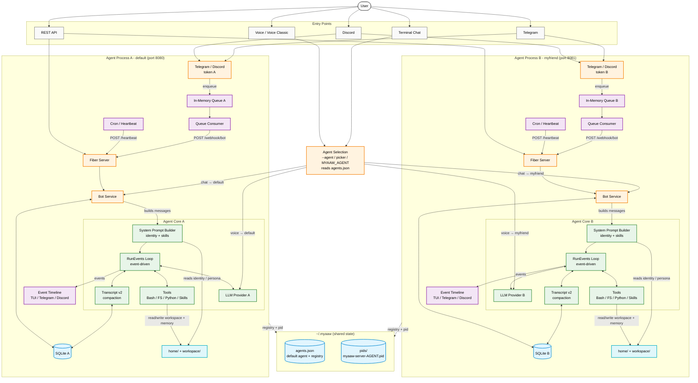

# 🔗 Myaaw (My AI Agent Well)

<div align="center">
  

  [](https://goreportcard.com/report/github.com/Shiyinq/myaaw)
  [](https://opensource.org/licenses/MIT)
  [](https://github.com/Shiyinq/myaaw)
  [](https://github.com/Shiyinq/myaaw/stargazers)

</div>

  **Myaaw is my personal AI assistant. You don't need to waste your time trying it out—I recommend sticking with your beloved [Hermes Agent](https://github.com/nousresearch/hermes-agent), [OpenClaw](https://github.com/openclaw/openclaw), or whatever else you use. Hmm, or maybe you can try [Pi Agent](https://github.com/earendil-works/pi).**

---

> **Note:** The details below are only for my personal reference and my AI Assistant. You really don't need to read this!

## ✨ Key Features
- [x] **Multimodal Input**: Supports Text, Voice (Transcribed), and Image input.
- [x] **Smart Responses**: Supports both Basic and Streamed responses for real-time interaction.
- [x] **Conversation Memory**: Remembers your chat history for natural flow.
- [x] **Agent Skills**: Dynamically extensible capabilities via `SKILL.md` definitions.
- [x] **Powerful Tools**: Native integration with Filesystem, Bash, and Python execution.
- [x] **Heartbeat (Autonomous Check)**: Scheduled background checks for health and tasks via `HEARTBEAT.md`.
- [x] **CLI Voice Chat**: Native support for Real-time Voice (Gemini Live) and Classic STT/TTS pipeline with screen/camera sharing via CLI.
- [x] **Single Binary & Zero Config**: Runs entirely locally using SQLite and Go Channels. No Docker or complex databases required!

## 🤖 Supported Providers

Myaaw currently focuses on delivering the best experience with **Google Gemini API**.


## 📡 Supported Channels

Myaaw can be integrated with various platforms:

- 📨 **Telegram**: Integration via Bot API (Polling or Webhook).
- 👾 **Discord**: Integration via Discord Bot.
- 💻 **Terminal**: Interactive TUI chat and CLI management.


# Table of Contents
- [✨ Key Features](#-key-features)
- [🤖 Supported Providers](#-supported-providers)
- [📡 Supported Channels](#-supported-channels)
- [🏗 Architecture](#-architecture)
- [🚀 Quick Start (Non-Technical)](#-quick-start-non-technical)
- [🛠 Development](#-development)
  - [Prerequisites](#prerequisites)
  - [Getting Started](#getting-started)
  - [Start Development](#start-development)
  - [Generate Swagger Documentation](#generate-swagger-documentation)
  - [Build from Source](#build-from-source-optional)
- [💻 Myaaw CLI Reference](#-myaaw-cli-reference)
- [📚 Documentation](#-documentation)
  - [Agents](#-agents)
  - [CLI](#-cli)
  - [API](#-api)
  - [Generated references](#-generated-references)


## 🏗 Architecture

Myaaw uses one binary with **one isolated process per agent**. Each agent process owns its Fiber server, channels, database, workspace, and event-driven agent loop (v2). A shared registry and PID directory coordinate the agents on one machine.



Telegram and Discord payloads always pass through a queue first: **channel adapter → in-memory queue → queue consumer → that agent's own `POST /webhook/bot`**. The queue is an in-process Go channel, so each agent process has its own queue; messages can never move between agents. Cron and heartbeat are the exception: they call `POST /heartbeat` directly on their own server.

Both processes share `~/.myaaw/agents.json` (registry and default agent) and `~/.myaaw/pids/` (one `myaaw-server-<agent>.pid` file per running server). Nothing else is shared: config, `.env`, SQLite, `home/`, skills, jobs, logs, and ports are per agent.

`Agent Core` marks the components that belong to the agent itself (system prompt builder, event loop, transcript, tools, provider). The `System Prompt Builder` reads identity files from `home/` (`BOOTSTRAP.md`, `IDENTITY.md`, `AGENTS.md`, `SOUL.md`, `TOOLS.md`, `USER.md`) and `skills/`, and Bot Service passes the resulting messages to the loop. `MEMORY.md` and `memory/` are not auto-injected: the agent reads and writes them through tools during a run, following the rules in `AGENTS.md`.

Terminal sessions are not web clients. `myaaw chat` runs in its own process, creates a Bot Service directly, and calls `BotStream` in-process — it never goes through Fiber or the in-memory queue, but it uses the same per-agent config, SQLite, and `home/`. `myaaw voice` talks to Gemini Live directly, while `myaaw voice-classic` builds the agent and provider itself and still uses the full tool-enabled loop.

The selection node resolves the active agent from `~/.myaaw/agents.json`. Telegram and Discord do not use it: each bot token already binds messages to one agent process. Only CLI sessions resolve `--agent` / picker / `MYAAW_AGENT`, and they use the selected agent's config, SQLite, and `home/`: `myaaw chat` drives the Bot Service and loop in its own process, `myaaw voice` goes straight to the provider, and `myaaw voice-classic` drives the loop with tools.

### Key Components

1. **Channels (`internal/channel`)**: The entry point for interactions. It provides an `Adapter` interface to normalize messages from Telegram, Discord, REST APIs, or Terminal CLI into a standard format.
2. **Server & Workers (`cmd/myaaw`)**: Uses Cobra CLI to manage the application. `myaaw server --agent <name>` boots one Fiber server for that agent while spinning up its own background goroutines for Queue Consumer, Cron, and Heartbeat. The CLI also provides `myaaw chat`, `myaaw voice`, and `myaaw voice-classic`.
3. **Bot Service (`internal/services/bot`)**: The per-agent core brain. It processes normalized messages from that agent's channels and Terminal CLI, retrieves chat history from the agent's SQLite database, and invokes the event-driven agent loop. Voice CLIs (`myaaw voice`/`voice-classic`) bypass this to connect directly to the Agent/Providers for lower latency.
4. **Agentic Layer (`internal/agent`)**: Implements an event-driven ReAct (Reasoning and Action) loop. It streams lifecycle events (turns, message deltas, tool execution), executes tool calls with validation and parallel scheduling, and manages transcript compaction and usage aggregation. Legacy trace-based conversations are migrated on read.
5. **Providers (`internal/provider`)**: A factory-based abstraction layer for various LLMs (Gemini, OpenAI, Groq, Ollama), Transcribers (STT), and Synthesizers (TTS). Currently, Gemini is the main provider for Myaaw's intelligence and live-voice functionality.
6. **Message Queue (`internal/services/queue`)**: Handles asynchronous messaging using fast, native **Go Channels**. Polled or webhook payloads are pushed to the in-memory queue and processed by the Consumer worker to reliably deliver messages.
7. **Automation (`internal/cron`, `internal/heartbeat`)**: Background schedulers. The `cron` handles scheduled messages, while the `heartbeat` autonomously wakes up the agent at intervals to check `HEARTBEAT.md` for pending background duties.
8. **Local Workspace (`~/.myaaw`)**: The operational directory for the Agent.
   - `agents.json`: Registry of isolated agents and the default agent.
   - `<agent>/`: Per-agent config, `.env`, database, memory, workspace, skills, and logs. The default agent is `default/`.
     - `home/`: Long-term file storage containing the agent's core definitions:
       - `AGENTS.md` / `SOUL.md`: Persona and behavior instructions.
       - `BOOTSTRAP.md` / `TOOLS.md`: Initialization steps and tool usage rules.
       - `USER.md`: Facts and details learned about the user.
       - `HEARTBEAT.md`: Ongoing active background jobs and tasks.
       - `MEMORY.md` & `memory/`: Historical conversation summarizations and logs.
       - `workspace/`: All agent-created output. Coding projects live in `workspace/projects/` and downloads in `workspace/downloads/`; the home root stays reserved for identity and memory files.
9. **Multi-Agent Runtime (`internal/agentdir`)**: Resolves the active agent from `--agent`, `MYAAW_AGENT`, or `agents.json`. Each agent process gets an isolated config, `.env`, SQLite database, home, workspace, skills, jobs, logs, cron, tools, channels, and server port.

## 🚀 Quick Start (Non-Technical)

If you just want to use Myaaw without worrying about code, use our interactive installer script!

1.  **Install Myaaw**: Open your terminal (Mac/Linux/Git Bash) and run:
    ```bash
    curl -fsSL https://raw.githubusercontent.com/Shiyinq/myaaw/main/install.sh | bash
    ```
    *This will automatically download the correct binary for your OS and start the onboarding process.*
2.  **Onboard**: If you skipped the installation script, you can trigger onboarding anytime:
    ```bash
    myaaw onboard
    ```
3.  **Launch the Server**:
    ```bash
    myaaw server start
    ```
4.  **Check Status**:
    ```bash
    myaaw status
    ```


## 🛠 Development


### Prerequisites

Before you start, ensure you have:
- [Go](https://go.dev/) **1.23.0** or later installed.

#### 🎤 Voice Feature Requirements (CGo)
The `myaaw voice` feature relies on native system libraries for audio (PortAudio) and screen/camera capture. If you are building from source, you must install these dependencies:

**macOS**
```bash
brew install pkg-config portaudio
```
*Note: macOS will prompt for Microphone, Screen Recording, and Camera permissions upon first use.*

**Linux (Ubuntu/Debian)**
```bash
sudo apt update
sudo apt install -y portaudio19-dev libasound2-dev pkg-config
# For screen/camera capture:
sudo apt install -y libx11-dev libxext-dev
```

**Windows**
Building with CGo on Windows requires a C compiler environment like MSYS2/MinGW:
1. Install [MSYS2](https://www.msys2.org/).
2. Open MSYS2 MinGW 64-bit terminal and run:
   ```bash
   pacman -S mingw-w64-x86_64-gcc mingw-w64-x86_64-portaudio
   ```

### Getting Started

1. **Clone the Repository**
   ```bash
   git clone https://github.com/Shiyinq/myaaw.git
   cd myaaw
   ```

2. **Install Dependencies**
   ```bash
   go mod tidy
   ```

3. **Onboard (Dev Mode)**
   Since you have the source code, you can run the onboarding flow directly:
   ```bash
   go run ./cmd/myaaw onboard
   ```

### Start Development

Once everything is set up, you can start the gateway using **one** of the following methods:

#### Option A: Direct Execution (Standard)
```bash
go run ./cmd/myaaw server start
```

#### Option B: Live Reload (Recommended for Dev)
If you want the server to restart automatically when you change the code, use [Air](https://github.com/air-verse/air). 

1. Install it globally (first time only):
   ```bash
   go install github.com/air-verse/air@latest
   ```
2. Run it in the root directory:
   ```bash
   air
   ```

---

**Monitor Status & Logs**:
In a separate terminal, you can monitor the server:
```bash
go run ./cmd/myaaw status
go run ./cmd/myaaw logs
```

> [!NOTE]
> These commands only track services started via **Option A**. 
> If you are using **Option B (Air)**, the status and logs will appear directly in the same terminal where the `air` command is running.

---

### Generate Swagger Documentation

Swagger documentation is automatically updated every time you run `make build` or `make install`.

1. **Manual Update**
   If you only want to update the documentation without building:
   ```bash
   make swagger
   ```

2. **Accessing the UI**
   Once the server is running, the interactive documentation is available at:
   `http://localhost:8080/docs/index.html`


### Build from Source (Optional)

If you want to build the Myaaw binaries yourself (e.g., for distribution or custom versions), you can use the provided `Makefile`:

1.  **Build for current platform**:
    ```bash
    make build
    ```
2.  **Cross-compile for all platforms**:
    ```bash
    make build-all
    ```
    *Note: Due to PortAudio's CGO requirements, cross-compilation via `make build-all` requires external C-compilers to be installed on your host machine. Alternatively, you can rely on the automated GitHub Actions pipeline which builds natively across OS runners.*


## 💻 Myaaw CLI Reference

The `myaaw` CLI is your control center for managing the AI assistant, infrastructure, and services. You can run these commands via `go run ./cmd/myaaw` (Development) or simply `myaaw` (if installed globally).

### 🛠️ Getting Started
| Command | Description |
| :--- | :--- |
| `onboard` | Interactive setup for first-time users (Keys and Channels). |

### 🐱 Core Interaction
| Command | Description |
| :--- | :--- |
| `chat` | Start an interactive TUI chat session with Myaaw. Use `-m "text"` for one-shot. |
| `voice` | Start a real-time voice conversation (Gemini Live). Use `--video=screen,camera` to stream vision. |
| `voice-classic` | Voice chat using STT → Agent → TTS pipeline. Supports tools. Use `--video=screen,camera` to stream vision.|
| `status` | Check the health of SQLite and channel configs. |
| `logs` | Interactive TUI to select and stream logs from `~/.myaaw/<agent>/logs/`. |

### CLI Project Context
When `myaaw chat` or `myaaw voice-classic` starts, Myaaw treats the directory it was launched from as the active project and injects it as `## Current Directory` in the system prompt. The filesystem tool also registers that directory as an allowed project root, even when it has no marker files, so the agent can work on it in place without copying it into `workspace/`.

Telegram and Discord sessions do not receive the server's working directory. New projects and downloads always go to `~/.myaaw/<agent>/home/workspace/`.

Agent data lives under `~/.myaaw/<agent>/`, for example:

```text
~/.myaaw/myfriend/config/config.json
~/.myaaw/myfriend/.env
~/.myaaw/myfriend/database/myaaw.db
```

For the complete guide, see [docs/agents/multi-agent.md](docs/agents/multi-agent.md).

### 🧩 Multiple Agents
Myaaw runs one isolated process per agent. Each agent has its own config, `.env`, database, memory, workspace, skills, logs, channels, and port under `~/.myaaw/<agent>/`. The default agent is `default/`; names may contain letters, numbers, `_`, and `-`.

Full guide: [agent management commands](docs/agents/multi-agent.md#6-managing-agents).

| Command | Subcommands / Flags | Description |
| :--- | :--- | :--- |
| **`agent`** | `list`, `create <name>`, `use [name]`, `delete [name]` | Manage agents. `use` and `delete` open an arrow-key picker when no name is passed; `delete` asks for confirmation. |
| **`--agent <name>`** | global flag | Target a specific agent for `chat`, `status`, `logs`, `server`, `provider`, `channel`, `config`, `cron`, `webhook`, `voice`, `voice-classic`, and `consumer`. Without it, the registry default is used. |
| **`chat`** | `--agent <name>`, `-m "text"` | Interactive chat shows an agent picker when more than one initialized agent exists. |
| **`onboard`** | `--agent <name>` | Configure providers and channels for a specific agent. |
| **`server`** | `start`, `stop`, `restart`, `status` | Each agent runs its own daemon (`myaaw-server-<agent>`) on its own `PORT`. |
| **`provider`** | `create`, `list`, `default <name>`, `delete` | Providers are stored in `~/.myaaw/<agent>/config/config.json`. |
| **`channel`** | `create`, `list`, `edit`, `delete` | Channel tokens are per agent; use a different Telegram/Discord token for each running agent. |

**Examples:**
```bash
myaaw agent create myfriend
myaaw agent list
myaaw agent use myfriend
myaaw --agent myfriend onboard

myaaw --agent myfriend provider create
myaaw --agent myfriend provider list
myaaw --agent myfriend provider default deepseek

myaaw --agent myfriend channel create
myaaw --agent myfriend channel list
myaaw --agent myfriend channel edit

myaaw server --agent myfriend start
myaaw server --agent myfriend status
myaaw agent delete myfriend --yes
```

Restart the server after changing channel tokens:

```bash
myaaw server --agent myfriend restart
```

### 💾 Backup
Back up agent data into portable `tar.gz` archives. Archives are written to `~/.myaaw-backups`, outside `~/.myaaw`, because folders under `~/.myaaw/` are reserved for agents.

| Command | Description |
| :--- | :--- |
| `myaaw backup` | Back up every initialized agent plus `agents.json` and `controlplane.json`. |
| `myaaw backup --agent agent-b` | Back up one agent. |
| `myaaw backup --agent agent-b,agent-c -o ~/Backups` | Back up several agents to a custom directory. |
| `myaaw backup --include-workspace --include-logs` | Include workspace and log files. |
| `myaaw backup --no-secrets` | Exclude `.env` and blank API keys and A2A tokens. |
| `myaaw restore <archive>` | Verify and restore an archive; add `--force` to replace an existing agent. |
| `myaaw restore` | Choose a backup interactively (arrow keys + enter) from `~/.myaaw-backups`; use `--dir` for another directory. |

Restores verify every file against `manifest.json` before writing. With `--force`, the running daemon is stopped, a pre-restore backup is written to `~/.myaaw-backups`, and the daemon is started again unless `--no-start` is used. `--restore-packages` rebuilds the Python venv from the archived `pip freeze`.

Included by default: `.env`, `config/`, `contacts.json`, `database/` (SQLite snapshotted with `VACUUM INTO`), `home/` (without `workspace` and `.venv`), `skills/`, `tools/`, `cron/` (without `runs/`), and `jobs/` (without `*.log`).

Skipped unless requested: `workspace/` (`--include-workspace`), logs (`--include-logs`), `home/.venv` (`--include-venv`), and browser/tmp caches (`--include-caches`). Each archive contains `manifest.json` with SHA-256 checksums and, when a venv exists, a `pip freeze` recipe.

See [docs/cli/backup.md](docs/cli/backup.md) for the archive layout, manual restore, and limitations.

### 🚀 Service Management
Myaaw runs as a unified background service daemon.

| Command | Subcommands | Description |
| :--- | :--- | :--- |
| **`server`** | `run`, `start`, `stop`, `status` | Manage the Myaaw Server (API + Background Workers) daemon. |
| **`api`** | `run`, `start`, `stop`, `status`, `restart` | Run the unified control plane API used by web/desktop/mobile clients (default port 9000). |
| **`webhook`** | `set`, `info`, `delete` | Manage Telegram bot webhook configuration easily. |

> [!TIP]
> Use `myaaw server run` for foreground execution (useful for debugging) and `myaaw server start` for background daemon execution.

The `api` command is documented in the [Control Plane API guide](docs/api/control-plane.md).

### ⏰ Cron Scheduler & Tasks
Myaaw includes a built-in scheduler to automate tasks (like sending recurring messages or reminders).

| Command | Subcommands | Description |
| :--- | :--- | :--- |
| **`cron`** | `list` | View all scheduled jobs in a neat table. |
|  | `add` | Create a new job (supports cron expression, interval, or one-time `at`). |
|  | `remove` | Delete a scheduled job by ID. |
|  | `run` | Manually trigger a specific job immediately. |
|  | `history` | View execution logs (success/fail/skipped) for a job or globally. |

**Examples:**
```bash
# Every morning at 7 AM
myaaw cron add --name "Morning Greeting" --cron "0 7 * * *" --message "Selamat Pagi!" --channel telegram --to 123456789

# Every 2 hours
myaaw cron add --name "Hydration Check" --every "2h" --message "Drink water!" --channel telegram --to 123456789

# One-time reminder in 30 minutes
myaaw cron add --name "Meeting Remind" --at "30m" --message "Meeting in 30 mins" --channel telegram --to 123456789
```

### ⚙️ System & Config
| Command | Subcommands | Description |
| :--- | :--- | :--- |
| **`config`** | `check`, `dump` | Validate your `.env` or print current configuration (masked). |
| **`completion`** | `bash`, `zsh`, `fish`, `ps` | Generate autocompletion scripts for your shell. |
| **`help`** | `[command]` | Display help information for Myaaw or any specific command. |
| **`update`** | - | Automatically check for and install the latest version via GitHub Releases. |
| **`version`** | - | Show build version, commit hash, and system info. |

## 📚 Documentation

All guides are grouped by topic. Start with the [Documentation Index](docs/README.md).

### 🤖 Agents

| Document | Description |
| :--- | :--- |
| [Multi-Agent Guide](docs/agents/multi-agent.md) | Registry, agent commands, per-agent config, channels, ports, and servers. |
| [Agent Loop](docs/agents/agent-loop.md) | Event-driven `RunEvents` engine, transcript v2, compaction, and retries. |
| [Agent Skills](docs/agents/skills.md) | `SKILL.md` skills: discovery, prompt injection, execution, and data isolation. |
| [MCP & Custom Tools](docs/agents/mcp-and-custom-tools.md) | MCP servers, custom CLI tools, `tools.json`, and hot reloading. |
| [A2A Guide](docs/agents/protocol/a2a.md) | Enable the endpoint, call another agent, and manage contacts. |
| [A2A Protocol](docs/agents/protocol/a2a-protocol.md) | Agent Card discovery, task lifecycle, methods, streaming, and storage. |
| [A2A Interop](docs/agents/protocol/a2a-interop.md) | Local, cross-server, and non-Myaaw peer connections. |
| [A2A Spec Compliance](docs/agents/protocol/a2a-spec-compliance.md) | Validation against the A2A v1.0 specification. |

### 🖥 CLI

| Document | Description |
| :--- | :--- |
| [CLI Reference](docs/cli/README.md) | Every command, flag, global option, and convention. |
| [Onboarding](docs/cli/onboard.md) | First-run setup for providers, channels, and heartbeat. |
| [Chat](docs/cli/chat.md) | Interactive TUI, one-shot messages, sessions, models, and file attachments. |
| [Voice](docs/cli/voice.md) | Real-time voice and the classic STT/TTS pipeline. |
| [Service Management](docs/cli/service.md) | `server` daemon lifecycle, status, logs, and ports. |
| [Cron](docs/cli/cron.md) | Scheduled jobs: cron expressions, intervals, one-time runs, and history. |
| [Backup & Restore](docs/cli/backup.md) | Per-agent archives, database snapshots, venv recipes, and verified restore. |
| [Providers](docs/cli/provider.md) | LLM provider integrations and default models. |
| [Channels](docs/cli/channel.md) | Telegram and Discord setup, edit, and removal. |
| [Webhook](docs/cli/webhook.md) | Telegram webhook info, set, and delete. |
| [Logs](docs/cli/logs.md) | Interactive log viewer, filtering, and tailing. |
| [Config](docs/cli/config.md) | `config check` and `config dump`. |
| [Utilities](docs/cli/utilities.md) | `status`, `version`, `update`, and shell completion. |

### 🔌 API

| Document | Description |
| :--- | :--- |
| [API](docs/api/api.md) | Per-agent `/api/chat` and `/api/chat/stream`, timeline items, and SSE events. |
| [Control Plane API](docs/api/control-plane.md) | `myaaw api`: auth, agent switching, chat proxy, files, providers, channels, logs, and cron. |

### 📚 Generated references

| Document | Description |
| :--- | :--- |
| [Control Plane Swagger](docs/controlplane/) | Generated specification for the unified API. |
| [Server Swagger](docs/swagger/) | Generated specification for the per-agent server. |
