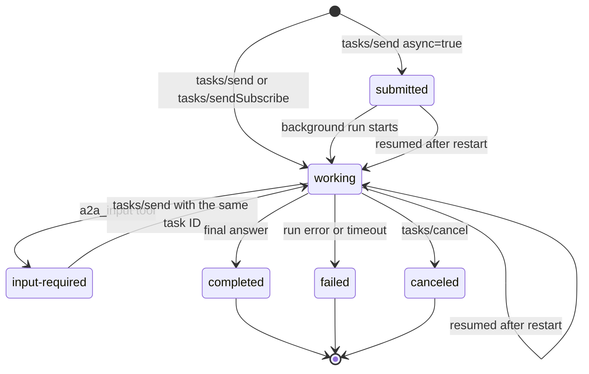
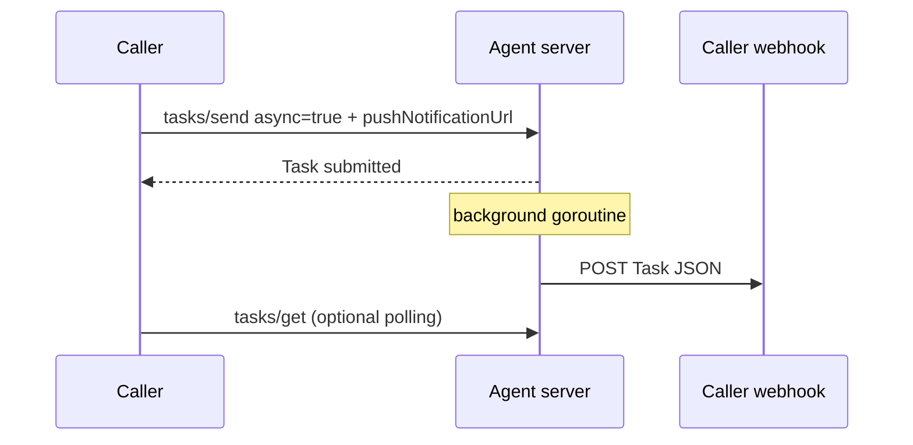
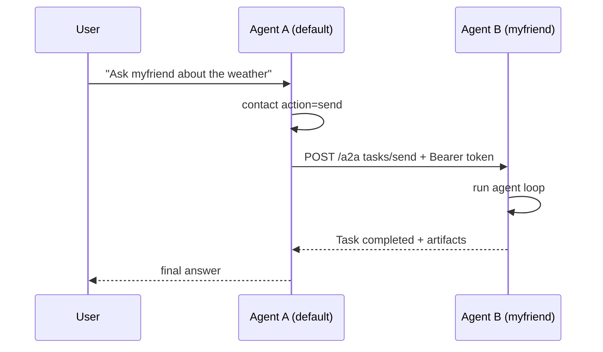
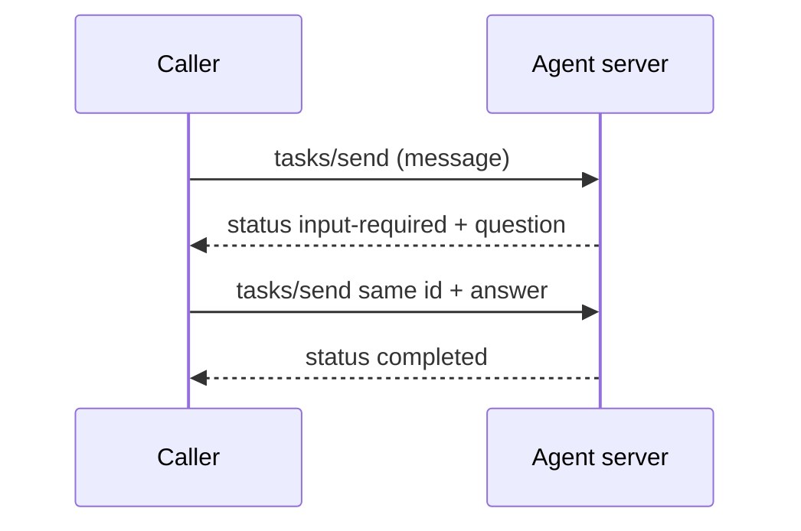

# A2A Protocol and Myaaw Implementation

[Agent2Agent (A2A)](https://a2a-protocol.org/) is an open protocol that lets agents running in different processes, servers, or organizations discover each other, exchange messages, and hand off tasks over HTTP and JSON-RPC.

This document explains the protocol model and how Myaaw implements it. For setup and day-to-day usage, see [a2a.md](a2a.md). For connection recipes (local, cross server, and non-Myaaw agents), see [a2a-interop.md](a2a-interop.md). For isolated local agents, see [multi-agent.md](multi-agent.md).

## 1. Why A2A

Myaaw has three ways to delegate work. They solve different problems:

| Mechanism | Scope | Lifetime | Cost | Use when |
| :--- | :--- | :--- | :--- | :--- |
| `subagent` tool | Same process, same agent | Child of the current run | Low | A focused or parallel subtask |
| MCP server | Tool/resource interface | Per tool call | Low to medium | Expose external tools to one agent |
| A2A contact | Another agent process or server | Autonomous task with its own ID | Network round trips | Hand off work to an agent with its own identity, memory, tools, and possibly another owner |

A2A is **not** just another tool. The `contact` tool is only the trigger on the caller side. What makes the exchange A2A is:

- discovery through an Agent Card,
- a durable task state machine with IDs and statuses,
- multi-turn tasks through `input-required`,
- streaming and asynchronous result delivery,
- an explicit trust boundary between caller and callee.

If the work can be done inside the same agent, use `subagent` instead: it is cheaper and shares context.

## 2. Protocol model

### 2.1 Discovery: the Agent Card

Every agent publishes a public document describing itself. In Myaaw it is served at:

```text
GET /.well-known/agent.json
GET /.well-known/agent-card.json   (alias)
```

```json
{
  "name": "myfriend",
  "description": "Myaaw agent myfriend",
  "url": "http://localhost:8081/a2a",
  "version": "1.0.0",
  "capabilities": {"streaming": true, "pushNotifications": true},
  "defaultInputModes": ["text", "file"],
  "defaultOutputModes": ["text"],
  "skills": [
    {"id": "weather", "name": "Weather", "description": "Get the current weather in a given location."}
  ],
  "securitySchemes": [{"type": "http", "scheme": "bearer"}],
  "publicKey": "base64url-ed25519-public-key",
  "keyId": "short-key-id",
  "signatures": [
    {"protected": "base64url-header", "signature": "base64url-signature"}
  ]
}
```

Rules in Myaaw:

- The card is **public** and never contains tokens.
- `url` is the JSON-RPC endpoint, built from `MYAAW_BASE_URL` (or `PORT`) plus `/a2a`.
- `skills` comes from the agent's enabled skills (`skills.json` plus the `skills/` directory).
- `securitySchemes` is only present when at least one credential is configured.
- `publicKey` and `keyId` are only present when `A2A_SIGNING_KEY` is configured. The key is public metadata, safe to share.
- `signatures` is present when the card is signed. See section 2.9.

### 2.2 Tasks and states

A **task** is the unit of work. It has an ID, an optional context ID, a status, the message history, and artifacts.



| State | Meaning |
| :--- | :--- |
| `submitted` | Accepted for async execution, not started yet |
| `working` | The agent is running |
| `input-required` | The agent asked the caller a question and is waiting |
| `completed` | Final answer and artifacts are available |
| `failed` | The run failed; `status.message` explains why |
| `canceled` | Canceled by the caller |

On startup, Myaaw calls `ResumePending`, which re-runs leftover `submitted` and `working` tasks instead of failing them. Each resumed task increments its attempt counter; after three attempts it is marked `failed` with an explanatory `status.message`.

### 2.3 Messages, parts, and artifacts

A message has a `role` (`user` or `agent`) and a list of parts. A part is one of:

| Kind | Payload | Myaaw behavior |
| :--- | :--- | :--- |
| `text` | `text` | Joined into the prompt |
| `data` | `data` (any JSON) | Serialized into the prompt as `[Data part: {...}]` |
| `file` | `file.name`, `file.mimeType`, `file.bytes` (base64) | `image/*` becomes a model image input; other files are written to the task directory and referenced by path |

Limits: at most 10 file parts per message and 5 MiB per decoded file. File parts with `uri` are rejected; send base64 `bytes` instead.

Artifacts are outputs returned to the caller:

- The agent's text reply is always an artifact named `response`.
- Any file the agent writes under the task's `output/` directory becomes a `file` artifact (base64 + MIME type). Up to 10 files per task, 5 MiB each.

The prompt tells the agent where to write files:

```text
[A2A] Save files for the caller under <jobs>/a2a/<taskId>/output; they will be returned as artifacts.
```

### 2.4 JSON-RPC surface

All task operations go to one endpoint:

```text
POST /a2a
Content-Type: application/json
Authorization: Bearer <token>
```

| Method | Params | Result |
| :--- | :--- | :--- |
| `tasks/send` (alias `message/send`) | `message`, optional `id`, `contextId`, `async`, `pushNotificationUrl` | `Task` (sync) or `Task` in `submitted` (async) |
| `tasks/sendSubscribe` (alias `message/stream`) | `message`, optional `id`, `contextId` | SSE stream |
| `tasks/get` | `id` | `Task` |
| `tasks/cancel` | `id` | `Task` |
| `tasks/resubscribe` | `id` | SSE replay of buffered events plus live events |
| `tasks/pushNotificationConfig/set` | `id`, `pushNotificationConfig` | stored config |
| `tasks/pushNotificationConfig/get` | `id`, optional `pushNotificationConfigId` | stored config |
| `tasks/pushNotificationConfig/list` | `id` | array of configs |
| `tasks/pushNotificationConfig/delete` | `id`, `pushNotificationConfigId` | `{"deleted": true}` |

Error codes:

| Code | Meaning |
| :--- | :--- |
| `-32700` | Parse error |
| `-32600` | Invalid JSON-RPC request |
| `-32601` | Method not found |
| `-32602` | Invalid params (bad message, file, URL, or task ID) |
| `-32603` | Internal error |
| `-32001` | Task not found |
| `-32002` | Task exists and is not resumable |
| `-32003` | Caller lacks the required scope (HTTP 403) |

Task IDs supplied by the caller must match `^[A-Za-z0-9_-]{1,128}$`. A caller-supplied ID is only accepted as a **resume** when the existing task is in `input-required`; otherwise the server returns `-32002`.

### 2.5 Streaming

`tasks/sendSubscribe` returns `text/event-stream` with two event kinds:

```text
event: status
data: {"kind":"status","taskId":"...","status":{"state":"working"}}

event: artifact
data: {"kind":"artifact","taskId":"...","artifact":{"name":"response","parts":[{"kind":"text","text":"Hel"}]},"append":true}

event: artifact
data: {"kind":"artifact","taskId":"...","artifact":{"name":"response","parts":[{"kind":"text","text":"lo"}]},"append":true}

event: artifact
data: {"kind":"artifact","taskId":"...","artifact":{"name":"response","parts":[{"kind":"text","text":"Hello"}]},"lastChunk":true}

event: status
data: {"kind":"status","taskId":"...","status":{"state":"completed"},"final":true}
```

- Incremental chunks use `append: true`.
- The final artifact is emitted **without** `append` (replacing the deltas) and with `lastChunk: true`.
- The closing status event has `final: true`.
- `async` is rejected for this method.

### 2.6 Async and push notifications

With `async: true`, `tasks/send` returns immediately with a `submitted` task and runs in the background. If `pushNotificationUrl` is set (absolute HTTP(S)), the server POSTs the final `Task` JSON to that URL with:

```text
Content-Type: application/json
X-Myaaw-Task-ID: <task id>
```

The same notification is sent to every config registered with `tasks/pushNotificationConfig/set`. If a config has a `token`, it is sent as `Authorization: Bearer <token>`. Notifications fire on `completed`, `failed`, `input-required`, and `canceled`.

The background run uses `AGENT_RUN_TIMEOUT_SECONDS` (default 15 minutes) and is serialized with the other A2A runs in the same process.

Task state survives restarts: on startup `ResumePending` re-runs tasks left in `submitted` or `working`, including their stored `pushNotificationUrl`. Each task carries an attempt counter; after three attempts it is marked `failed` instead of retried forever. Because the original user message is replayed, side effects performed before the restart can happen twice.

### 2.7 Multi-turn: `input-required`

The callee can pause and ask the caller a question:

1. The agent calls the built-in `a2a_input` tool with `question`.
2. The tool writes `<taskDir>/input-required.json`.
3. After the run stops, the service sets the task to `input-required` and records the question in `status.message`.
4. The caller resumes with `tasks/send`, the **same task ID**, and the answer as the message. The service appends the message and continues.

From the built-in `contact` tool, the `input-required` state is surfaced as `[input-required taskId=<id>]` plus the question. The caller answers by calling `send` again with that `taskId`; without it, a new task would be created.

`a2a_input` only works while an A2A task is running; it is a no-op otherwise.

### 2.8 Authentication and scopes

Credentials are configured per agent:

| Variable | Purpose |
| :--- | :--- |
| `A2A_TOKEN` | Single bearer token, shared identity `default`, delegate access |
| `A2A_TOKENS` | Comma-separated tokens, shared identity `default`, delegate access |
| `A2A_CALLERS` | `name:token[:read\|delegate]`, named identities with scopes |
| `A2A_SIGNING_KEY` | Ed25519 PKCS#8 PEM used to sign outgoing requests |
| `A2A_TRUSTED_KEYS` | `name:base64url-public-key` entries accepted for signatures |
| `A2A_REQUIRE_SIGNATURE` | When true, every request must carry a valid signature |

Scopes:

- `read` allows `tasks/get`.
- `delegate` allows `tasks/send`, `tasks/sendSubscribe`, and `tasks/cancel`, and implies `read`.

When every credential variable is empty the endpoint is open: every request is anonymous with full access. Tokens are compared in constant time. The header accepts `Bearer <token>` and a raw `<token>` value. A valid caller without the required scope receives HTTP 403 and JSON-RPC error `-32003`.

**Signatures.** Outgoing `contact` requests include `X-A2A-Signature: <compact JWS>` over the raw JSON body, using `alg=EdDSA` and `kid=<key id>`. Receivers verify the signature against `A2A_TRUSTED_KEYS`:

- A signature that is present but malformed, unknown, or invalid is always rejected with `401`.
- When `A2A_REQUIRE_SIGNATURE=true`, a missing signature is also rejected.
- Otherwise, bearer-only callers keep working.

Signatures prove possession of the private key; the token remains the authorization mechanism. If the signing key matches a trusted entry, that entry's name becomes the caller identity for the request.

### 2.9 Signed Agent Cards

When `A2A_SIGNING_KEY` is configured, the card also carries `signatures`. Each entry is a compact JWS:

```json
{
  "protected": "base64url({\"alg\":\"EdDSA\",\"kid\":\"...\"})",
  "signature": "base64url(signature)"
}
```

The signed payload is the canonical JSON of the card with `signatures` removed: object keys sorted and insignificant whitespace removed. For the card's data types (strings, booleans, arrays, objects) this matches JCS (RFC 8785).

Verification uses the pinned peer keys:

```go
keys := a2a.ParseTrustedCardKeys(config.A2ATrustedKeys)
kid, err := a2a.VerifyCard(card, keys)
```

- Trust comes from pinning the peer's `publicKey` in `A2A_TRUSTED_KEYS`; an unsigned or self-signed card is not trusted by itself.
- `contact get` verifies automatically when the remote card is signed and reports `Card signature: verified` or `unverified`.
- Card signing is optional and does not replace bearer tokens.

## 3. Implementation map

| Concern | Location |
| :--- | :--- |
| Types, states, JSON-RPC envelopes | `internal/services/a2a/types.go` |
| Task execution, files, streaming, push | `internal/services/a2a/service.go` |
| SQLite persistence, resume, stale recovery | `internal/services/a2a/store.go` |
| HTTP handlers, method aliases, scope checks | `internal/services/a2a/handler.go` |
| Caller credentials and scopes | `internal/services/a2a/auth.go` |
| JWS signing and trusted keys | `internal/services/a2a/signing.go` |
| Route mounting | `internal/services/a2a/router.go`, called from `internal/services/bot/router.go` |
| Caller-side tool | `internal/agent/tools/contact/contact.go` |
| `input-required` tool | `internal/agent/tools/a2ainput/a2ainput.go` |
| Contact registry API | `internal/services/controlplane/service/contacts.go`, `handler/contacts.go` |
| Contact file path helpers | `internal/agentdir/agentdir.go` |
| Config variables | `internal/config/config.go` |

The A2A routes are mounted on the **agent server**, not the control plane:

```text
myaaw server --agent myfriend start      -> :8081 (agent server, A2A here)
myaaw api start --port 9000           -> :9000 (control plane, contacts API here)
```

The control plane manages contacts; the agent server answers A2A calls.

## 4. Request flows

### 4.1 Synchronous task

```mermaid
sequenceDiagram
    participant Caller
    participant Server as Agent server
    participant Store as a2a_tasks
    participant Loop as Agent loop

    Caller->>Server: POST /a2a tasks/send
    Server->>Server: verify bearer token
    Server->>Store: create task (working)
    Server->>Loop: run with message
    Loop-->>Server: text reply
    Server->>Store: status completed + artifacts
    Server-->>Caller: JSON-RPC result (Task)
```

### 4.2 Streaming task

```mermaid
sequenceDiagram
    participant Caller
    participant Server as Agent server
    participant Loop as Agent loop

    Caller->>Server: tasks/sendSubscribe
    Server-->>Caller: status working
    Loop-->>Server: text chunk
    Server-->>Caller: artifact append=true
    Loop-->>Server: more chunks
    Server-->>Caller: artifact append=true
    Server-->>Caller: artifact lastChunk=true
    Server-->>Caller: status completed final=true
```

### 4.3 Async task with push notification



### 4.4 Agent-to-agent through the contact tool



### 4.5 Resuming an `input-required` task



## 5. Storage

Tasks are stored per agent in SQLite:

```text
~/.myaaw/<agent>/database/myaaw.db
```

```sql
CREATE TABLE IF NOT EXISTS a2a_tasks (
    id             TEXT PRIMARY KEY,
    context_id     TEXT,
    status         TEXT NOT NULL,
    status_message TEXT,
    messages       TEXT NOT NULL,   -- JSON array
    artifacts      TEXT NOT NULL,   -- JSON array
    attempts       INTEGER NOT NULL DEFAULT 0,
    push_url       TEXT,            -- survives restarts
    caller         TEXT,            -- calling agent name
    created_at     DATETIME,
    updated_at     DATETIME
);

CREATE TABLE IF NOT EXISTS a2a_callers (
    name       TEXT PRIMARY KEY,
    user_id    INTEGER UNIQUE NOT NULL,  -- synthetic id, starts at -1001
    created_at DATETIME
);

CREATE TABLE IF NOT EXISTS a2a_push_configs (
    task_id    TEXT NOT NULL,
    id         TEXT NOT NULL,
    url        TEXT NOT NULL,
    token      TEXT,
    created_at DATETIME,
    PRIMARY KEY (task_id, id)
);
```

The `attempts`, `push_url`, and `caller` columns are added automatically to existing databases on startup.

Task files live under the agent's jobs directory:

```text
~/.myaaw/<agent>/jobs/a2a/<taskId>/
├── <incoming files>
├── input-required.json      (transient, removed after reading)
└── output/                  (files returned as artifacts)
```

`MYAAW_A2A_TASK_DIR` is set to `<taskId>`'s directory only while that task runs, which is how `a2a_input` finds the right task. Runs are serialized because the environment variable is process-global.

## 6. Contact registry and the `contact` tool

A contact is another agent the local agent may call. Contacts live in:

```text
~/.myaaw/<agent>/contacts.json
```

```json
[
  {
    "name": "myfriend",
    "url": "http://localhost:8081/a2a",
    "token": "remote-agent-token",
    "description": "Agent myfriend di server lokal"
  }
]
```

`url` must be the remote **JSON-RPC endpoint** (`/a2a`), not the Agent Card URL. `token` is the remote agent's token, stored only in this file and masked by the control-plane API.

The built-in tool exposes four actions:

| Action | Purpose | Parameters |
| :--- | :--- | :--- |
| `send` | Delegate a task and return the final answer | `contact`, `message`, optional `taskId` |
| `list` | List contacts (tokens masked) | - |
| `get` | Show a contact plus its remote Agent Card skills | `contact` |
| `add` | Register a contact (atomic write, mode `0600`) | `contact`, `url`, optional `token`, `description` |

Aliases: `send_message`, `list_contacts`, `get_contact`, `add_contact`. Calls without `action` that include `contact` and `message` are treated as `send`.

`send` uses `message/send` first and falls back to `tasks/send` when the peer answers `-32601`, so it works with both newer and early A2A servers. It reads `artifacts`, then `messages`, then `history`. When the remote task stops in `input-required`, the tool returns `[input-required taskId=<id>]` followed by the question; call `send` again with that `taskId` to answer it. `get` fetches `/.well-known/agent.json` with a 5-second timeout and degrades gracefully when the remote agent is offline.

The same registry is managed by the control plane:

```text
GET    /agents/:name/contacts
POST   /agents/:name/contacts
DELETE /agents/:name/contacts/:contact
```

Duplicate names (case-insensitive) return `409`; tokens are never returned.

## 7. Security model

- **Two different secrets.** `.env` holds *this* agent's token and signing key (used when others call it). `contacts.json` holds *other* agents' tokens (used when this agent calls them).
- The Agent Card is public metadata and never contains credentials. `publicKey` is public by design.
- Incoming tokens are compared in constant time; `A2A_CALLERS` gives each caller a name and a scope set.
- Scopes: `read` allows `tasks/get`; `delegate` additionally allows sending and canceling tasks.
- Incoming signatures are optional unless `A2A_REQUIRE_SIGNATURE=true`. A signature that is present but invalid is always rejected.
- Contact files are written with mode `0600` and atomic rename; signing keys should also be `0600`.
- A2A tasks run under a synthetic local user **per calling agent**: `A2A_CALLERS` names are mapped to user IDs starting at `-1001` and stored in `a2a_callers`. The `users` row is named `a2a:<caller>`, so transcripts do not mix with terminal chats or the default control-plane user (`0`).
- The first task that uses a caller-supplied `contextId` creates a conversation with that ID; later tasks with the same ID continue it. A different caller cannot continue it because the conversation belongs to another user.
- `tasks/get`, `tasks/cancel`, and `input-required` resume are restricted to the caller recorded on the task. Legacy tasks without a caller remain accessible.
- Signed Agent Cards are verified against pinned `A2A_TRUSTED_KEYS`; an unsigned or untrusted card is reported as unverified, never silently trusted.
- `add` lets the model register a new endpoint. A prompt-injected model could add an attacker-controlled URL and send data there. Block the tool (`AGENT_BLOCKED_TOOLS=contact`) or keep `contacts.json` read-only for agents that must not manage contacts.
- Use HTTPS for contacts that cross hosts; bearer tokens and signature headers travel in clear text over plain HTTP.

## 8. Compatibility and deliberate deviations

Myaaw implements a **subset** of A2A, using the early protocol surface:

| Area | Myaaw behavior |
| :--- | :--- |
| Discovery path | `/.well-known/agent.json` and `/.well-known/agent-card.json` |
| RPC methods | `tasks/send`, `tasks/sendSubscribe`, `tasks/get`, `tasks/cancel`; aliases `message/send`, `message/stream` |
| Push notifications | Per-task `pushNotificationUrl` plus stored `tasks/pushNotificationConfig/*` entries |
| Streaming resume | `tasks/resubscribe` replays buffered events for streams started by this process (up to 10 minutes); not available after a restart |
| Identities | Bearer tokens, optional EdDSA JWS request signing, and signed Agent Cards |
| Authorization | Per-caller `read` and `delegate` scopes, per-caller synthetic user IDs, and task ownership |
| File parts | Base64 bytes only; `uri` parts are rejected |
| Async durability | Resumed on startup with an attempt counter (max 3) |
| Cancel | Stops the running agent loop through context cancellation and keeps the canceled state |

Before integrating with third-party A2A implementations, re-check the current protocol revision: newer spec revisions may add signed Agent Cards, push notification configuration methods, and streaming resubscribe. Treat this table as the source of truth for what Myaaw currently speaks.

## 9. Operations and troubleshooting

Enable and restart:

```bash
# ~/.myaaw/<agent>/.env
A2A_TOKEN=$(openssl rand -hex 24)

myaaw --agent <agent> server restart
```

Verify:

```bash
curl -s http://localhost:8080/.well-known/agent.json

curl -s -X POST http://localhost:8080/a2a \
  -H "Authorization: Bearer $A2A_TOKEN" \
  -H 'Content-Type: application/json' \
  -d '{"jsonrpc":"2.0","id":1,"method":"tasks/send",
       "params":{"message":{"role":"user","parts":[{"kind":"text","text":"Halo"}]}}}'
```

Inspect tasks:

```bash
sqlite3 ~/.myaaw/<agent>/database/myaaw.db \
  "select id, status, created_at from a2a_tasks order by created_at desc limit 10;"

tail -f ~/.myaaw/<agent>/logs/myaaw-server-<agent>.log
```

| Symptom | Likely cause | Fix |
| :--- | :--- | :--- |
| `401` on `POST /a2a` | Missing or wrong bearer token; missing/invalid signature when required | Compare with `.env`; check `X-A2A-Signature` and `A2A_TRUSTED_KEYS`; restart after editing |
| `403` `insufficient scope` | Caller token only has `read` | Use a `delegate` token for `tasks/send` |
| `-32001` | Task ID does not exist | Check `a2a_tasks` |
| `-32002` | Reused task ID that is not `input-required` | Omit `id` to create a new task |
| `-32602` `message must contain...` | Empty parts | Send text, data, or file bytes |
| Task `failed` | Agent run error, timeout, or exhausted resume attempts | Read `status.message` and server logs |
| Task disappears after restart | Task exceeded three attempts | Resubmit the task |
| Agent Card has no skills | No enabled skills | Check `skills.json` and the `skills/` directory |
| `contact` reports not found | Name mismatch or empty registry | Use `{"action":"list"}` |
| Streaming never closes | Provider stream stall | Check `LLM_STREAM_TIMEOUT_SECONDS` and provider health |

## 10. Roadmap

Not implemented yet:

- General JCS canonicalization for arbitrary card extensions (the current implementation covers the card's data types).
- Push notification authentication schemes beyond a bearer token.
- Restart-safe `tasks/resubscribe` buffers (currently in memory, 10 minutes).
- Alignment with future A2A spec revisions.
