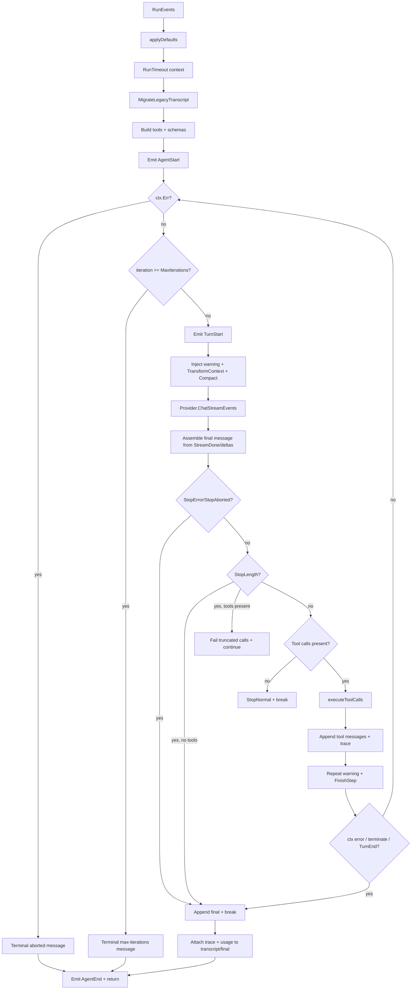

# Agent Loop v2 — Architecture, Flow, and Configuration

This document describes the `v2` agent loop used by `myaaw`: the engine, provider streaming, tool execution, transcripts, and how the timeline is consumed by the TUI, Telegram, and Discord. It also lists every configuration added since the agent loop redesign.

It reflects the state of the `feat/agent-loop-v2` branch after the Telegram and Discord timeline work.

---

## 1. Summary

The v2 agent loop replaces the old recursive ReAct loop with a single iterative, event-driven engine:

- `RunEvents` is the only loop implementation.
- Providers emit `StreamEvent`s (text/thinking deltas, usage, and `StreamDone`).
- `StreamDone.Message` is the authoritative assistant message; deltas are for UI only.
- Tools use a structured contract (`Tool`, `ToolResult`) with argument validation, timeouts, panic recovery, truncation, policy hooks, and parallel/sequential execution.
- Transcripts are stored as version `2`, with assistant tool calls and tool results as separate messages.
- The whole lifecycle is observable through `AgentEvent`s.
- A valid `RunResult` is returned even on errors or cancellation, so partial transcripts can still be persisted.

Core principles:

1. **One iteration = one provider request plus the tool calls from that turn.**
2. **The transcript is the primary state.** Every loop decision is derived from it, not from hidden state.
3. **Events are the UI/channel contract.** Consumers do not need to understand provider-specific formats.
4. **Partial results remain valid.** Errors, timeouts, and cancellation never discard an already-built transcript.

---

## 2. Component Map

| Component | File | Responsibility |
|---|---|---|
| Agent facade | `internal/agent/agent.go` | `Run`, `RunContext`, `RunStream`, `RunEvents`, `WithExcludedTools` |
| Engine loop | `internal/agent/engine.go` | Iteration, provider streaming, tool calls, stop reasons, usage, trace |
| Event model | `internal/agent/events.go` | `AgentEvent`, `EventType`, `RunResult` |
| Run config and hooks | `internal/agent/config.go` | `RunConfig`, `DefaultRunConfig`, `BeforeToolCall`, `AfterToolCall`, `FinishStep` |
| Tool executor | `internal/agent/tool.go` | Validation, policy, timeouts, panic recovery, parallel/sequential execution, truncation |
| Transcript | `internal/agent/transcript.go` | v2 migration, token estimation, compaction |
| Provider events | `internal/provider/events.go` | `StreamEvent`, `StreamDone`, `MessageText` helpers |
| Retry and timeout | `internal/provider/retry.go` | Initial-request retry and stream timeout |
| Service | `internal/services/bot/service/conversation.go` | Runs the agent, maps events to `StreamChunk`s, persists transcripts |
| TUI timeline | `cmd/myaaw/timeline.go`, `cmd/myaaw/chat.go` | Per-item timeline, group collapse, timer, duration |
| Telegram timeline | `internal/channel/telegram/timeline.go` | Per-item bubbles, HTML quotes, 4096 limit |
| Discord timeline | `internal/channel/discord/timeline.go` | Per-item messages, blockquotes, 2000 limit |

---

## 3. `RunEvents` Execution Flow

### 3.1 Main diagram



### 3.2 Detailed steps

1. **Defaults**
   - Empty `RunConfig` fields are filled from `DefaultRunConfig` and global configuration.
   - `MaxIterations`, `WarningThreshold`, timeouts, tool output limits, context budget, and repeat limit are applied.

2. **Run timeout**
   - If `RunTimeout > 0`, the engine wraps the context with `context.WithTimeout`.
   - This deadline covers the entire run, not just a single provider request.

3. **Initial transcript**
   - `MigrateLegacyTranscript(history)` upgrades old messages to version `2`.
   - Tool context (`user_id`, channel) is extracted from the transcript if not supplied.

4. **Tool registry**
   - Tools are built from registered factories, minus `ExcludedTools`.
   - Tool schemas are sent to the provider with every request.

5. **Loop**
   - Check cancellation at the start of the iteration.
   - Check the `MaxIterations` limit.
   - Emit `EventStepStart`.
   - Build `requestMessages`:
     - remaining-step warning,
     - repeated-tool warning from the previous iteration,
     - `TransformContext` (optional hook),
     - `CompactTranscript` when `ContextMaxTokens > 0`.
   - Call `Provider.ChatStreamEvents`.
   - Accumulate deltas for the UI, but still use `StreamDone.Message` as the final message.
   - If the provider did not emit text/thought deltas but the final message has content, the engine emits fallback deltas so consumers still see the content.
   - Emit `EventMessageStart` / `EventMessageEnd` if they have not been emitted yet.
   - Append the assistant message to the transcript and `NewMessages`.

6. **Turn decision**
   - `StopError` / `StopAborted`: record the error, emit `EventStepEnd`, stop.
   - `StopLength`:
     - no tool calls: finish with stop reason `length`;
     - tool calls present: fail every call because arguments may be truncated, then ask the model to re-issue them.
   - No tool calls: `StopNormal`, finish.
   - Tool calls present: execute tools, append tool messages, emit trace, run `FinishStep`, then continue.

7. **Finalization**
   - `final.Trace` is populated with the full trace.
   - `final.Usage` is populated with aggregated usage.
   - Trace and usage are attached to transcript/new messages for UI metadata.
   - Emit `EventAgentEnd`.
   - Return `RunResult`.

### 3.3 Normal event order

```text
AgentStart
TurnStart
MessageStart
MessageUpdate (thinking delta)...
MessageUpdate (text delta)...
ToolExecutionStart
ToolExecutionEnd
TraceUpdate
TurnEnd
...
AgentEnd
```

`EventMessageUpdate` may carry `Delta` (text) and/or `ThinkingDelta`.

---

## 4. `AgentEvent` and `RunResult`

### 4.1 Event types

| Event | Main payload | Purpose |
|---|---|---|
| `EventAgentStart` | — | Run started |
| `EventAgentEnd` | `Message`, `Trace`, `Usage`, `StopReason`, `Err` | Run finished with aggregate results |
| `EventStepStart` | — | Iteration started |
| `EventStepEnd` | `Message`, `Trace`, `ToolResult` | Iteration finished |
| `EventMessageStart` | `Message` | Assistant message started |
| `EventMessageUpdate` | `Delta`, `ThinkingDelta` | Text/thinking delta |
| `EventMessageEnd` | `Message` | Final assistant message for the turn |
| `EventToolExecutionStart` | `ToolCallID`, `ToolName`, `ToolArguments` | Tool started |
| `EventToolExecutionUpdate` | Partial `ToolResult` | Tool progress (when supported) |
| `EventToolExecutionEnd` | `ToolResult` | Tool finished/errored/timed out |
| `EventTraceUpdate` | `Trace` | Latest ReAct trace |
| `EventUsage` | `Usage` | Per-request usage |
| `EventLLMRequestStart` | `Model`, `Messages` | About to call the provider; carries the exact transcript being sent |
| `EventLLMRetry` | `Attempt`, `Err` | The previous attempt failed and the request is retried; `Attempt` is 1-based |
| `EventContextCompacted` | `Compact` | The transcript was trimmed to fit `ContextMaxTokens`, with tokens before/after and how many messages were dropped |

Every event also carries `RunID`, `Time`, and `StepIndex`, filled by the engine, so a consumer can group events without reconstructing run state. `RunResult` exposes the same `RunID` plus `StartedAt` / `EndedAt`. Set `RunConfig.RunID` when the caller already owns an identifier (for example a trace recorder), and the engine will reuse it instead of generating one.

`EventLLMRequestStart` is what trace recording uses to capture the prompt that was actually sent, after context injection and compaction. `EventContextCompacted` fires just before it whenever compaction actually removed messages, so a trace can show why the model stopped seeing older turns. See [Observability](observability.md).

All other fields in `AgentEvent` are only valid for the matching event type. Consumers must treat events as a discriminated union keyed by `Type`.

### 4.2 `RunResult`

| Field | Contents |
|---|---|
| `RunID` | Identifier shared by every event of this run |
| `StartedAt`, `EndedAt` | Run boundaries |
| `Transcript` | Full transcript after the run, including the system message |
| `NewMessages` | Messages produced by this run |
| `Final` | Last assistant message |
| `Usage` | Aggregated usage across all requests |
| `StopReason` | Why the run ended |
| `Err` | Provider/cancellation error, if any |

`RunResult` remains valid on errors. Callers should persist the partial `Transcript` and surface `Final` as the terminal message.

---

## 5. Transcript v2

### 5.1 Message shape

Transcript v2 uses `provider.Message` with `Version: 2`.

A normal turn with tools looks like:

```text
assistant (thought + tool_calls)
tool (result for call 1)
tool (result for call 2)
assistant (final text)
...
```

Tool calls and results are separate messages. This differs from the legacy transcript, which stored everything inside `Trace`.

Important fields:

| Field | Purpose |
|---|---|
| `Role` | `system`, `user`, `assistant`, `tool` |
| `Content` | Text or content items |
| `Thought` | Model reasoning |
| `ToolCalls` | Tool call list |
| `ToolCallID` | Links a tool result to its call |
| `IsError`, `ErrorMessage` | Error status |
| `DurationMs` | Tool duration |
| `StopReason` | Why the turn ended |
| `Trace` | ReAct metadata for the UI |
| `Usage` | Token usage |
| `Version` | Transcript version (`2`) |

### 5.2 Legacy migration

`MigrateLegacyTranscript`:

- bumps old message versions to `2`;
- for legacy assistant messages that have a `Trace` but no tool messages:
  - groups trace steps by `StepGroup`,
  - turns each step into assistant `tool_calls`,
  - turns observations into `tool` messages,
  - keeps the original final assistant answer;
- leaves messages already at version `2` unchanged.

Migration is idempotent: v2 transcripts are never expanded again.

### 5.3 Persistence

`runConversation` calls `saveConversation` with `result.Transcript`.

- The system message is dropped before saving.
- Every message is stamped with `Version: 2`.
- The transcript is written to the `messages` JSON column on the `conversations` table.
- This also applies to runs that end due to cancellation/error, as long as `RunEvents` returned a `RunResult`.

---

## 6. Context Compaction

`CompactTranscript` limits transcript size before a provider request.

- Token estimate: roughly 4 bytes per token plus per-message overhead; images count as 1000 tokens.
- The system prefix is always kept.
- The newest turn is always kept.
- Turns are grouped by `user` messages and never split, so assistant tool calls and tool results stay together.
- Old turns are removed from the front until the budget is satisfied.

Configuration:

- `context_max_tokens` / `AGENT_CONTEXT_MAX_TOKENS`
- `0` disables compaction.

---

## 7. Tool Execution

### 7.1 Validation and policy

Before a tool runs:

1. Context cancellation is checked.
2. The tool is looked up in the registry.
3. Arguments are validated against the schema:
   - required properties,
   - primitive types (`string`, `number`, `integer`, `boolean`, `object`, `array`, `null`).
4. `BeforeToolCall` may block the tool through `ToolBlock`.
   - `Block: true` produces an error tool result.
   - `Terminate: true` can end the run when every call terminates.
5. `AGENT_BLOCKED_TOOLS` / `bot.blocked_tools` installs an automatic block policy.

### 7.2 Execution mode

- A tool may declare `ExecutionSequential` or parallel mode.
- If any tool is sequential, the whole turn runs sequentially.
- Otherwise, calls run in parallel with `sync.WaitGroup`.
- Results are always returned in call order, not completion order.

### 7.3 Timeouts and cancellation

For each tool:

- A derived context is created with `ToolTimeout` when configured.
- The tool runs in a goroutine so a tool that ignores context cannot block the loop forever.
- `select` waits for the tool result or `ctx.Done()`.
- Panics are recovered and converted into an error tool result.
- If the context ends, the result is marked as an error if it was not already.
- `AfterToolCall` may override or redact the result.
- Text output is truncated to `MaxToolOutputBytes`.

### 7.4 Tool results

`ToolResult` contains:

- `Content` (text/image),
- `Details` / `StructuredContent`,
- `IsError`,
- `Terminate`,
- `Usage`,
- `DurationMs`.

A tool result enters the transcript as a `tool` message with `ToolCallID`, `IsError`, and `DurationMs`.

### 7.5 Repeated tool calls

The engine counts `tool name + arguments` pairs.

When the same pair reaches `RepeatToolCallLimit`:

- the model receives a warning in the next request;
- the same warning is not repeated endlessly;
- limit `0` disables warnings.

---

## 8. Provider Streaming and Retry

### 8.1 `StreamEvent` contract

Providers must:

- emit `StreamTextDelta` for text;
- emit `StreamThinkingDelta` for reasoning;
- emit `StreamUsage` when available;
- emit exactly one `StreamDone` at the end.

`StreamDone.Message` is the final assistant message. Deltas are UI-only. If a provider only exposes full content in `StreamDone`, the engine emits fallback deltas so consumers still receive it.

### 8.2 Retry

`doWithRetry` wraps provider requests:

- retries transport errors and HTTP statuses `408`, `425`, `429`, `500`, `502`, `503`, `504`;
- uses linear backoff: 500ms, 1s, 1.5s, etc.;
- does not retry `context.Canceled` or `context.DeadlineExceeded`;
- for streaming, retries only cover the initial connection. Once a successful response starts streaming, there is no mid-stream retry.

`LLM_REQUEST_RETRIES` is the number of **additional retries**, not total attempts:

| Value | Maximum total attempts |
|---:|---:|
| `0` | 1 |
| `1` | 2 |
| `2` | 3 |

### 8.3 Stream timeout

`LLMStreamTimeoutSeconds` limits one provider request/stream. It is applied by OpenAI-compatible, Gemini, Ollama, and Groq providers (Groq via the OpenAI-compatible path).

---

## 9. Termination, Cancellation, and Timeouts

### 9.1 Stop reasons

| StopReason | Cause |
|---|---|
| `normal` | Model finished without tool calls, or `FinishStep` ended the run |
| `max_iterations` | Iteration count reached `MaxIterations` |
| `length` | Model output was truncated by the token limit |
| `error` | Provider/stream error |
| `aborted` | Context cancelled or run timed out |

### 9.2 Cancellation checkpoints

Cancellation is checked:

1. at the start of each iteration;
2. after provider streaming;
3. before and during tool execution;
4. after tools finish.

When cancellation happens:

- the partial assistant message is still assembled;
- completed tool results still enter the transcript;
- a terminal `Request aborted` or timeout message is added where relevant;
- `RunResult` is still returned.

### 9.3 Persistence on interrupt

The service calls `saveConversation` **before** checking `context.Canceled`.

Therefore, for a normal interrupt (Esc in the TUI):

- the partial transcript is saved;
- the user message and completed tool results remain available;
- the next message sees that context.

The TUI adds a `stopping` state and waits for the service acknowledgment before reopening input, preventing a new message from reading the transcript before the save completes.

Notes:

- `Ctrl+C` that immediately exits the app is not guaranteed to finish the save.
- Crashes or process kills are not guaranteed either.
- A failed save produces an error and a warning in the TUI.

---

## 10. Service and Channel Integration

### 10.1 Event-to-`StreamChunk` mapping

`runConversation` maps agent events to `channel.StreamChunk`s:

| Agent event | StreamChunk `Kind` | Contents |
|---|---|---|
| `EventMessageUpdate` text | `text` | text delta |
| `EventMessageUpdate` thinking | `thought` | thought delta |
| `EventToolExecutionStart` | `tool` | tool name, args, call ID |
| `EventToolExecutionEnd` | `tool_result` | result, error flag |
| `EventTraceUpdate` | `trace` | latest trace |
| `EventUsage` | `usage` | usage |
| end of run | `final` | final text, trace, usage, thought |

`final` is emitted once after the run. Intermediate text before tool calls must not be treated as the final answer.

### 10.2 Persistence and title

- The transcript is saved after the run.
- Heartbeat responses with `HEARTBEAT_OK` are not saved.
- Conversation titles are generated asynchronously so they do not block the response.

### 10.3 TUI

The TUI builds a timeline from `StreamChunk`s:

- `thinking` → thinking item,
- `tool` + `tool_result` → tool item,
- `text` → text item,
- `final` → authoritative final answer.

TUI features:

- each timeline item can be collapsed;
- the activity group can be collapsed/expanded;
- a live timer runs during streaming;
- the final duration is shown after completion;
- interrupts wait for persistence to finish.

### 10.4 Telegram

- One item = one bubble.
- Thinking and tools render inside `<blockquote expandable>`.
- Tool results update the same tool bubble.
- Final answers are split by the 4096 UTF-16 unit limit.
- Link previews are always disabled on `sendMessage` and `editMessageText`.
- Streaming mode uses repeated edits; non-stream mode sends bubbles from the `Trace`.

### 10.5 Discord

- One item = one message.
- Thinking and tools render as multiline `>>>` blockquotes without spoilers.
- Tool results update the same tool message.
- Final answers are split by the 2000-character limit (conservatively counted as UTF-16 units).
- Streaming mode uses repeated edits; non-stream mode sends messages from the `Trace`.

Neither channel adds new configuration. Both use:

- `bot.stream` / `STREAM_RESPONSE` to select streaming;
- `bot.watermark` for the final-answer watermark.

### 10.6 System prompt context

`agent.SystemPromptBuilder` rebuilds the system message for each request from the active agent's `home/` directory (`~/.myaaw/<agent>/home`):

- It always injects the absolute `workspace/` paths.
- For local sessions (`cli`, `voice-classic`), it injects the launch directory as `## Current Directory`, and the filesystem tool registers that directory as an allowed project root even when no marker files are present.
- For remote channels (`telegram`, `discord`), it omits the server process working directory because it is not user project context.

---

## 11. Configuration

### 11.1 New configuration since agent loop v2

| Env | JSON (`bot.*`) | Default | Purpose | Validation |
|---|---|---:|---|---|
| `AGENT_CONTEXT_MAX_TOKENS` | `context_max_tokens` | `64000` | Token budget before compaction | `< 0` → `0`; `0` disables |
| `AGENT_MAX_TOOL_OUTPUT_BYTES` | `max_tool_output_bytes` | `32768` | Tool output limit before truncation | `<= 0` → `32768` |
| `AGENT_REPEAT_TOOL_CALL_LIMIT` | `repeat_tool_call_limit` | `3` | Warning for identical tool+args | `< 0` → `0`; `0` disables |
| `AGENT_TOOL_TIMEOUT_SECONDS` | `tool_timeout_seconds` | `300` | Per-tool timeout | `< 0` → `0`; `0` disables |
| `AGENT_BLOCKED_TOOLS` | `blocked_tools` | empty | Tools blocked by policy | CSV in env, array in JSON |
| `LLM_REQUEST_RETRIES` | `request_retries` | `1` | Additional provider request retries | `< 0` → `0` |
| `AGENT_RUN_TIMEOUT_SECONDS` | `run_timeout_seconds` | `900` | Whole-run deadline | `<= 0` → `900` |
| `LLM_STREAM_TIMEOUT_SECONDS` | `stream_timeout_seconds` | `180` | One request/stream timeout | `<= 0` → `180` |

### 11.2 Existing configuration that remains relevant

| Env | JSON (`bot.*`) | Default | Purpose |
|---|---|---:|---|
| — | `max_iterations` | `100` | Agent iteration limit |
| — | `warning_iterations` | `90` | Start warning when steps remain |
| `STREAM_RESPONSE` | `stream` | `true` | Streaming vs non-streaming |
| — | `watermark` | `false` | Final-answer watermark |

Per-agent tool exclusion does not use global config; use `Agent.WithExcludedTools(...)` in code.

### 11.3 Configuration precedence

1. `.env` is loaded first.
2. `config.json` is loaded next.
3. For fields with a JSON counterpart, `config.json` overrides `.env`.

`.env` lookup order:

1. `./.env`
2. `~/.myaaw/.env`
3. development fallback path

`config.json` lookup order:

1. `./config.json`
2. `~/.myaaw/config/config.json`

### 11.4 Example `config.json`

```json
{
  "bot": {
    "max_iterations": 100,
    "warning_iterations": 90,
    "stream": true,
    "watermark": false,
    "context_max_tokens": 64000,
    "max_tool_output_bytes": 32768,
    "repeat_tool_call_limit": 3,
    "tool_timeout_seconds": 300,
    "run_timeout_seconds": 900,
    "stream_timeout_seconds": 180,
    "request_retries": 1,
    "blocked_tools": []
  }
}
```

### 11.5 Example `.env`

```dotenv
AGENT_CONTEXT_MAX_TOKENS=64000
AGENT_MAX_TOOL_OUTPUT_BYTES=32768
AGENT_REPEAT_TOOL_CALL_LIMIT=3
AGENT_TOOL_TIMEOUT_SECONDS=300
AGENT_BLOCKED_TOOLS=
LLM_REQUEST_RETRIES=1
AGENT_RUN_TIMEOUT_SECONDS=900
LLM_STREAM_TIMEOUT_SECONDS=180
```

### 11.6 `LLM_REQUEST_RETRIES` in detail

- `1` means one retry after the initial request, for a maximum of two requests.
- Retries apply only to transport errors and statuses `408`, `425`, `429`, `500`, `502`, `503`, `504`.
- Backoff is linear: 500ms, 1s, 1.5s, etc.
- Context cancellation and deadlines are never retried.
- Streaming retries only cover the initial connection; errors after streaming starts are not retried.

---

## 12. Observability

### 12.1 Logs

| File | Contents |
|---|---|
| `~/.myaaw/logs/myaaw-chat-cli.log` | `myaaw chat` process logs |
| `~/.myaaw/logs/myaaw-server.log` | Server logs when running as a daemon |
| `~/.myaaw/logs/tools.log` | Tool loading/watching, MCP, custom tools |
| `~/.myaaw/logs/skills.log` | Skill loading/watching |

These logs are not raw stream deltas. They contain operational warnings/errors and messages such as `[Agent] turn N: executing ...`.

### 12.2 Raw transcript

The raw timeline data lives in SQLite:

```text
~/.myaaw/database/myaaw.db
```

Table `conversations`, column `messages` (JSON). It contains assistant thoughts/tool calls, tool results, final text, trace, and usage.

Examples:

```bash
sqlite3 ~/.myaaw/database/myaaw.db \
  "SELECT id, title, updated_at FROM conversations ORDER BY updated_at DESC LIMIT 10;"

sqlite3 ~/.myaaw/database/myaaw.db \
  "SELECT messages FROM conversations WHERE id='ID_CONVERSATION';" \
  | python3 -m json.tool
```

---

## 13. File Map

```text
internal/agent/
  agent.go        Run/RunContext/RunStream/RunEvents facade
  engine.go       iterative loop + provider + tool orchestration
  events.go       AgentEvent, RunResult
  config.go       RunConfig, hooks, defaults
  tool.go         Tool, ToolResult, validation, execution
  transcript.go   v2 migration, token estimation, compaction

internal/provider/
  provider.go     provider interface + StopReason
  events.go       StreamEvent contract + helpers
  retry.go        request retry + stream timeout
  openai_stream.go
  gemini.go
  ollama.go
  groq.go

internal/services/bot/service/
  conversation.go event -> StreamChunk, persist transcript

internal/channel/
  message.go      StreamChunk / OutgoingMessage
  telegram/timeline.go
  discord/timeline.go

cmd/myaaw/
  chat.go         TUI loop, interrupt persistence, timer
  timeline.go     TUI timeline model + renderer
```

---

## 14. Testing

Relevant tests include:

- `internal/agent/engine_test.go` — loop, tool calls, stop reasons, timeouts, cancellation.
- `internal/agent/transcript_test.go` — v2 migration, compaction, token estimation.
- `internal/provider/stream_test.go` — provider stream parsing.
- `cmd/myaaw/timeline_test.go` — timeline rendering, hit-testing, interrupt state.
- `internal/channel/telegram/timeline_test.go` — per-item bubbles, 4096 limit, link preview config.
- `internal/channel/discord/timeline_test.go` — per-item messages, 2000 limit, text splitting.

Validation commands:

```bash
go vet ./...
go test ./...
go test -race ./cmd/myaaw/ ./internal/channel/telegram/ ./internal/channel/discord/
```
