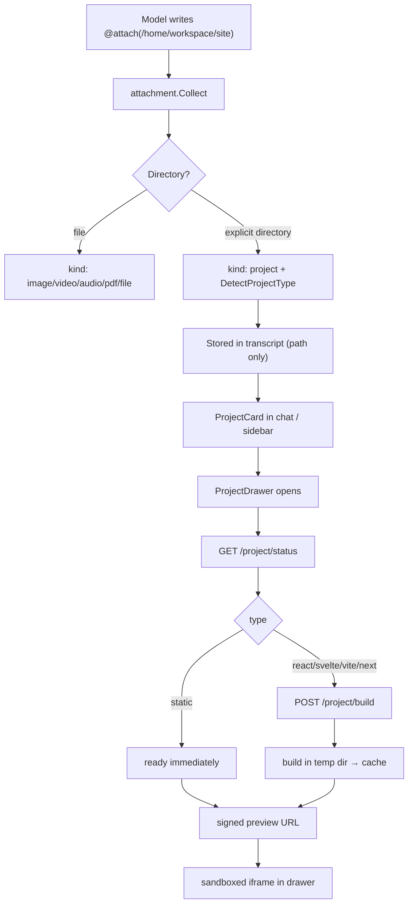
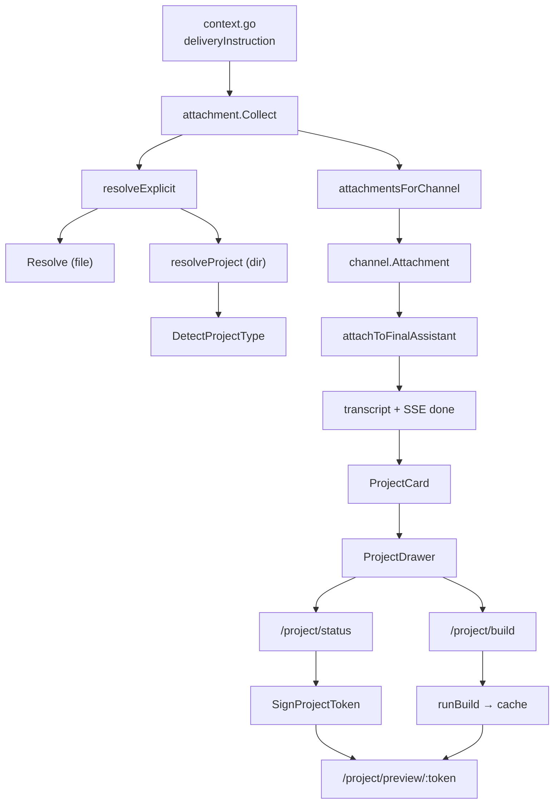

# Project Attachments & Previews

End-to-end reference for attaching a **project directory** to an agent answer and
rendering it in the dashboard: delivery, detection, persistence, the preview
API, the sandboxed build pipeline, the signed preview URL, and the WebUI card
and drawer.

Companion documents:

- [Agent Attachments](attachments.md) — the general `@attach` contract for files.
- [Project Attachments plan](../webui/project-attachment.md) — the original
  phased plan and implementation checklist.

---

## 1. Why projects are special

A project is a directory, not a file. Attaching its individual files floods the
chat and loses structure, while uploading a directory to Telegram or Discord is
not portable. A project attachment therefore stores **only the directory path**,
and every surface decides how to present it:

| Surface | Presentation |
| :--- | :--- |
| WebUI / API | `kind: "project"` card; opening it shows a full-screen preview drawer |
| Telegram / Discord | the directive is replaced by the plain path; no bytes are uploaded, but path-only metadata is persisted so the WebUI history still shows the project card |
| CLI / TUI | the directive is replaced by the plain path |

The model is told to attach the directory exactly once:

```text
For a project, attach only the project directory once, writing
@attach(/absolute/path/to/project) and nothing else.
```

That instruction lives in `deliveryInstruction` in
`internal/agent/context.go` and is identical for every channel so the prompt
cache prefix stays stable.

### 1.1 Architecture at a glance



### 1.2 Messaging and terminal surfaces

Telegram, Discord, and CLI/TUI do **not** participate in the preview pipeline:

| Surface | `@attach(project)` becomes | Bytes uploaded | Build / port |
| :--- | :--- | :--- | :--- |
| Telegram / Discord | the absolute path in the message text **and** path-only `kind: "project"` metadata on the turn | none | none |
| CLI / TUI | the absolute path in the message text | none | none |
| WebUI / API | `kind: "project"` metadata (path only) | none | build only if the drawer opens |

- `messagingAttachments` appends a path-only `channel.Attachment` for a
  `KindProject` item, then continues. The Telegram/Discord adapters skip any
  attachment with no `Data`, so nothing is uploaded, but `attachToFinalAssistant`
  stores the path, kind, and project type on the assistant turn. Opening the same
  conversation in the WebUI therefore renders an **Open project** card, exactly
  like an image delivered from Telegram.
- The 20 MB size check and `os.ReadFile` are skipped for a project: a directory
  is never read into memory.
- The default branch (`cli` and any surface without an attachment renderer)
  calls `attachment.Substitute`, which resolves the directory and writes its
  absolute path into the text. It does not persist an attachment object.
- No messaging or terminal surface calls `/project/build`; builds start only from
  the dashboard / control-plane API.
- Files delivered alongside a project still travel normally; the adapters upload
  the ones that have bytes and ignore the path-only project entry.
- Trade-off: a remote Telegram or Discord reader receives a path on the **agent
  host**, which may not exist on their machine. The feature deliberately does not
  upload a project archive there; the card is useful when the same conversation
  is later opened on the dashboard.
- Turns processed before this behavior have no project metadata in their stored
  transcript and are not retroactively enriched; a new turn produces the card.

---

## 2. Delivery: from directive to `kind: "project"`

### 2.1 Accepted syntax

Only an **explicit** reference can attach a directory:

```text
@attach(/home/workspace/site)
@attach("/home/workspace/my site")
@attach('/home/workspace/site')
@/home/workspace/site
@~/workspace/site
```

A bare path in prose is never promoted to a project. Auto-promotion
(`Promote`) still handles previewable media and standalone file paths, but it
calls the file-only resolver, so a stray directory path cannot attach a whole
tree by accident.

Directives inside fenced code blocks are documentation and are ignored. A path
followed by sentence punctuation is retried without the punctuation.

### 2.2 Validation

A directory becomes a project attachment only when all of these hold:

- it exists and is a directory;
- it resolves inside one of the agent roots:

  | Virtual root | Absolute directory |
  | :--- | :--- |
  | `/home` | `<agent>/home` |
  | `/user` | `<agent>/user` |
  | `/skills` | `<agent>/skills` |
  | `/jobs` | `<agent>/jobs` |

- no path segment inside the root starts with `.` (`.env`, `.git`, `.ssh`, …);
- its base name is not a denied credential name (`auth.json`,
  `credentials.json`, `id_rsa`, `id_ed25519`, `id_ecdsa`);
- its symlink-resolved target also stays inside the same root;
- it is not the root itself.

The item then carries:

```go
attachment.Item{
    AbsPath:     "/Users/me/.myaaw/agents/default/home/workspace/site",
    Virtual:     "/home/workspace/site",
    Name:        "site",
    Kind:        attachment.KindProject, // "project"
    ProjectType: "static",               // see §3
    Size:        0,                      // computed lazily by /project/status
}
```

### 2.3 Project type detection

`attachment.DetectProjectType(dir)` checks the manifest in this order. The first
match wins.

| Type | Detection | Preview strategy |
| :--- | :--- | :--- |
| `next` | `next.config.*` exists, or `package.json` depends on `next` | sandboxed build |
| `svelte` | `svelte.config.js` / `svelte.config.ts`, or `svelte` / `@sveltejs/kit` | sandboxed build |
| `vite` | `vite.config.*` exists | sandboxed build |
| `react` | `package.json` depends on `react` | sandboxed build |
| `static` | `index.html` exists and no build tooling matched above | serve files as-is |
| `source` | none of the above | download-only |

Detection is cheap: it only stats a handful of manifest files. File counts and
byte sizes are measured later by the status endpoint.

### 2.4 Non-web projects

The preview pipeline only renders **web output**. A project without an HTML entry
point or a known web build manifest is classified `source` and is **not** built.

| Project kind | Example | Detected as | Result |
| :--- | :--- | :--- | :--- |
| Backend API | FastAPI, Django, Flask, Go `net/http`/Gin/Echo, Express, NestJS | `source` | `failed` + `download_only`; no server is started |
| Full-stack (frontend + API) | React/Vite UI plus a Node/Go/Python API | `react` / `vite` | only the static frontend is built and served; the API process is not running, so data calls fail |
| Backend with nested static files | Express serving `public/index.html` | `source` (detection looks at the project root only) | attach `public/` itself if you only want the static pages |
| Backend with a root `index.html` | API plus a static home page | `static` | the HTML is served, but `/api/*` endpoints do not exist in the preview |
| Native desktop | Swift, Go, Qt, Rust GUI | `source` | `failed` + `download_only` |
| Electron / Tauri | React + Vite renderer | `react` / `vite` | build is attempted; only the static renderer can be previewed, the desktop app is never launched |
| CLI | Go, Rust, Python, Node CLI | `source` (unless a React/Vite/Svelte/Next marker exists) | `failed` + `download_only` |
| Markdown folder | notes or a README only | `source` | `failed` + `download_only` |
| Markdown folder with HTML | docs plus a hand-written `index.html` | `static` | the HTML is served |
| Server-only web app | Next SSR, SvelteKit Node adapter, Express | `next` / `svelte` / `source` | the build may run, but without an `index.html` output it ends `failed` |

The language (Python, Go, Node, Rust, …) does not decide anything; detection is
purely file-based. A backend API **never starts**: the preview only serves files.
If a frontend exists it can render, but its API calls fail because (a) no backend
process is running and (b) `connect-src 'none'` blocks `fetch`/XHR/WebSocket.

To preview a full-stack UI, produce a static build of the frontend and attach
the output directory (`dist/`, `build/`, …). For a static-site generator (Hugo,
Jekyll, Astro, Vite), attach its built output (`public/`, `dist/`), not the
source tree, because detection only looks at the attached directory's root.
API documentation is previewable only if it is exported to static HTML and the
OpenAPI spec is baked in.

Svelte with a Node/Python/Go API follows the same rule:

| Layout | Detected as | What happens |
| :--- | :--- | :--- |
| SvelteKit + API in one root | `svelte` | the frontend build runs; the API process is never started |
| SvelteKit `adapter-static` | `svelte` | `build/index.html` is served; prerendered data works |
| SvelteKit `adapter-node` | `svelte` | output has no `index.html`; build ends `failed` |
| Plain Svelte + Vite + API in one root | `svelte` | Vite build output is served; the API process is never started |
| Monorepo root (`frontend/` + `backend/`) | `source` | no preview; attach `frontend/` or its build output instead |

Even when a frontend renders, API-backed features fail: there is no backend
process and `connect-src 'none'` blocks `fetch`/XHR/WebSocket. A preview must
contain its data statically (SSG/prerender, baked JSON) or use mock data.

For `source`, `GET /project/status` returns:

```json
{
  "type": "source",
  "state": "failed",
  "download_only": true,
  "error": "This project has no preview entry point."
}
```

No `npm` command runs, no port is opened, and no project process is started. The
attachment itself is still persisted: the card appears with a **Source** badge,
the badge and path stay in chat and in the sidebar, and the drawer shows the
error plus **Try again**.

> **Current UI limitation:** “download-only” describes the fallback policy, but
the drawer does not yet expose a Download or Browse-files action for `source`
> projects. Use the Files page to inspect the directory until that action lands.

Ways to make such a project previewable:

- add an `index.html` (it becomes `static`);
- export it to static HTML (`next export`, or a Vite/Svelte build that emits
  `index.html`);
- or wait for a dedicated Markdown/docs or archive-download type.

---

## 3. Persistence

A project travels through the same attachment plumbing as a file, minus the
bytes.

### 3.1 Channel attachment

```go
channel.Attachment{
    FileName:    "site",
    MimeType:    "",            // a directory has no MIME type
    Path:        "/home/workspace/site",
    Kind:        "project",
    ProjectType: "static",
    Size:        0,
}
```

### 3.2 Transcript

The last assistant turn stores path metadata only:

```json
{
  "role": "assistant",
  "content": "The site is ready.",
  "attachments": [
    {
      "file_name": "site",
      "path": "/home/workspace/site",
      "kind": "project",
      "project_type": "static"
    }
  ]
}
```

`Size` is omitted while zero; the real size comes from `/project/status`.

### 3.3 Other API shapes

The same fields are carried by:

- the SSE `done` event (`internal/channel/api/timeline.go`);
- the non-streaming chat response (`AttachmentResponse` in
  `internal/services/bot/handler/api_handler.go`);
- the conversation attachment list (`ConversationAttachment` in
  `internal/services/controlplane/service/conversations.go`), which also
  accepts `kind=project` as a filter.

Messaging surfaces do not upload a project directory, but they keep its path-only
metadata so the same conversation renders the project card in the dashboard. The
text is still substituted, so the platform user sees a usable path.

---

## 4. Control-plane API

All routes are agent-scoped and require the normal bearer token, except the
preview route, which accepts its signed token instead.

```http
GET  /agents/:name/project/status?path=/home/workspace/site
POST /agents/:name/project/build?path=/home/workspace/site
GET  /agents/:name/project/preview/:token
GET  /agents/:name/project/preview/:token/*
```

### 4.1 Status

```json
{
  "path": "/home/workspace/site",
  "type": "static",
  "state": "ready",
  "entry": "index.html",
  "url": "/agents/default/project/preview/L2hvbWUv.../index.html",
  "expires_at": 1794548709,
  "file_count": 3,
  "size": 239
}
```

| Field | Meaning |
| :--- | :--- |
| `type` | `static`, `react`, `svelte`, `next`, `vite`, or `source` |
| `state` | `idle`, `building`, `ready`, or `failed` |
| `entry` | Entry file relative to the preview root (`index.html`) |
| `url` | Signed preview URL, present only when `state == "ready"` |
| `expires_at` | Unix expiry of `url` (15 minutes) |
| `logs` | Build log tail, capped at 64 KB |
| `error` | Human-readable failure reason |
| `file_count` / `size` | Measured tree excluding dependency/build directories |
| `download_only` | The project is too large or has no preview entry point |

State by type:

| Type | Initial state | On open |
| :--- | :--- | :--- |
| `static` | `ready` if an HTML entry exists, otherwise `failed` + `download_only` | rendered immediately |
| built types | `idle` | drawer requests a build |
| `source` | `failed` + `download_only` | no preview |

A tree larger than **500 files / 50 MB** is reported as `failed` with
`download_only: true`. Measurement stops as soon as a cap is crossed.

### 4.2 Build

`POST /project/build` returns `202 Accepted` with the current status:

```json
{ "path": "/home/workspace/site", "type": "svelte", "state": "building", "entry": "index.html" }
```

- A build already running (or a ready result younger than 15 minutes) is
  returned as-is; a second build is not started.
- A type without a build step (`static`, `source`) returns `400`.
- A project over the size caps returns a `download_only` status and starts
  nothing.

### 4.3 Preview

The preview route is the only endpoint that does not require a bearer token. It
validates the token that is part of the path, resolves the virtual project root,
and streams the requested file.

- `/preview/:token` maps to `index.html`.
- `/preview/:token/` also maps to `index.html`.
- `/preview/:token/assets/app.js` serves that file from the preview root.

Serving rules:

- traversal (`..`), absolute paths, hidden segments, and `node_modules` are
  rejected with `400`;
- symlinks must stay inside the preview root;
- a directory request falls back to its `index.html`;
- missing files return `404`;
- the response sets `X-Content-Type-Options: nosniff` and
  `Cache-Control: no-store`;
- every preview response also sets `Access-Control-Allow-Origin: *` and
  `Cross-Origin-Resource-Policy: cross-origin`. The iframe is sandboxed without
  `allow-same-origin`, so the document has an opaque (`null`) origin; module
  scripts and `crossorigin` stylesheets are therefore cross-origin requests and
  fail with a CORS error without these headers;
- HTML additionally receives a CSP:

  ```text
  sandbox allow-scripts allow-forms allow-modals allow-popups;
  default-src 'none';
  script-src http: https: 'unsafe-inline' 'unsafe-eval';
  style-src http: https: 'unsafe-inline';
  img-src http: https: data: blob:;
  font-src http: https: data:;
  media-src http: https: data: blob:;
  worker-src http: https: blob:;
  connect-src 'none';
  frame-src 'none';
  form-action 'none'
  ```

  `'self'` is not used: in an opaque origin it matches no URL. Scheme sources
  (`http:` / `https:`) let the document load its own scripts, styles, images, and
  linked webfonts. `connect-src 'none'` is deliberate and still blocks
  `fetch`, XHR, WebSocket, and EventSource.

- `Range` requests are supported, so media inside a static project can seek.

`connect-src 'none'` is deliberate: a preview may run scripts, but it cannot
call network APIs. Network-backed demos will show a blocked fetch in the browser
console. Stylesheets, images, media, and webfonts may still load from http(s)
origins (including Google Fonts) because asset loading is governed by
`style-src`/`img-src`/`font-src`, not `connect-src`.

---

## 5. Signed preview URL

### 5.1 Why the token is in the path

An iframe cannot send an `Authorization` header. A query signature works for one
URL, but relative subresource requests inside the document **drop the query
string**:

```text
/preview?token=.../index.html  +  assets/app.js
→ /preview/assets/app.js       (token lost)
```

Putting the token in a path segment keeps it on every relative request:

```text
/agents/default/project/preview/<token>/index.html
/agents/default/project/preview/<token>/assets/app.js
```

### 5.2 Token format

```text
base64url(virtualPath) "." decimalExpiry "." hexHMAC
```

The HMAC covers:

```text
agent \0 "project:"+virtualPath \0 expiry
```

using the same key as media URL signing (`~/.myaaw/config/media.key`). Readable
form:

```text
L2hvbWUvd29ya3NwYWNlL3NpdGU.1794548709.46a5f57f...
```

- TTL: **15 minutes**.
- Clock skew tolerated on verification: 30 seconds.
- A token for one agent or one path does not verify for another.
- The auth middleware (`projectPreviewAllowed`) accepts only `GET` requests whose
  path matches `/agents/:name/project/preview/:token...` and whose token
  verifies. Every other request still needs the session token.

Signing uses the same signer as `/fs/raw`, so no new secret or key rotation path
is introduced.

---

## 6. Static previews

For `static`, `PreviewBase` returns the project directory itself. No copy and no
build occur.

1. Entry resolution prefers `index.html`, then the first top-level `*.html`.
2. The signed URL points at that entry.
3. Relative CSS/JS/image links resolve under the same token path and are served
   from the project tree.
4. The preview is strictly read-only.

This covers hand-written HTML/CSS/JS, exported static-site generators, and any
project whose build output is already committed.

---

## 7. Built previews (React, Svelte, Vite, Next)

### 7.1 Static output only — no port, no server

“Built” describes a project that needs a **compile step**, not a project that runs
as a server. Every preview ends up as plain files served by the existing control
plane:

| Phase | What runs | Lifetime | Port |
| :--- | :--- | :--- | :--- |
| Build | one `npm run build` (preceded by install) | bounded by 5 minutes | none |
| Cache | copy of the output directory | 15-minute TTL | none |
| Preview | control-plane static file route | while the control plane runs | the existing control-plane port |

Consequences:

- No `npm run dev`, watcher, hot reload, or long-lived per-project process.
- No port is allocated or reserved per project. The preview URL is
  `/agents/:name/project/preview/:token/...` on the **existing** control-plane
  listener; the dashboard reaches it through its normal `/api` proxy, so the
  browser still sees one origin.
- When nobody opens the drawer, nothing builds.
- Once ready, each request only reads cached files; the build process has already
  exited.
- The static output is removed on the next build after 15 minutes, or whenever
  the cache directory is deleted.

Projects that only exist as a running server (Next SSR, SvelteKit with the Node
adapter, Express, API routes) are not supported. If the build produces no
`index.html` entry point, the drawer shows the logs and a failed state instead of
starting a server.

### 7.2 One build at a time

Builds are keyed by `agent + "\x00" + virtualPath` in an in-memory map. The map
stores the state, the cached output directory, and the last update time. There is
no persistent job queue: if the control plane restarts, the status returns to
`idle`, but a fresh cache directory may still be reused.

### 7.3 Sandboxed build steps

1. **Cache check** — hash the project tree (relative path + size + mtime for each
   file, skipping dependency/build directories). The cache path is
   `<agent>/cache/projects/<hash>-v2`; the schema suffix invalidates output from
   an older build strategy. If `index.html` exists and is younger than 15
   minutes, mark the build ready without running npm.
2. **Copy** — copy the project into `os.MkdirTemp("", "myaaw-project-*")`.
   Excluded directories: `.git`, `node_modules`, `dist`, `build`, `out`,
   `.next`, `.svelte-kit`, `.cache`, `vendor`, and any other dot-directory.
   The copy enforces the 500-file / 50 MB cap.
3. **Install** — `npm ci --ignore-scripts --no-audit --no-fund` when
   `package-lock.json` exists, otherwise
   `npm install --ignore-scripts --no-audit --no-fund`.
   `--ignore-scripts` prevents dependency lifecycle scripts from running.
   npm itself is resolved by `npmExecutable`, not by the daemon's sparse `PATH`:
   `MYAAW_NPM` (explicit override) → `exec.LookPath("npm")` → nvm / fnm / mise /
   asdf (newest installed version first) → Homebrew / `/usr/local` / Volta /
   pnpm. The chosen npm's directory is prepended to `PATH` for the child, so
   `node` and build binaries (`vite`, `svelte-kit`, `next`) come from the same
   installation.
4. **Build** — `npm run build --if-present`. For a plain Vite build
   (`vite.config.*` without `svelte.config.*` or `next.config.*`) the command is
   `npm run build --if-present -- --base=./`, so HTML, CSS, and lazy chunks use
   relative asset URLs instead of `/assets/…`.
5. **Locate output** — the first of these that contains `index.html`:
   `dist`, `build`, `out`, `.svelte-kit/output/client`,
   `.svelte-kit/output/prerendered/pages`, `.next/out`.
6. **Cache** — copy the output directory to the cache path (replacing any stale
   copy). `rewritePreviewPaths` then converts any remaining root-absolute
   `src`, `href`, `poster`, `action`, CSS `url(/…)`, and `@import "/…"`
   references into document-relative paths, because the preview is served under
   a tokenized subpath.
7. **Cleanup** — the temp workdir is always removed; the project directory is
   never written to.

The whole install + build phase is bounded by a **5-minute context timeout**.
Logs are streamed into `status.logs` while building and capped at 64 KB.

### 7.4 Per-framework notes

| Type | Command | Output | Caveat |
| :--- | :--- | :--- | :--- |
| `react` | `npm run build -- --base=./` when Vite is detected | `dist` or `build` | Vite/CRA projects must emit `index.html`; CRA ignores the flag, so the rewrite pass handles its HTML/CSS |
| `vite` | `npm run build -- --base=./` | `dist` | Works for vanilla Vite too |
| `svelte` | `npm run build` | `build` or `.svelte-kit/output/client` | SvelteKit must be configured for a static/Node output containing `index.html`; absolute paths are rewritten in the cached copy |
| `next` | `npm run build` | `out` | Requires `output: 'export'`; otherwise the build fails with logs. Rewriting cannot fix webpack's runtime public path, so a Next preview may need `assetPrefix: './'` |

If no output directory contains `index.html`, the build is marked `failed` with:

```text
Build finished but no dist/build/out directory with index.html was found
```

The drawer then shows the logs instead of a blank frame.

### 7.5 Cache and expiry

- Location: `<agent>/cache/projects/<treeHash>-v2`.
- TTL: **15 minutes**, checked from the cached `index.html` mtime and the
  in-memory update time.
- On each build start, cache entries older than the TTL are deleted.
- Built artifacts are never written into the project directory.
- Only the output directory is cached; `node_modules` and the temp workdir are
  discarded.

---

## 8. WebUI

### 8.1 Project card

`webui/src/lib/components/app/ProjectCard.svelte` renders two variants:

| Variant | Used in | Layout |
| :--- | :--- | :--- |
| `card` | chat answer (`RunAttachments`) | folder icon, name, type badge, size, path, **Open project** button |
| `row` | attachments sidebar (`AttachmentPanel`) | compact 40 px row with folder icon, name, badge, size |

Both variants open `ProjectDrawer` locally; the card owns its own overlay so it
works in chat, in the sidebar, and in the focus panel without shared state.

Badges map `project_type` to `Static`, `React`, `Svelte`, `Next`, `Vite`, or
`Source`. The attachments sidebar gains a **Projects** filter (`kind=project`).

### 8.2 Drawer lifecycle

`webui/src/lib/components/app/ProjectDrawer.svelte` is a full-screen overlay
(`fixed inset-0 z-[70]`) with a header, an entry in the browser, and a close
button.

On mount:

1. lock body scrolling;
2. `GET /project/status`;
3. if the state is `idle` and the type is buildable, `POST /project/build`;
4. poll status every 1.5 seconds while `building`;
5. stop polling on `ready` or `failed`.

On unmount: clear the timer and restore body overflow.

States:

| State | UI |
| :--- | :--- |
| loading | spinner + “Checking project…” |
| `building` | spinner, “Building preview…”, live logs |
| `ready` + `url` | sandboxed iframe, “Open in browser” action |
| `failed` / `download_only` | error message, logs, retry button |

Keyboard and accessibility:

- `Escape` closes the drawer (unless an inner control already handled it).
- `role="dialog"`, `aria-modal="true"`, and the project name as `aria-label`.
- The close button is a normal focusable button.
- Background scroll is disabled while the drawer is open.

### 8.3 Iframe sandbox

```html
<iframe
  sandbox="allow-scripts allow-forms allow-modals allow-popups"
  src="/agents/default/project/preview/<token>/index.html"
/>
```

`allow-same-origin` is intentionally absent, so the preview document runs in an
opaque origin and cannot:

- read the dashboard DOM or storage;
- call the control plane with the dashboard's session;
- remove its own sandbox.

The trade-off is that `localStorage`, cookies, and IndexedDB are unavailable
inside a preview. A demo that persists state client-side will not work fully.

Because the origin is opaque, a Vite build's `type="module"` script and
`crossorigin` stylesheet are cross-origin requests from the browser's point of
view even though their URL points at the dashboard's `/api` proxy. The preview
endpoint therefore sends `Access-Control-Allow-Origin: *` and
`Cross-Origin-Resource-Policy: cross-origin`. Without them the drawer renders an
empty frame while the console reports:

```text
Access to script at '…/project/preview/…/assets/index.js' from origin 'null'
has been blocked by CORS policy
```

### 8.4 “Open in browser”

The header link opens the signed preview URL directly in a new tab. It uses the
configured control-plane base (`getApiBase()`) when the dashboard talks to a
remote server. The signature is still required, so the link is not public and
expires with the same 15-minute TTL.

---

## 9. Limits and failure modes

### 9.1 Limits

| Limit | Value | Enforced by |
| :--- | :--- | :--- |
| Files per project | 500 | status measurement, build copy |
| Project bytes | 50 MB | status measurement, build copy |
| Build + install time | 5 minutes | build context timeout |
| Build log tail | 64 KB | in-memory log buffer |
| Preview token lifetime | 15 minutes | signer TTL |
| Build cache lifetime | 15 minutes | cache mtime + in-memory state |
| Concurrent builds per project | 1 | in-memory build map |

Larger projects remain attachable, but the card reports `download_only` and the
drawer shows the reason instead of a preview.

### 9.2 Troubleshooting

| Symptom | Likely cause |
| :--- | :--- |
| No project card in chat | Model wrote a bare directory path; only `@attach(dir)` or `@dir` attaches a project |
| Card shows **Source** and no preview | No `index.html`, no build manifest, or unsupported layout |
| Status request returns `404` | Control plane binary predates this feature — rebuild and `myaaw api restart` |
| Build says `npm was not found` | No Node/npm installation was detected. Install Node.js or set `MYAAW_NPM` to the npm binary. A daemon started by launchd/systemd does not inherit your shell `PATH`. |
| Build uses an unexpected Node version | Several installs exist. `npmExecutable` prefers the newest nvm/fnm/mise/asdf version, then Homebrew/`/usr/local`. Set `MYAAW_NPM` to pin one. |
| Svelte/Next build fails after install | Framework needs an adapter or `output: 'export'` that produces `index.html` |
| Preview renders but its fonts/styles are missing | Older builds used `style-src 'self'`, which an opaque origin cannot match. Rebuild and restart; current CSP allows http(s) assets. |
| Empty iframe, console shows `blocked by CORS policy` from origin `null` | The preview response is missing `Access-Control-Allow-Origin`. Rebuild/restart so the handler sends it. |
| Assets 404 after upgrading from an older build | The cache schema changed. Delete `<agent>/cache/projects` or let the new build write a `-v2` entry. |
| Preview iframe is blank | Open the same signed URL directly; check CSP, CORS, and the browser console |
| `fetch()` inside the preview fails | `connect-src 'none'` is intentional |
| `localStorage` throws inside the preview | The iframe has no `allow-same-origin` |
| Preview returns `401` after being idle | The 15-minute token expired; reopen the drawer to sign again |
| Build always restarts | The project tree changed (mtime/content), invalidating the cache hash |

---

## 10. Code map

| Concern | File |
| :--- | :--- |
| Directive parsing, directory resolution, type detection | `internal/attachment/attachment.go` |
| Delivery per surface, transcript persistence | `internal/services/bot/service/attach.go` |
| Attachment structs | `internal/channel/message.go`, `internal/provider/provider.go` |
| SSE `done` serialization | `internal/channel/api/timeline.go` |
| Non-stream API response | `internal/services/bot/handler/api_handler.go` |
| Conversation attachment list | `internal/services/controlplane/service/conversations.go` |
| Status, caps, build sandbox, cache, preview resolution | `internal/services/controlplane/service/projects.go` |
| HTTP routes and error mapping | `internal/services/controlplane/handler/projects.go` |
| Route registration | `internal/services/controlplane/router.go` |
| Preview token signing and verification | `internal/services/controlplane/service/media_sign.go`, `media_auth.go` |
| Auth exemption for signed preview requests | `internal/services/controlplane/middleware/auth.go` |
| Project card and drawer | `webui/src/lib/components/app/ProjectCard.svelte`, `ProjectDrawer.svelte` |
| Chat rendering | `webui/src/lib/components/app/RunAttachments.svelte` |
| Attachments sidebar and Projects filter | `webui/src/lib/components/app/AttachmentPanel.svelte` |
| API client | `webui/src/lib/apis/projects.ts` |
| Types and i18n copy | `webui/src/lib/types/conversations.ts`, `webui/src/lib/types/chat.ts`, `webui/src/lib/i18n/locales/{en,id}.json` |

---

## 11. Function-level walkthrough

This section traces the code that actually runs, in call order. The boundaries are
deliberate: `internal/attachment` parses and validates paths but knows nothing
about HTTP; the control-plane service owns filesystem/build work but knows nothing
about Fiber; the handler is the only layer that speaks HTTP; the Svelte
components only call the API and render state.

The end-to-end chain, from the prompt to the preview iframe:



### 11.1 Turn, delivery, and persistence

| Stage | Function | File | Responsibility |
| :--- | :--- | :--- | :--- |
| Prompt | `deliveryInstruction` | `internal/agent/context.go` | Tells the model to attach a project directory once and never its individual files. Static text, identical for every channel, so the cached prompt prefix stays valid. |
| Parse | `attachment.Collect(text, roots)` | `internal/attachment/attachment.go` | Fast-path regex check; scans lines outside fenced blocks; collects `@attach(...)` and `@/path` via `add`; merges `Promote` results afterwards. |
| Resolve explicit | `resolveExplicit(raw, roots)` | same | Tries a file first (`resolveLoose` → `Resolve`), then a directory (`resolveProject`), then retries without trailing punctuation. |
| Resolve file | `Resolve(raw, roots)` | same | `expandPath`, `os.Stat`, reject directories, `virtualPath`, hidden/credential checks, `EvalSymlinks` containment, MIME/kind/size. |
| Resolve project | `resolveProject(raw, roots)` | same | `expandPath`, `os.Stat` must be a directory, `virtualPath`, hidden/credential checks, symlink containment, returns `KindProject` plus `ProjectType`. |
| Detect | `DetectProjectType(dir)` | same | `hasGlob`/`hasFile`/`readPackageJSON`/`packageFramework`; first match of next → svelte → vite → react → static → source. |
| Buildable? | `Buildable(projectType)` | same | True for react/svelte/next/vite; used by the API and the drawer. |
| Promote | `Promote(text, roots)` | same | Media anywhere in prose, other files only on a standalone line; calls the file-only `Resolve`, so directories are never promoted. |
| Surface routing | `attachmentsForChannel(channelName, text, roots)` | `internal/services/bot/service/attach.go` | For `api`, copies `Name`, `Virtual`, `Kind`, `ProjectType`, `Size` into `channel.Attachment`. For Telegram/Discord, calls `messagingAttachments`, which adds a path-only project entry and reads bytes for real files. Every other surface gets `attachment.Substitute`. |
| Messaging | `messagingAttachments` | same | Substitutes directives with plain paths; skips a project before `os.ReadFile` because a directory has no bytes to upload. |
| Persist | `attachToFinalAssistant(transcript, attachments)` | same | Writes path-based attachments, including `ProjectType`, onto the last assistant turn as `provider.MessageAttachment`. Byte-only entries are skipped. |
| Structs | `channel.Attachment`, `provider.MessageAttachment` | `internal/channel/message.go`, `internal/provider/provider.go` | Carry `Path`, `Kind`, `ProjectType`, `Size`. A project stores no bytes. |
| Stream | `Timeline.Done` | `internal/channel/api/timeline.go` | Adds `project_type` to each `done` attachment map when non-empty. |
| Non-stream | `writeChatResult`, `AttachmentResponse` | `internal/services/bot/handler/api_handler.go` | Mirrors the same fields in the JSON response. |
| History | `collectConversationAttachments`, `attachmentKind` | `internal/services/controlplane/service/conversations.go` | Copies `ProjectType`; `attachmentKind` preserves the stored `project`, so `?kind=project` filters correctly. |

### 11.2 Wiring and authentication

| Symbol | File | Role |
| :--- | :--- | :--- |
| `Handler.projects`, `handler.New(..., projects, ...)` | `internal/services/controlplane/handler/handler.go` | Injects the project service into the HTTP layer. |
| `NewProjectService(files *FileService)` | `internal/services/controlplane/service/projects.go` | Holds the `FileService` for virtual-path resolution and the in-memory build map. |
| `NewApp` route block | `internal/services/controlplane/router.go` | Registers `GET /project/status`, `POST /project/build`, `GET /project/preview/:token`, and `GET /project/preview/:token/*`. |
| `RequireAuth` + `projectPreviewAllowed` | `internal/services/controlplane/middleware/auth.go` | Normal requests need a bearer token. A `GET` on the preview path may instead present a signed token in the path; the middleware validates it before the handler runs. |
| `isRawMediaPath` + `mediaSignatureAllowed` | same | Unchanged media-signature path for `/fs/raw`, kept separate from project previews. |

`projectPreviewAllowed` splits the path and requires
`agents/<name>/project/preview/<token>...`, then calls
`AuthService.ValidateProjectPreview(agent, token)`. Nothing else is exempted.

### 11.3 Status and signed URL

| Symbol | File | Role |
| :--- | :--- | :--- |
| `ProjectStatus(c)` | `internal/services/controlplane/handler/projects.go` | Reads `?path`, calls `Status`, attaches a signed URL when ready, returns JSON. |
| `ProjectService.Status(agent, virtualPath)` | `internal/services/controlplane/service/projects.go` | `resolveProject` → `DetectProjectType` → `measureProject`. Static: `staticEntry`. Built: reads the build map and applies the TTL. Source/oversize: `failed` + `download_only`. |
| `resolveProject` | same | Requires a non-empty virtual path; calls the private `FileService.resolve` (same package) for root containment/symlink checks; requires `IsDir`. |
| `measureProject` | same | Walks the tree, skips dependency/build directories, stops at 500 files or 50 MB and reports `over`. |
| `staticEntry` | same | Prefers `index.html`, else the first sorted top-level `*.html`. |
| `attachPreviewURL(agent, &status)` | handler | Calls `AuthService.SignProjectPreview`, then builds `/agents/<agent>/project/preview/<token>/<entry>` with each entry segment escaped. |
| `SignProjectPreview` / `ValidateProjectPreview` | `service/media_auth.go` | Thin wrappers over the signer. |
| `SignProjectToken` / `VerifyProjectToken` | `service/media_sign.go` | Produce/verify `base64url(path).exp.hmac`; HMAC input is `agent \0 "project:"+path \0 exp`; TTL 15 minutes; 30-second skew. |

### 11.4 Build pipeline

| Symbol | File | Role |
| :--- | :--- | :--- |
| `ProjectService.StartBuild` | `service/projects.go` | Validates the directory and type, enforces caps, checks the build map, stores `building`, and launches `runBuild` in a goroutine. |
| `buildKey` | same | `agent + "\x00" + virtualPath`; one entry per project. |
| `npmExecutable` | same | Resolves npm from `MYAAW_NPM`, `LookPath`, version managers (newest nvm/fnm/mise/asdf), then Homebrew/`/usr/local`/Volta/pnpm. Prefers a directory that also contains `node`. |
| `envWithPath` | same | Replaces the child `PATH` with npm's directory first, so npm's shebang and the scripts it spawns find the matching `node`. |
| `runBuild` | same | Creates a temp workdir, buffers logs, resolves the cache dir, hashes the tree, reuses a fresh cache, copies the project, runs npm, locates output, copies it into the cache, and finishes the state. |
| `treeHash` | same | SHA-256 over `relative path + size + mtime` for every non-excluded file; the cache key. |
| `copyProject` | same | Walk + skip ignored directories; enforces the 500-file/50 MB cap during the copy. |
| `run` (closure in `runBuild`) | same | `exec.CommandContext` with the 5-minute context; captures combined output into the capped log buffer. |
| `findBuildOutput` | same | First of `dist`, `build`, `out`, `.svelte-kit/output/client`, `.svelte-kit/output/prerendered/pages`, `.next/out` containing `index.html`. |
| `usesViteRelativeBase` | same | Detects a plain Vite project (`vite.config.*` without SvelteKit/Next) and appends `-- --base=./` to the build script. |
| `rewritePreviewPaths` | same | Converts root-absolute `src`/`href`/`poster`/`action`, CSS `url(/…)`, and `@import "/…"` into document-relative paths in the cached HTML/CSS. |
| `copyDir` / `copyFile` | same | Copies only the output directory into `<agent>/cache/projects/<hash>-v2`; replaces stale output. |
| `finishBuild` / `setBuildLogs` | same | Update the in-memory entry under a mutex. Logs are visible while `building`; state/output are final at the end. |
| `isFreshCache` / `cleanupCache` | same | 15-minute TTL from the cached `index.html` mtime; stale cache directories are removed on the next build. |
| `projectCacheDir` | same | `<agent>/cache/projects`, created with `0700` through `agentdir.CacheDir`. |

### 11.5 Serving a preview file

| Symbol | File | Role |
| :--- | :--- | :--- |
| `ProjectPreview(c)` | `handler/projects.go` | Validates the path token, resolves the file, sets security headers, and streams it with `SendFile` (range enabled). |
| `PreviewBase` | `service/projects.go` | Static → project directory. Built → cache output, but only when the build is `ready` and younger than the TTL; otherwise `ErrProjectNotReady` / `ErrProjectBuilding`. |
| `PreviewFile` | same | Cleans the relative path, rejects `..`, absolute paths, hidden segments, and `node_modules`, checks canonical containment, maps directories to `index.html`, and returns the absolute file. |
| `ContentTypeForPreview` | same | Explicit HTML/CSS/JS/JSON/SVG types; falls back to `mime.TypeByExtension`, then `application/octet-stream`. |
| `projectError` | handler | Maps service errors to `404`, `400`, `409`, or `500`. |

### 11.6 WebUI

| Symbol | File | Role |
| :--- | :--- | :--- |
| `projects.status` / `projects.build` | `webui/src/lib/apis/projects.ts` | Typed `client` calls to `/project/status` and `/project/build`. |
| `kindOf` + `projectItems` | `RunAttachments.svelte` | Splits project attachments from media/files; project items skip `ensureSigned` because there are no file bytes to sign. |
| `ProjectCard` | `ProjectCard.svelte` | Two variants: chat card and sidebar row. Owns an `open` rune and renders `ProjectDrawer` locally. |
| `ProjectDrawer` | `ProjectDrawer.svelte` | `onMount` calls `refresh(true)`; `refresh` posts a build for an idle buildable project and schedules a 1.5-second poll while building; `absoluteUrl` prefixes `getApiBase()`; Escape/close/scroll-lock live here. |
| `AttachmentPanel` | `AttachmentPanel.svelte` | Adds the **Projects** filter (`kind=project`) and renders project rows through `ProjectCard variant="row"` instead of the file preview pane. |
| `ConversationAttachment.project_type` / `Attachment.project_type` | `webui/src/lib/types/conversations.ts`, `chat.ts` | Types for the persisted metadata and the live `done` payload. |
| Copy | `webui/src/lib/i18n/locales/en.json`, `id.json` | `project_*`, project type labels, and the Projects filter label in both locales. |

---

## 12. Testing

Automated coverage:

- `internal/attachment/attachment_test.go` — project resolution, detection,
  promotion refusal, root containment.
- `internal/services/controlplane/service/projects_test.go` — static status,
  file rejection, traversal, size cap, token round-trip.
- `internal/services/controlplane/router_test.go` (`TestRouterProjectPreview`) —
  status, signed preview without a bearer token, relative asset, CSP, invalid
  path.

Suggested manual pass:

```bash
# 1. Build and restart the control plane so /project/* exists.
go build -o ./bin/myaaw ./cmd/myaaw
myaaw api restart

# 2. Static project
mkdir -p ~/.myaaw/agents/default/home/workspace/demo/assets
printf '<h1>Hello</h1>' > ~/.myaaw/agents/default/home/workspace/demo/index.html

# 3. Ask the agent for a project, or call the API directly:
#    GET /agents/default/project/status?path=/home/workspace/demo
```

Then check:

1. The card appears in chat and in the sidebar.
2. The drawer fills the viewport on desktop and a 375 px phone viewport.
3. `Escape`, the close button, and “Show in chat” behave.
4. A static page with CSS/JS renders and relative assets load.
5. A React/Vite sample reaches `ready`; a broken build shows logs.
6. Reopening within 15 minutes is fast (cache hit).
7. The preview token expires after 15 minutes and a reopen signs a fresh one.

---

## 13. Out of scope

- Editing project files from the drawer.
- Running a dev server, watcher, HMR, or a per-project port; previews are
  static output only.
- Hosting arbitrary user projects as public sites.
- Per-project access control beyond the agent root and the signed token.
- Persisting build artifacts outside the cache directory.
