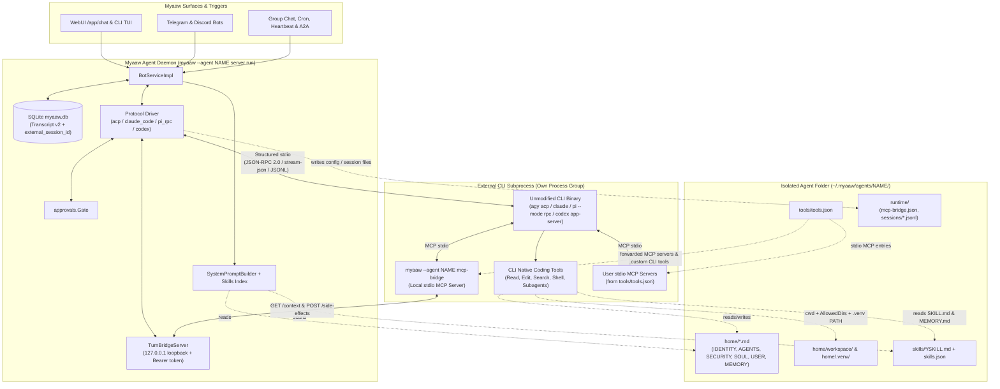
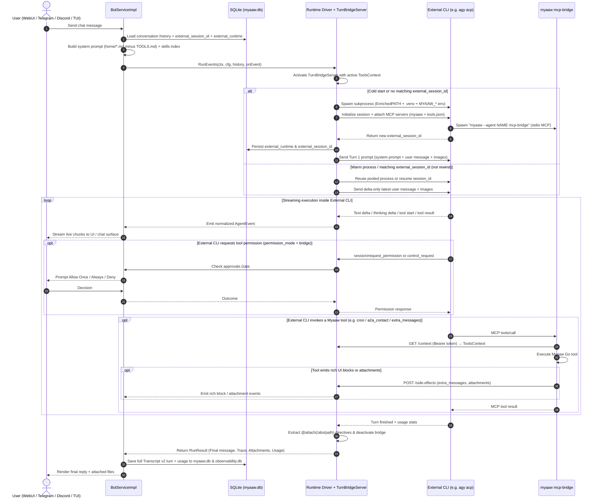
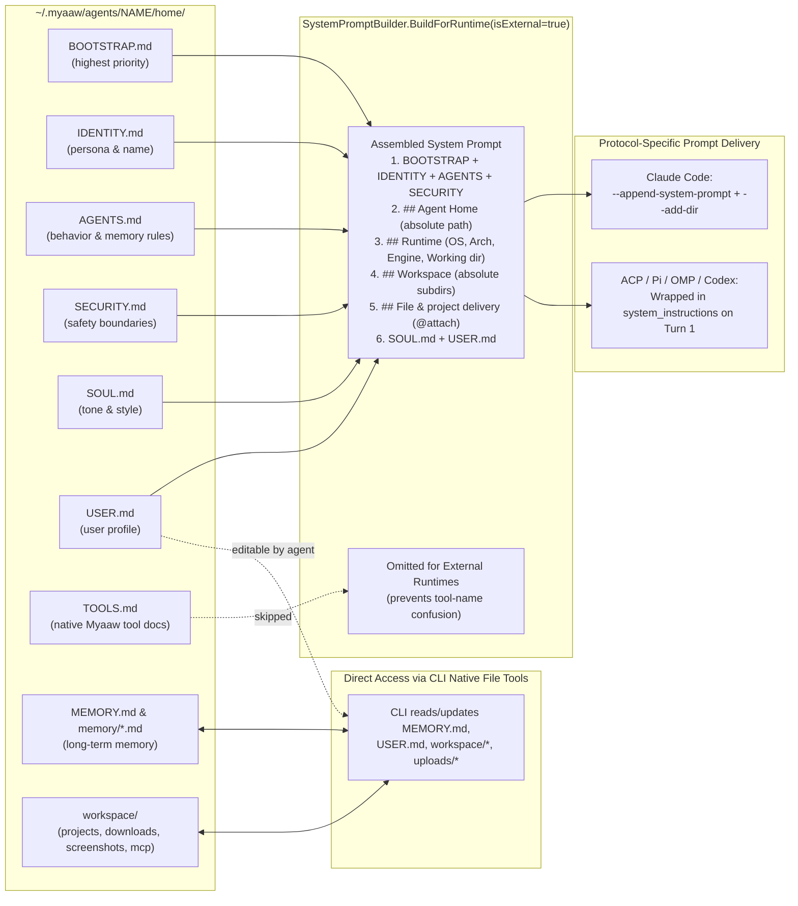
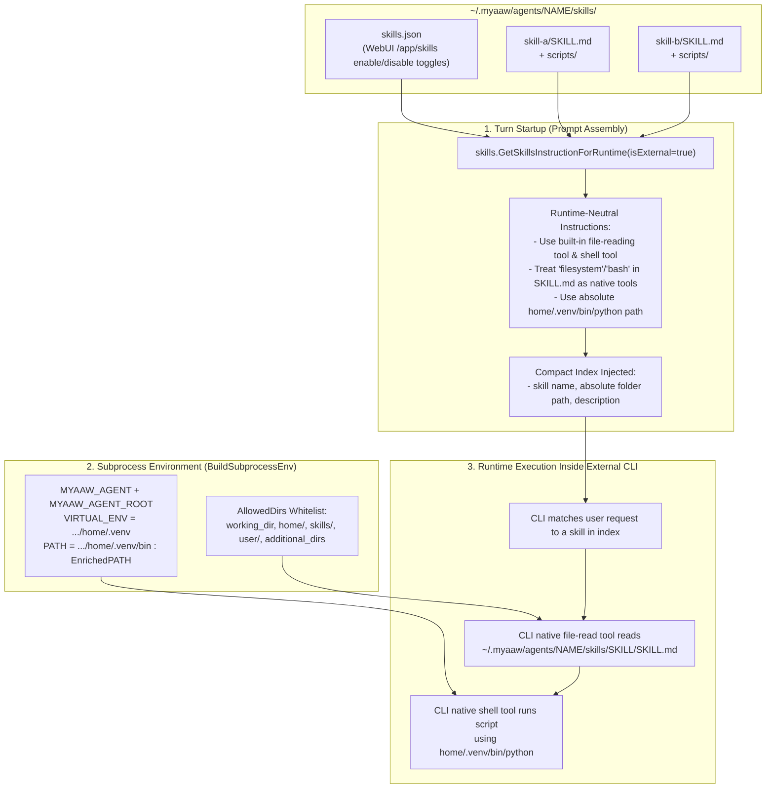
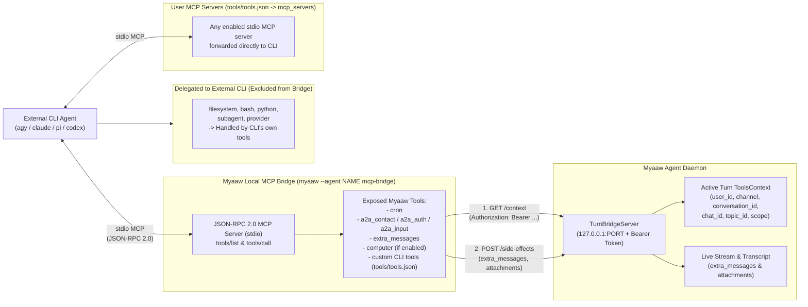
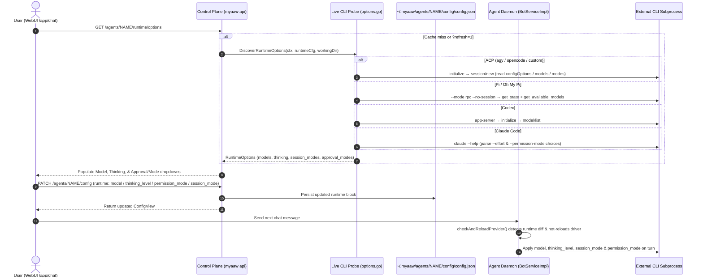

# External Agent Runtimes

Myaaw lets every isolated agent choose its own **Agent Runtime (Engine)**—either Myaaw's built-in ReAct loop (`myaaw`) or an external CLI coding agent such as **Claude Code (`claude`)**, **OpenAI Codex CLI (`codex`)**, **Google Antigravity (`agy`)**, **OpenCode (`opencode`)**, **DeepSeek Harness (`dsh`)**, **Pi (`pi`)**, **Oh My Pi (`omp`)**, or any **Agent Client Protocol (ACP)** compliant binary.

An external-runtime agent remains a first-class Myaaw agent:

- It lives in its own isolated directory at `~/.myaaw/agents/<name>/`.
- It streams text, reasoning/thinking, tool calls, tool results, and interactive approval requests straight into **Myaaw's WebUI (`/app/chat`)**, **CLI TUI (`myaaw chat`)**, **Telegram**, **Discord**, **Multi-Agent Group Chats**, **Cron/Heartbeat**, and **A2A**.
- You can freely mix native `myaaw` agents and external-runtime agents inside the same fleet and even inside the same Multi-Agent Group Chat room.

---

## 1. Native Engine vs. External Agent Runtimes

| Responsibility | `myaaw` (Built-in Engine) | External Runtime (`antigravity`, `claude_code`, `omp`, `pi`, `codex`, `acp`) |
| :--- | :--- | :--- |
| **Agent Loop & LLM Calls** | Myaaw v2 ReAct engine + `providers` in `config.json` | Unmodified external CLI binary over structured `stdio` protocol |
| **Core Coding Tools** (`filesystem`, `bash`, `python`, `subagent`) | Myaaw built-in Go tools | **External CLI's own native tools** (AST/LSP edit, search, sandbox, shell) |
| **Myaaw Ecosystem Tools** (`cron`, `a2a_contact`, `extra_messages`, `computer`, custom tools) | Direct Go registry | Automatically attached via **`myaaw mcp-bridge`** (local MCP server) |
| **Identity & Context (`home/`)** (`IDENTITY.md`, `AGENTS.md`, `SOUL.md`, `SECURITY.md`, `USER.md`) | Built by `SystemPromptBuilder` | Built by `SystemPromptBuilder.BuildForRuntime(true, ...)` (omits native `TOOLS.md` schemas) |
| **Skills (`skills/*/SKILL.md`)** | Compact index in system prompt (`skills.json` filter) | Same index with runtime-neutral tool wording, absolute `.venv/bin/python` path, and `skills/` directory access |
| **Surfaces & Transcripts** | WebUI `/app/chat`, TUI, Telegram, Discord, Groups, A2A, SQLite `myaaw.db` | **Identical** — events map onto `AgentEvent` and Transcript v2 |
| **Interactive Tool Approvals** | `approvals.Gate` | Bridged from ACP / Claude Code / Codex permission prompts into `approvals.Gate` |

---

## 2. How External Agents Work (Architecture Overview)

Instead of embedding a raw terminal (PTY) or scraping ANSI text, Myaaw treats an external CLI agent as an **execution engine behind the same `agent.AgentProvider` (`RunEvents`) contract** used by the built-in Myaaw engine.

Every surface (WebUI, CLI TUI, Telegram, Discord, Group Chat, Cron, A2A) continues talking to `BotServiceImpl` as usual. `BotServiceImpl` assembles the agent's home context and skills, hands the turn to the configured `runtime.Runtime` driver, and streams normalized `AgentEvent` chunks back out to the surface and into `myaaw.db`.



### Key Architectural Layers

1. **Daemon (`myaaw --agent <name> server run`)** — Owns HTTP/WebSocket streaming, Telegram/Discord connections, SQLite persistence (`myaaw.db`), observability traces (`observability.db`), approval gates (`approvals.json`), and per-turn `ToolsContext`.
2. **Protocol Driver (`internal/agent/runtime/`)** — Resolves the CLI binary (even under minimal `launchd`/`systemd` `PATH`), injects Myaaw environment variables, manages warm subprocess pools, translates protocol frames into `AgentEvent`, and handles clean `/stop` cancellation.
3. **External CLI Subprocess** — Runs inside its own OS process group (`Setpgid` on Unix) with `cwd` set to `runtime.working_dir` (defaulting to `~/.myaaw/agents/<name>/home/workspace`). It executes its own LLM calls and native file/shell tools directly.
4. **Local MCP Bridge (`myaaw --agent <name> mcp-bridge`)** — Spawned by the external CLI over stdio MCP whenever `runtime.mcp_bridge` is enabled, giving the external agent access to Myaaw's ecosystem tools while communicating live turn context and rich UI side-effects back to the daemon over `TurnBridgeServer`.

---

## 3. End-to-End Request & Turn Flow

When a user sends a message to an external-runtime agent, the turn moves through seven phases: **Context Assembly → Process Acquire/Resume → Prompt Dispatch → Live Streaming → Bridged Approvals & MCP Tools → `@attach` Extraction → Persistence**.



### Turn 1 vs. Turn 2+ (Delta vs. Seeded History)

`BuildTurnInput(history, resuming, rewind)` in `internal/agent/runtime/runtime.go` keeps external sessions fast and token-efficient:

- **Turn 1 (new external session):** Sends the full system prompt (`home/*.md` + enabled skills index) together with the user's message and any attached images.
- **Turn 2+ (resumed external session):** Because the external CLI already holds the prior turns in its own session state (`session/load`, `--resume`, `runtime/sessions/<conv>.jsonl`, or `thread/resume`), Myaaw sends **only the trailing new user message(s)**—avoiding duplicated prompt tokens while still recording the complete canonical Transcript v2 in `myaaw.db`.
- **Rewind / Edit / Runtime Switch:** If the user edits an earlier message (`cfg.Rewind == true`) or changes the agent from one runtime to another (for example `myaaw` → `antigravity` or `claude_code` → `pi`), Myaaw starts a **fresh external session** and prepends a compact `<previous_conversation>...</previous_conversation>` seed reconstructed from `myaaw.db` so context is never lost.

---

## 4. How External Agents Connect to Myaaw `home/*.md`

External CLIs do not natively know about Myaaw's `~/.myaaw/agents/<name>/home/` convention. Myaaw bridges the agent's identity, rules, workspace paths, and memory through **two complementary channels**:

1. **System Prompt Injection (`SystemPromptBuilder.BuildForRuntime`)** — Myaaw reads the core `.md` files from `home/` and injects them directly into the external agent's system instructions.
2. **Direct Filesystem Access (`AllowedDirs` + `MYAAW_AGENT_ROOT`)** — Myaaw exposes the absolute paths to `home/`, `home/workspace/`, `skills/`, and `user/uploads/` in the prompt, environment, and CLI directory allow-lists so the external CLI can read and update files like `MEMORY.md`, `USER.md`, and generated workspace files using its own native file tools.



### Exact File-by-File Behavior

| File in `home/` | Handled By | How the External Agent Uses It |
| :--- | :--- | :--- |
| `BOOTSTRAP.md` | Injected first in system prompt | One-time first-run onboarding instructions if present. |
| `IDENTITY.md` | Injected in system prompt | Gives the external CLI the agent's Myaaw name, role, and identity. |
| `AGENTS.md` | Injected in system prompt | Operating instructions, memory discipline, workspace conventions. |
| `SECURITY.md` | Injected right after `AGENTS.md` | Security and privacy boundaries enforced before runtime metadata. |
| `SOUL.md` & `USER.md` | Injected at the end of system prompt | Tone/personality (`SOUL.md`) and persistent facts about the user (`USER.md`). |
| `TOOLS.md` | **Skipped** when `isExternal == true` | Omitted intentionally so the external CLI does not try to call Myaaw's internal `filesystem`/`bash`/`python` function schemas. |
| `MEMORY.md` & `memory/*.md` | Direct filesystem via CLI native tools | Referenced by `AGENTS.md` and `## Agent Home` absolute path; the CLI reads/appends memory using its own file tools. |
| `workspace/` | Default `cwd` + `## Workspace` paths | Default working directory (`projects/`, `downloads/`, `screenshots/`, `mcp/`) when `runtime.working_dir` is empty. |

### `@attach(/absolute/path)` File Delivery

`BuildForRuntime` injects the exact same `## File & project delivery` contract used by native Myaaw agents. Whenever an external CLI creates a file, chart, archive, or project and writes `@attach(/absolute/path)` in its final response, Myaaw's turn accumulator extracts those directives so WebUI, Telegram, and Discord deliver the real files/attachments seamlessly.

---

## 5. How External Agents Connect to Skills (`skills/*/SKILL.md`)

Myaaw's skill system uses **progressive disclosure** (a compact index in the system prompt, with full `SKILL.md` read on demand). For external runtimes, Myaaw adapts both the **prompt wording** and the **subprocess environment** so existing Myaaw skills work out-of-the-box without editing every `SKILL.md`:



### Why Skills Work Even When `working_dir` Points to Another Repo

If you configure `runtime.working_dir` to point at an external git repository (for example `~/Development/my-app`), a skill's `SKILL.md` might still live inside `~/.myaaw/agents/<name>/skills/` and reference `.venv/bin/python`. Myaaw handles all three edge cases automatically:

1. **Tool-name translation:** `GetSkillsInstructionForRuntime(true)` tells the external CLI that any mention of `'filesystem'` or `'bash'` inside a `SKILL.md` maps to the CLI's own native file-reading and shell tools (so Antigravity uses `read_file`/`run_command`, Claude Code uses `Read`/`Bash`, Pi uses `read`/`bash`, etc.).
2. **Absolute `.venv` Python path + `PATH` prepending:** If `~/.myaaw/agents/<name>/home/.venv/bin/python` exists, Myaaw prints that exact absolute path in the `# Agent Skills` section **and** prepends `home/.venv/bin` to `PATH` (plus sets `VIRTUAL_ENV`) in the subprocess environment.
3. **Directory access:** `AllowedDirs()` always includes `home/`, `skills/`, and `user/` alongside `working_dir`, and exports `MYAAW_AGENT` and `MYAAW_AGENT_ROOT` to every subprocess.

---

## 6. How External Agents Connect to Tools & `myaaw mcp-bridge`

External coding CLIs already have deeply optimized coding tools (AST/LSP editors, ripgrep, sandboxes, subagents). Duplicating Myaaw's `filesystem`, `bash`, `python`, `subagent`, or `provider` tools would only bloat context and confuse the model.

Instead, Myaaw splits tool ownership cleanly and bridges **Myaaw-specific ecosystem tools** through a local stdio MCP server (`myaaw --agent <name> mcp-bridge`):



### How Each Piece Works

1. **Tool Filtering (`CoreCodingTools` — why `myaaw` MCP exposes 5 built-in tools by default):**
   - `internal/agent/mcpbridge/bridge.go` calls `tools.GetFactories(CoreCodingTools...)`, intentionally **excluding 5 core coding tools** (`filesystem`, `bash`, `python`, `subagent`, and `provider`) because external CLIs already provide native shell, file editing, subagents, and their own model/provider management.
   - As a result, the `myaaw` MCP server exposes **5 built-in Myaaw ecosystem tools** by default—`cron`, `extra_messages`, `a2a_contact`, `a2a_input`, and `a2a_auth_request`—plus `computer` (when Computer Use is enabled) and every enabled **Custom CLI tool** from `tools/tools.json`.
   - User-configured stdio MCP servers from `tools/tools.json` (`mcp_servers`) are attached directly to the external CLI instead of double-proxying through `mcp_*` wrappers.
   - To avoid confusing no-op switches, the WebUI (**New Agent `/app/new`**, **Plugins `/app/plugins`**, and **Tools `/app/tools`**) automatically hides those 5 delegated `CoreCodingTools` whenever an external runtime is selected, showing only the Myaaw ecosystem tools that toggling actually controls.
2. **Automatic Attachment per Driver:**
   - **ACP (`agy`, `opencode`, `custom_acp`):** Myaaw passes `mcpServers` directly in `session/new` / `session/load` containing `"myaaw"` (`myaaw --agent <name> mcp-bridge`) plus every enabled stdio server from `~/.myaaw/agents/<name>/tools/tools.json`.
   - **Claude Code (`claude`):** Myaaw writes `~/.myaaw/agents/<name>/runtime/mcp-bridge.json` (mode `0600`) in standard `{"mcpServers": {...}}` format and passes `--mcp-config <path>`.
   - **OpenAI Codex CLI (`codex`):** Myaaw appends per-process TOML override flags (`-c mcp_servers.<name>.command=...`, `args=[...]`, `env={...}`) to `codex app-server` without modifying `~/.codex/config.toml`. Codex MCP approval prompts (`mcpServer/elicitation/request`) and permission escalations (`item/permissions/requestApproval`) are bridged directly into Myaaw's `approvals.Gate`.
   - **Pi Coding Agent (`pi`):** Myaaw merges `"myaaw"` (and enabled stdio servers from `tools/tools.json`) with `"exposure": "direct"` into `<working_dir>/.pi/mcp.json` (preserving any user-defined entries) and passes `--approve` to `pi --mode rpc`.
   - **Disabling the bridge:** Set `"mcp_bridge": false` in `runtime` (or uncheck *Attach Myaaw Ecosystem MCP Bridge* in `/app/new`) if you want a pure coding agent without Myaaw ecosystem tools.
3. **Loopback `TurnBridgeServer` (`127.0.0.1:0`):** Because `myaaw mcp-bridge` runs as a child process spawned by the external CLI, it doesn't share memory with the agent daemon. Each external runtime starts a localhost-only HTTP server with a random 128-bit Bearer token (`MYAAW_BRIDGE_URL`, `MYAAW_BRIDGE_TOKEN`):
   - `GET /context` returns the active turn's `ToolsContext` (`user_id`, `channel`, `conversation_id`, `chat_id`, `topic_id`, `scope`), so tools like `cron` know which chat/channel to schedule reminders for.
   - `POST /side-effects` streams `extra_messages` (rich UI cards/blocks) and `attachments` straight into the active `RunEvents` stream.

---

## 7. Dynamic Runtime Controls (Model, Thinking Level, Tool Approvals, & Runtime Mode)

In `/app/chat`, external-runtime agents expose the same three composer controls as native Myaaw agents—**Model**, **Thinking Level**, and **Approval / Mode**—without hardcoding model lists, reasoning levels, or CLI modes anywhere in Myaaw.

Every option is discovered **dynamically at runtime** from the installed CLI binary via `GET /agents/:name/runtime/options` (cached for 60 seconds per agent, with `?refresh=1` or the refresh button in the Model picker forcing a fresh probe). Selections are saved to `config.json` via `PATCH /agents/:name/config` (`runtime.model`, `runtime.thinking_level`, `runtime.permission_mode`, `runtime.session_mode`), and `BotServiceImpl.checkAndReloadProvider()` hot-reloads the runtime automatically on the next turn without restarting the agent daemon.

### Discovery & Live Switching Flow



### Per-Driver Dynamic Discovery & Enforcement

| Runtime Driver | How Options Are Discovered (Zero Hardcoding) | How Selections Are Applied on Turns |
| :--- | :--- | :--- |
| **ACP (`agy`, `opencode`, `dsh`, `custom_acp`)** | `initialize` → `session/new` reads standard ACP `configOptions` (both flat options and grouped select options like DeepSeek Harness `DeepSeek Account`, covering `category: "model"`, `"thought_level"` / `reasoning_effort`, and `"mode"`) with fallback to `models.availableModels` and `modes.availableModes` | `session/set_config_option` on new and resumed sessions (with fallback to `session/set_model` and `session/set_mode`; resumes via `session/load` with automatic `session/resume` fallback for DeepSeek Harness) |
| **Pi & Oh My Pi (`pi`, `omp`)** | Spawns `<cmd> --mode rpc --no-session` and queries `get_state` + `get_available_models`, extracting provider groups, context window, vision, and **per-model `thinkingLevelMap`** | Passes `--model <provider/id>` and `--thinking <level>` on spawn (re-attaching the same `--session <conv>.jsonl` file so history continues seamlessly) |
| **Codex (`codex`)** | Spawns `codex app-server` and queries `initialize` → `model/list` (including `supportedReasoningEfforts` per model) | Passes `model` and `effort` in `turn/start` |
| **Claude Code (`claude`)** | Parses live `--help` output for `--effort` and `--permission-mode` choices; enables custom model ID input | Passes `--model`, `--effort`, and `--permission-mode` CLI flags |

- **Adaptive UI:** If the active runtime or chosen model does not report thinking levels (for example OpenCode models without a `thought_level` config option, or a non-reasoning Pi model), the **Thinking** dropdown hides automatically. Likewise, if a runtime does not support interactive approval prompts (`SupportsApprovals == false`, such as Pi/OMP) and reports no native session modes, the **Approval / Mode** dropdown stays hidden.
- **Custom Model Override:** All external runtimes keep **CLI Default** (clears `runtime.model`) and an inline **Custom model ID** field inside the Model menu for aliases or newly released models.

### Two-Layer Permission Control: `Tool Approvals` vs. `Runtime Mode`

When an external CLI supports both Myaaw approval bridging and its own native session modes (for example Google Antigravity `agy` or OpenCode), the Shield dropdown cleanly separates the **two layers**:

```mermaid
flowchart LR
    subgraph Layer1["Layer 1: Runtime Mode (Inside External CLI — runtime.session_mode)"]
        CLIMode["CLI Native Behavior\n- Antigravity: Default / Accept edits / Auto / Plan\n- OpenCode: build / plan\n- Claude Code: --permission-mode choices"]
        Decide{"Does CLI need\npermission to run tool?"}
    end

    subgraph Layer2["Layer 2: Tool Approvals (Inside Myaaw — runtime.permission_mode)"]
        Gate{"Myaaw Permission Mode"}
        Auto["Full Access (auto)\nImmediately allow without prompting"]
        Bridge["Approval (bridge)\nForward to Myaaw approvals.Gate\n(WebUI / Telegram / Discord / TUI)"]
        ReadOnly["Read Only (read_only)\nAllow read/list/search/grep/glob only;\ndeny edits & shell commands"]
    end

    CLIMode --> Decide
    Decide -->|"No (e.g. Plan read-only\nor Accept edits on file edit)"| RunDirect["CLI executes or skips directly"]
    Decide -->|"Yes (emits permission request)"| Gate
    Gate --> Auto
    Gate --> Bridge
    Gate --> ReadOnly
```



- **`Tool Approvals` (`runtime.permission_mode`)** controls **how Myaaw answers** whenever the external CLI sends a permission request (`session/request_permission`, `control_request`, etc.):
  - **Full Access (`auto`):** Myaaw auto-approves every tool call from the CLI with zero confirmation prompts.
  - **Approval (`bridge`):** Myaaw routes the request through `approvals.Gate` so you can click *Allow Once / Allow Session / Always / Deny* from WebUI, Telegram, Discord, or CLI TUI.
  - **Read Only (`read_only`):** Myaaw only allows inspection/read tools and rejects edits or command execution.
- **`Runtime Mode` (`runtime.session_mode`)** controls **the CLI's own internal execution mode** (populated dynamically from the CLI):
  - For example, selecting **`Plan`** on Antigravity or OpenCode puts the CLI itself into planning mode before editing code, while selecting **`Accept edits`** on Antigravity auto-accepts workspace edits and only asks before shell commands.

---

## 8. Supported Runtimes & Protocols

Myaaw drives external agents over structured machine-readable `stdio` protocols (never raw terminal ANSI scraping):

| Preset (`runtime.preset`) | Driver (`runtime.type`) | Default Command | Protocol | Bridged Approvals | Auto MCP Bridge | Session Resume |
| :--- | :--- | :--- | :--- | :---: | :---: | :--- |
| `myaaw` | `myaaw` | *(in-process)* | Native ReAct loop | Yes | *(native)* | SQLite transcript |
| `claude_code` | `claude_code` | `claude` | Bidirectional `stream-json` stdio | Yes | Yes (`--mcp-config`) | `--resume <id>` |
| `codex` | `codex` | `codex app-server` | Codex JSON-RPC 2.0 stdio | Yes | Yes (`-c mcp_servers.*`) | `thread/resume` |
| `antigravity` | `acp` | `agy acp` | ACP (JSON-RPC 2.0 stdio) | Yes | Yes (`session/new`) | `session/load` |
| `opencode` | `acp` | `opencode acp` | ACP (JSON-RPC 2.0 stdio) | Yes | Yes (`session/new`) | `session/load` |
| `deepseek_harness` | `acp` | `dsh --profile acp` | ACP (JSON-RPC 2.0 stdio) | Yes | Yes (`session/new`) | `session/resume` |
| `pi` | `pi` | `pi --mode rpc` | Pi JSONL RPC stdio | — | Yes (`.pi/mcp.json` + `--approve`) | Scoped `.jsonl` in `runtime/sessions/` |
| `omp` | `omp` | `omp --mode rpc` | Pi/OMP JSONL RPC stdio | — | — | Scoped `.jsonl` in `runtime/sessions/` |
| `custom_acp` | `acp` | *(custom)* | ACP (JSON-RPC 2.0 stdio) | Yes | Yes (`session/new`) | `session/load` |

### Background Daemon Binary Discovery (`ResolveBinary` & `EnrichedPATH`)

When Myaaw runs as a background service under macOS `launchd` or Linux `systemd`, the OS provides a minimal `PATH` (such as `/usr/bin:/bin:/usr/sbin:/sbin`) that omits user bin folders. Both `GET /runtimes`, `myaaw doctor`, and subprocess startup use `ResolveBinary()` and `EnrichedPATH()` to automatically search standard user, version-manager, and bundled desktop app paths—including `~/.local/bin`, `/opt/homebrew/bin`, `/usr/local/bin`, `~/.nvm/versions/node/*/bin`, `~/.fnm/...`, `~/.bun/bin`, `~/.volta/bin`, `~/.opencode/bin`, `~/.cargo/bin`, `~/go/bin`, and the bundled DeepSeek Harness Desktop CLI (`/Applications/DeepSeek Harness.app/Contents/Resources/runtime/cli/bin` on macOS, `%LOCALAPPDATA%\Programs\DeepSeek Harness\resources\runtime\cli\bin` on Windows, `/opt/DeepSeek Harness/resources/runtime/cli/bin` on Linux)—and pass the enriched `PATH` down to the CLI subprocess so `#!/usr/bin/env node` and Python scripts work cleanly.

---

## 9. Per-Agent Directory Layout & Isolation

Every external-runtime agent keeps the exact same isolated directory layout under `~/.myaaw/agents/<name>/`, plus a `runtime/` folder for per-agent MCP bridge config and local session files:

```text
~/.myaaw/agents/<name>/
├── config/
│   ├── config.json          # Contains the "runtime" block ("providers" optional)
│   └── approvals.json       # Approval grants (including bridged acp:*/claude:*/codex:* keys)
├── .env                     # PORT, A2A_TOKEN, MYAAW_BASE_URL
├── contacts.json            # A2A peer mesh
├── home/
│   ├── IDENTITY.md / AGENTS.md / SECURITY.md / SOUL.md / USER.md / MEMORY.md
│   ├── .venv/               # Optional per-agent Python venv (prepended to subprocess PATH)
│   └── workspace/           # Default working_dir (cwd) for the external CLI subprocess
├── skills/                  # SKILL.md folders + skills.json enable/disable filter
├── tools/                   # tools.json custom CLI tools & user MCP servers
├── runtime/                 # Per-agent MCP bridge config & local Pi/OMP session files (0700)
│   ├── mcp-bridge.json
│   └── sessions/            # Scoped <conversation-id>.jsonl files for Pi / OMP
├── user/uploads/            # Uploaded files & images
├── logs/
└── database/
    ├── myaaw.db             # Canonical v2 transcripts + external_session_id / external_runtime
    └── observability.db     # Run traces & token usage
```

- **Default isolation:** When `runtime.working_dir` is omitted, the external CLI starts inside `~/.myaaw/agents/<name>/home/workspace`.
- **Targeting a project repo:** You may point `runtime.working_dir` at an existing repository (for example `/Users/you/Development/my-repo`). Myaaw still exports `MYAAW_AGENT` and `MYAAW_AGENT_ROOT`, prepends `~/.myaaw/agents/<name>/home/.venv/bin` to `PATH` when present, and whitelists `~/.myaaw/agents/<name>/home`, `skills/`, and `user/` so skills, memory, and uploads remain accessible.

---

## 10. Session Continuity, Warm Pooling, & `/stop`

- **Dual state:** Myaaw persists `external_session_id` and `external_runtime` on each `conversations` row in `myaaw.db`. Turn 1 creates a session; subsequent turns send only the new user message(s) while still recording full Transcript v2 turns in SQLite.
- **Warm process pool:** Stateful stdio drivers (`acp`, `omp`/`pi`, `codex`) keep subprocesses warm per `conversation_id` and automatically reap idle processes after `idle_timeout_seconds` (default `900` seconds).
- **Edit / Rewind / Runtime switch:** Rewinding a message or switching an agent's runtime starts a clean external session seeded with a compact `<previous_conversation>` block from `myaaw.db`.
- **Clean `/stop` & Interrupt:** Every subprocess runs in its own OS process group (`Setpgid` on Unix; process-tree kill on Windows). Stopping a turn sends the protocol's soft-cancel (`session/cancel`, `abort`, `turn/interrupt`) first, then terminates the process group after a 2-second grace window so child commands never leak as zombies.

---

## 11. Account Safety & Provider ToS Guardrails

Myaaw is designed to avoid OAuth credential scraping and Terms-of-Service violations:

1. **Zero credential touching:** Myaaw never reads, copies, or proxies `~/.gemini`, `~/.claude`, `~/.codex`, or keychain tokens. Only the unmodified official CLI binary installed on your host runs over `stdio`.
2. **Personal CLI login (`auth_source: "cli_login"`):** Safe for **private, personal interactive use** on your own machine (matching editor integrations such as Zed or JetBrains ACP). Myaaw **blocks `bot.type: "public"`** when `auth_source` is `cli_login` and warns on high-frequency heartbeats (`< 15m`).
3. **Official API keys (`auth_source: "api_key"`):** Recommended for public bots, unattended 24/7 cron/heartbeat schedules, VPS/cloud deployments, and third-party harnesses (`omp` / `pi`).
4. **Scoped official CLI login/logout modal:** Open **Settings → External Runtimes (`/app/settings#runtimes`)** and click **Sign in** / **Manage Auth** on any installed runtime. Myaaw spawns only the allowlisted official CLI subcommand (`claude auth login`, `codex login`, `agy`, `opencode auth login`, `pi`, `omp login`) inside an isolated PTY (no arbitrary shell), auto-detecting OAuth URLs and Device Auth codes for remote/headless logins without ever touching tokens. (For ad-hoc shell troubleshooting on a remote host, **Workspace → Terminal (`/app/terminal`)** remains available when enabled with `myaaw api start --terminal`.)

---

## 12. Configuration, Quickstart, & Verification

### Example `config.json` (Antigravity ACP)
```json
{
  "runtime": {
    "preset": "antigravity",
    "type": "acp",
    "command": "agy",
    "args": ["acp"],
    "model": "gemini-4-neon",
    "thinking_level": "high",
    "session_mode": "default",
    "auth_source": "cli_login",
    "permission_mode": "bridge",
    "mcp_bridge": true,
    "idle_timeout_seconds": 900
  },
  "bot": {
    "type": "private",
    "owner_ids": ["123456789"]
  }
}
```

### CLI Headless Onboarding Examples
```bash
# Antigravity (uses ~/.myaaw/agents/coder-agy/home/workspace by default)
myaaw onboard --yes --agent coder-agy --runtime antigravity --bot-type private

# Claude Code pointing at a specific repo with bridged approvals
myaaw onboard --yes --agent claude-dev --runtime claude_code \
  --working-dir ~/Development/my-app --runtime-permission bridge

# Oh My Pi with an explicit API key
MYAAW_API_KEY=sk-... myaaw onboard --yes --agent omp-dev --runtime omp \
  --runtime-auth api_key

# Verify binary availability, working_dir, and policy compliance
myaaw --agent coder-agy doctor
```

### Dashboard Setup & Global Runtime Settings
- **Global Runtime Management (`/app/settings#runtimes`):** Open **Settings → External Runtimes** to manage all supported external CLIs (ordered from popular official vendor CLIs → open-source CLIs → Custom ACP):
  - **Official 1-click Install, Update & Desktop Downloads:** Runs only compiled-in official vendor recipes (`claude.ai/install.sh`, `@openai/codex@latest`, `antigravity.google/cli/install.sh`, `opencode.ai/install`, `@deepseek-ai/dsh@latest`, `pi.dev/install.sh`, `omp.sh/install`, plus Homebrew/npm/pnpm/Bun alternatives) with live streaming SSE output and automatic non-root `npm` handling (using the user's `nvm`/Homebrew prefix or falling back to `~/.npm-global` symlinked into `~/.local/bin`). For **DeepSeek Harness** on macOS (Apple Silicon) and Windows, the install modal also links directly to the official Desktop App download (`https://www.deepseek.com/harness/`) with a **Re-check** action that auto-detects the bundled `dsh` binary without requiring Node.js `>= 24.9` on the host.
  - **Non-intrusive Auth Status & Interactive Login/Logout:** Detects signed-in sessions (`claude auth status`, `codex login status` + model count, `agy models`, `opencode auth list` + built-in free-tier model detection, DeepSeek Harness `DeepSeek Account` ACP model detection, `pi`/`omp` RPC models) and provides a scoped interactive PTY modal for official CLI `login`/`logout` (including headless `--device-auth` / `--no-browser` modes and clickable OAuth URL / Device Code helpers).
  - **Global Defaults per Runtime:** Save default `model`, `thinking_level`, `session_mode`, `permission_mode`, `auth_source`, `mcp_bridge`, `idle_timeout_seconds`, and an optional masked write-only global `api_key` in `controlplane.db` (`runtime_defaults` table). New agents inherit these defaults automatically on onboard, and you can optionally apply saved defaults to existing agents using that runtime.
  - **Opt-out guard:** Set `MYAAW_RUNTIME_MANAGEMENT=0` when starting `myaaw api` to disable host-level CLI installation, updates, and interactive login PTYs while keeping read-only status inspection and global defaults available.
- **Create / Reconfigure Agent (`/app/new`):** Open **New Agent (`/app/new`)** in the WebUI, pick any engine from **Agent Engine / Runtime** (`GET /runtimes`), and configure authentication mode, dynamic model/thinking/runtime mode, and tool approval routing. External agents display their runtime logo badge at the top-left corner of the agent icon in the Bots sidebar and home cards while keeping the full `/app/chat` experience.

### Verifying an Active External Agent at Runtime

Subprocesses are spawned **lazily on the first chat message** and stay warm until `idle_timeout_seconds`. After sending at least one message to `<name>`:

```bash
# 1. Check runtime config, binary resolution, and policy status
myaaw --agent <name> doctor

# 2. Verify the parent -> child process hierarchy
#    (PPID of the CLI matches PID of "myaaw --agent <name> server run",
#     and for ACP/Claude the CLI itself spawns "myaaw --agent <name> mcp-bridge")
ps -eo pid,ppid,command | grep -E "<name>|agy acp|pi --mode rpc|omp --mode rpc|claude|codex"

# 3. Verify persisted external session metadata in SQLite
sqlite3 ~/.myaaw/agents/<name>/database/myaaw.db \
  "SELECT id, external_runtime, external_session_id, title FROM conversations ORDER BY updated_at DESC LIMIT 5;"

# 4. For Pi / OMP agents, inspect isolated session files
ls -la ~/.myaaw/agents/<name>/runtime/sessions/
```
