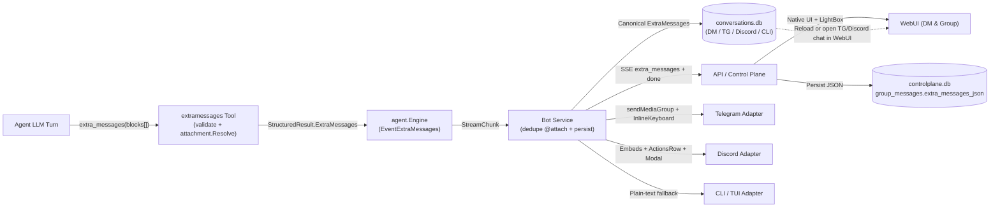
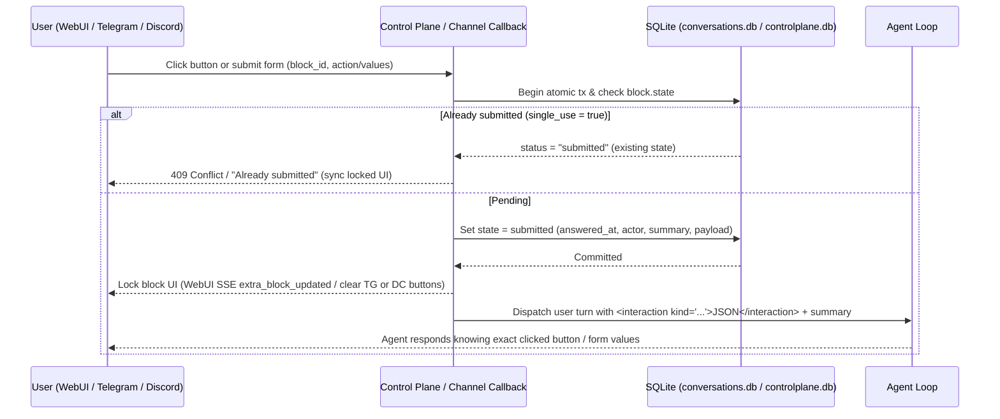

# Extra Messages (`extra_messages`)

How agents present rich display blocks and interactive UI components alongside
their answers: the `extra_messages` built-in tool, the nine block types,
interaction round-trips (`<interaction>`), atomic single-use locking,
persistence across refreshes, reuse of the `@attach(...)` pipeline, and channel
rendering behavior.

For plain file delivery directives (`@attach(/path)`), see
[Agent Attachments](attachments.md). Both features coexist and share the same
local path sandbox.

---

## 1. Overview & Tool Contract

`extra_messages` is a built-in tool registered automatically in the tool
registry (`internal/agent/tools/extramessages/`) and toggleable per agent in
`/app/tools` or `tools.json` (`builtin_tools.extra_messages`). Sub-agents
exclude `extra_messages` so background workers cannot inject unsolicited UI
cards into the user's active session.

### End-to-End Architecture



### Routing & Session Safety

The LLM **never** passes `user_id`, `chat_id`, or `conversation_id` to
`extra_messages`. The tool returns `tools.StructuredResult.ExtraMessages`, which
the agent engine binds directly to the active turn's `IncomingMessage`. As a
result, an agent cannot route cards or prompts to another user or conversation.

### Call Limits & Input Shape

```json
{
  "blocks": [
    {
      "id": "optional_stable_id",
      "type": "media | carousel | buttons | quick_replies | form | checklist | callout | summary | link_preview",
      "single_use": true,
      "data": { ... }
    }
  ]
}
```

- **Blocks per call**: 1 to 10 blocks.
- **Auto-generated IDs**: If `id` is omitted on a block, button, option, card,
  or checklist item, the tool generates a deterministic-prefix short ID
  (`em_...`, `blk_...`, `btn_...`, `opt_...`, `card_...`, `chk_...`).
- **Channel feedback**: The tool returns a compact textual confirmation to the
  model (and notes any channel degradation, such as a `form` degrading on
  Telegram).

---

## 2. Block Taxonomy: Display-Only vs. Interactive

Blocks are explicitly separated by whether user clicks send a follow-up turn to
the agent (`interactive: true`) or stay purely presentational
(`interactive: false`).

### 2.1 Display-Only Blocks (`interactive: false`)

| Type | Purpose | `data` Fields |
| :--- | :--- | :--- |
| `media` | Deliver **1–10** images, videos, audio clips, PDFs, or files in a single block (local agent paths or `http`/`https` URLs) | `layout?: "grid" \| "carousel" \| "list"`, `caption?`, `items: [{ url?, path?, kind?: "image" \| "video" \| "audio" \| "pdf" \| "file", title?, caption?, file_name?, mime_type? }]` |
| `carousel` *(link-only)* | Horizontal swipeable cards with uncropped zoomable images, badges, descriptions, and external link buttons | `cards: [{ id?, title, subtitle?, description?, image_url?, image_path?, badges?: string[], buttons?: ExtraButton[] }]` |
| `callout` | Highlighted alert/status banner | `variant?: "info" \| "success" \| "warning" \| "error"`, `title?`, `text` |
| `summary` | Structured key-value / metric report card | `title?`, `subtitle?`, `items: [{ label, value, tone?: "default" \| "positive" \| "warning" \| "danger" }]` |
| `link_preview` | Bookmark / rich link card | `url`, `title`, `description?`, `domain?`, `image_url?` |

### 2.2 Interactive Blocks (`interactive: true`)

Every interactive block starts with `state: { status: "pending" }` and defaults
to `single_use: true` (locks permanently after the first accepted submission).

| Type | Purpose | `data` Fields |
| :--- | :--- | :--- |
| `buttons` | Action buttons (and optional mixed `type: "link"` buttons) with optional confirmation modal (`confirm`) | `prompt?`, `layout?: "row" \| "stack"`, `buttons: [{ id?, label, type: "action" \| "link", value?, url?, style?: "primary" \| "secondary" \| "danger", confirm? }]` |
| `quick_replies` | Compact one-click choice chips | `prompt?`, `options: [{ id?, label, value? }]` |
| `form` | Dynamic form rendered inside the chat bubble | `id?`, `title`, `description?`, `submit_label?`, `fields: [{ name, label, type, required?, placeholder?, default?, help?, min?, max?, options?: [{ label, value }] }]` — supports 10 field types: `text`, `textarea`, `number`, `select`, `multiselect`, `checkbox`, `switch`, `date`, `time`, `radio` |
| `checklist` | Interactive checkable list + submit button | `title?`, `description?`, `submit_label?`, `items: [{ id?, label, description?, checked? }]` |
| `carousel` *(with action buttons)* | Any `carousel` containing at least one button with `type: "action"` becomes interactive and reports `{ card_id, action_id, label, value }` | Same as `carousel` above |

---

## 3. Interaction Round-Trip, Locking & Badge

Mirroring Myaaw's `<trigger kind="cron|heartbeat|subagent">` envelope, user
interactions produce a structured `<interaction>` turn:

```xml
<interaction kind="form">
{"block_id":"blk_8f2a","action_id":"booking","label":"Booking Details","values":{"date":"2026-11-25","guests":2}}
</interaction>
Booking Details: Date: 2026-11-25 · Guests: 2
```

### Round-Trip Lifecycle



1. **Atomic State Lock**:
   - **WebUI DM**: `POST /agents/:name/conversations/:id/interactions` runs
     inside an atomic SQLite transaction on the agent's `conversations.db`,
     verifying conversation ownership (`user_id`).
   - **WebUI Group**: `POST /groups/:id/interactions` updates
     `group_messages.extra_messages_json` atomically in `controlplane.db`,
     broadcasts an `extra_block_updated` SSE event to all connected tabs, and
     dispatches the `<interaction>` message with `reply_to_id` pointing to the
     originating agent's message (so the right agent answers even in `mention`
     mode).
   - **Telegram / Discord**: callback handlers verify and lock the block in
     `conversations.db` (`actor: "telegram"` / `"discord"`) via short-key lookup
     in `interaction_callbacks`, disable/update the platform buttons, and
     dispatch the `<interaction>` turn back into the same session.
2. **Double-Submit Protection (`409 Conflict`)**:
   - If a `single_use` block is already `submitted`, any duplicate click or
     concurrent tab submission is rejected with `409 Conflict` and the
     persisted `state` payload so clients immediately synchronize to the locked
     state.
3. **WebUI User Bubble Badge**:
   - The WebUI strips the `<interaction ...>...</interaction>` XML block from
     visible text and renders a dedicated pill badge (`Button`, `Quick reply`,
     `Form`, or `Checklist`) matching the visual style of `Scheduled` and
     `Sub-agent` badges, followed by the clean human-readable summary.

---

## 4. Persistence Across Refresh & Cross-Channel Sync

- **Live Streaming**: `agent.Engine` emits `EventExtraMessages` as soon as the
  tool returns → `conversation.go` emits `StreamChunk{Kind: "extra_messages"}`
  → API SSE emits `event: extra_messages` and includes `extra_messages` in
  `event: done`. Group chat streams `event: extra_messages` during live turns.
- **Authoritative Storage**:
  - **DM (`conversations.db`)**: persisted on `provider.Message.ExtraMessages`
    (presentation metadata only — stripped before LLM provider requests, just
    like `Attachments` and `Trace`).
  - **Group Chat (`controlplane.db` schema v5)**: persisted in
    `group_messages.extra_messages_json`.
- **Cross-Channel Canonical Storage**: Because Telegram, Discord, CLI, and WebUI
  all share each agent's `conversations.db`, `extra_messages` emitted during a
  Telegram or Discord chat are stored in canonical form and render natively
  with full interactive controls (and synchronized `submitted` lock state) when
  opened in the WebUI.

---

## 5. Reusing `@attach(...)` & Security Guardrails

- `@attach(...)` remains completely intact and unchanged.
- Local `path` values in `media` and `carousel.cards[].image_path` are resolved
  via `attachment.Resolve(rawPath, roots)` against the exact same allowed agent
  roots (home, user workspace, skills, jobs), blocking `../` traversal,
  symlinks escaping roots, and sensitive host files (e.g. `.env`).
- WebUI signs local paths with `ensureSigned(agent, paths)` and streams via
  `filesStore.rawUrl(agent, path)` with `LightBox` zoom and download controls.
- If a single assistant turn references the same local file via both
  `@attach(...)` and `extra_messages`, duplicate local paths are deduplicated
  automatically.
- External URLs (`url`, `image_url`, link buttons) allow only `http://` and
  `https://` schemes, and browser images render with
  `referrerpolicy="no-referrer"`.

---

## 6. Channel Compatibility Matrix

| Block | WebUI (DM & Group) | Telegram | Discord | CLI / TUI |
| :--- | :--- | :--- | :--- | :--- |
| `media` (1–10 items) | Native horizontal strip / LightBox / inline video & audio / download | Native (`sendMediaGroup` album or `sendPhoto`/`sendVideo`/`sendAudio`/`sendDocument`) | Native (batched file uploads up to 10/msg + URL embeds) | Text list of resolved paths & URLs |
| `buttons` | Native styled buttons + confirm modal + lock | Native `InlineKeyboardMarkup` (`em:<key>` callback + URL buttons) + lock | Native `ActionsRow` buttons (`em:<key>` + LinkButton) + lock | Numbered text list |
| `quick_replies` | Native pill chips + lock | Native `InlineKeyboardMarkup` row + lock | Native button row (or `SelectMenu` when >5) + lock | Numbered text list |
| `carousel` | Native swipeable cards + uncropped LightBox + buttons | Photo/album + card captions & inline buttons | Multi-`MessageEmbed` + `ActionsRow` buttons | Formatted markdown list |
| `form` | Native 10-field-type form + validation + read-only summary | Structured text prompt (no native Telegram form without Mini App) | Native Discord Modal (≤5 text/textarea/number fields via "Fill Form" button) or text fallback | Numbered prompt list |
| `checklist` | Native checkboxes + submit + locked summary | Formatted checklist (`☐`/`☑`) | Multi-select `SelectMenu` (≤25 items) or formatted text | Formatted checklist |
| `callout` & `summary` | Native styled banner / key-value card | Formatted blockquote / bold key-value text | Colored `MessageEmbed` / embed fields | Formatted text block |
| `link_preview` | Native bookmark card | URL with Telegram link preview | `MessageEmbed` with thumbnail | Title + URL |
