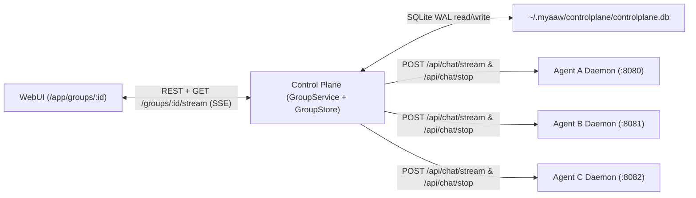
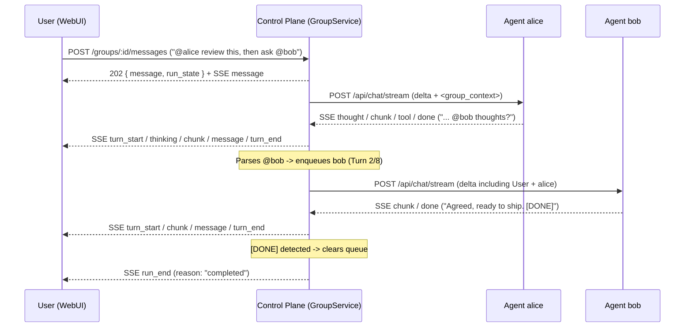

# Multi-Agent Group Chat

Group Chat lets multiple isolated Myaaw agents participate in a single shared room from the Control Plane and WebUI. You can brainstorm with several personas, review decisions across specialist agents, or let agents hand off work to one another autonomously via `@mentions` — while each agent keeps its own identity, memory, skills, tools, provider, and database.

---

## 1. Overview & Comparison

Myaaw supports three ways for multiple agents to collaborate. Choose the one that fits your task:

| Mechanism | Who orchestrates | Visibility to user | Isolation & State | Best for |
| :--- | :--- | :--- | :--- | :--- |
| **Group Chat** (`groups`) | Control Plane (`GroupService`) | Shared multi-speaker room in WebUI; every turn streams live | Each agent keeps its own process, `SOUL.md`, `MEMORY.md`, tools, and dedicated group `conversation_id`; Control Plane stores the shared transcript | Brainstorming, multi-perspective reviews, supervised autonomous discussions where you can jump in, reply to older turns, or stop/continue |
| **A2A / Contacts** (`a2a_contact` tool) | One agent calls another agent over HTTP (A2A v1.0) | Tool call inside a 1-on-1 chat | Separate processes across local or remote hosts; authenticated with `A2A_TOKEN` | Delegating a concrete subtask to a specialist agent (local or remote) without putting both in a shared room |
| **Subagents** | Parent agent spawns an internal worker run | Background trigger (`<trigger kind="subagent">`) | Same agent directory/config; isolated sub-run transcript | Splitting background work inside one agent |

---

## 2. Architecture

Group Chat preserves Myaaw's core multi-agent invariant: **one process = one isolated agent** (see [Multi-Agent Guide](multi-agent.md)). Agents do not talk directly to each other's databases or read each other's files. Instead, the **Control Plane** acts as the room hub and sequential turn orchestrator.



### Why the Control Plane is the Room Hub

1. **Zero coupling between agent daemons**: Agent daemons require no group-specific endpoints; the Control Plane speaks standard `POST /api/chat/stream` and `POST /api/chat/stop` using each agent's resolved base URL (`AgentService.BaseURL`).
2. **Unified live streaming**: Browsers open a single SSE connection (`GET /groups/:id/stream`) to the Control Plane rather than multiplexing connections to every agent port.
3. **Centralized guardrails**: Turn limits (`max_turns`), interruption, cancellation, and offline-bot skipping live in one state machine (`GroupService`).

---

## 3. Context & Memory Isolation

Each member in a group remains completely isolated on disk:

- **Own persona & memory**: Every agent still loads its own `SOUL.md`, `AGENTS.md`, `SECURITY.md`, `MEMORY.md`, skills, custom/MCP tools, workspace, and LLM provider.
- **Dedicated per-agent conversation (`scope: "group:<group_id>"`)**: Each `(group_id, agent_name)` pair stores a `conversation_id` on `GroupMember`.
  - On an agent's **first turn** in a group, the Control Plane sends `conversation_id: ""` and `scope: "group:<group_id>"` so the agent creates a scoped API conversation inside its own `~/.myaaw/agents/<name>/database/myaaw.db`.
  - Because the session is scoped under `group:<group_id>`, it is isolated from the agent's 1-on-1 DM history, sidebar previews, unread indicators, and activity counts — and any tool-call approvals requested during a group turn (including from sub-agents) route back into the group composer (one at a time) and the Group Info sidebar list rather than the individual bot DM.
  - The Control Plane captures the returned `conversation_id` from the agent's `conversation` or `done` SSE event and persists it on the member record.
  - Every **subsequent turn** reuses that `conversation_id`. If the agent ever returns `404` (for example, its database was reset), `GroupService` clears that member's `conversation_id` and `last_seen_message_id` and retries once automatically.
  - Clearing chat history (`DELETE /groups/:id/messages`) resets both `conversation_id` and `last_seen_message_id` for all members so every agent begins a clean session.

### Delta Sync via `last_seen_message_id`

Instead of re-sending the entire room transcript on every turn, `GroupService` tracks `last_seen_message_id` per member:

1. Before calling agent `X`, `GroupService` collects only the messages in the group strictly **after** `X.last_seen_message_id` (or the last 30 messages if `X` is new or history was reset).
2. On `X`'s first turn (`conversation_id == ""`), `GroupService` wraps the turn in `<group>…</group>` with a full `<group_context>…</group_context>` block (group name, topic/description, member roster, discussion mode, and concise room rules: `@mention` handoff, `[DONE]` only when no other member needs to speak, `[PASS]`, never impersonate other agents) followed by `<chats>…</chats>` containing the unseen messages.
3. On subsequent turns, `GroupService` wraps the turn in the same `<group>…</group>` envelope with a compact `<group_context>…</group_context>` header (carrying room identity and the rule never to append `[DONE]` when `@mention`ing a teammate or while other members still need to answer) followed by `<chats>…</chats>` containing only unseen delta messages labeled by speaker (`[User]`, `[<agent_name>]`, `[System]`). Whenever `X` was directly addressed (via `@mention`, replying to `X`, plain-name match, or an autonomous teammate handoff), `<group_context>` also instructs `X` to answer directly and not reply with `[PASS]`.
4. Because each agent's system prompt stays static and previous turns stay append-only in its own `conversation_id`, **provider prompt caching remains intact** (see [Agent Context](context.md#8-prompt-caching)).
5. After `X` responds (or passes with `[PASS]`), `X.last_seen_message_id` advances to the newest message so `X` never re-reads messages it has already seen.

### Reply-to-Message vs. Text-Selection Quotes

Group Chat supports two complementary ways to reference earlier content, and both are safely injected into the delta prompt:

1. **WhatsApp-style Full-Message Reply (`reply_to_id`)**:
   - Attaches a specific earlier message (user or agent) to the new message so you can bump or follow up on an older turn with new context.
   - When building the delta prompt, `GroupService` resolves `reply_to_id` against the full group transcript — **even if the original message is older than a bot's `last_seen_message_id` window** — and injects its sender and content (capped to 1,200 characters) directly above the new message:
     ```text
     [User] (replying to alice: "We should keep sessions in Redis...")
     What if we don't want Redis as an extra dependency?
     ```
   - The Control Plane also persists a `reply_preview` (`{ id, sender_type, sender_name, excerpt }`) on the `GroupMessage` so the WebUI can render a clickable quote card that scrolls back to and highlights the original message.

2. **Text-Selection Quotes (`quotes[]`)**:
   - Selecting any span of text inside an agent reply attaches one or more `AskQuote` excerpts (`answer`, `thinking`, or `tool`), using the exact same `<selections>` XML wrapper as 1-on-1 chat (`webui/src/lib/utils/ask.ts`):
     ```xml
     <selections note="Excerpts the user selected from earlier messages. Treat them as quoted context for the request that follows.">
     <selection n="1" from="answer">
     ...quoted excerpt...
     </selection>
     </selections>
     ```
   - Literal closing `</selection>` / `</selections>` tags inside quoted excerpts are escaped (`<\/selection>`) before injection so untrusted text cannot break out of the block.
   - Both features coexist cleanly: you can reply to one message while also quoting specific excerpts from another.

### Attachments (`images` and `files`)

When a user sends images (`images[]`) or documents (`files[]`) with `POST /groups/:id/messages`, uploads follow a two-layer storage flow so the room stays unified while every agent remains sandboxed:

1. **Control Plane room copy (for UI, preview & Files tab)**:
   - Decoded files and images are persisted under `~/.myaaw/controlplane/group_uploads/<group_id>/<message_id>/<stored_name>` (`0700` dir, `0600` file), and their metadata (`GroupAttachment`) is saved in `group_messages.attachments_json`.
   - Served via `GET /groups/:id/uploads/:msgId/:file` (`?download=1` forces download; path-traversal protected) and listed newest-first via `GET /groups/:id/attachments?limit=&offset=&kind=`.
   - In the WebUI, images render as zoomable thumbnails (LightBox + download) and non-image files render as clickable chips above the user's message bubble; all uploads are also browsable in the **Files** tab of `GroupInspectorPanel` with preview and **Show in chat** auto-scroll.
   - Clearing chat history (`DELETE /groups/:id/messages`) or deleting the group (`DELETE /groups/:id`) automatically removes `~/.myaaw/controlplane/group_uploads/<group_id>/`.

2. **Per-agent copy (for model vision & tool access)**:
   - `GroupService` forwards `images[]` and `files[]` to each participating agent's `POST /api/chat/stream` only on the first turn in which that agent sees the triggering user message (never re-uploaded on later bot-to-bot follow-up turns).
   - Each receiving agent daemon saves its own isolated copy under `~/.myaaw/agents/<name>/user/uploads/<conversation_id>/<message_id>/` so agents never need access to `~/.myaaw/controlplane/`.
   - For non-image files, the agent daemon automatically prepends an `<attached>…</attached>` block (between `<userinfo>…</userinfo>` and `<group>…</group>`) containing the virtual `/user/uploads/…` paths so the agent can inspect them with its `filesystem` / `bash` tools.
   - Because receiving agents store these copies in `/user/uploads/`, those files also appear under **Uploads** on each receiving agent's `/app/artifacts` page (agents that did not participate in that turn do not receive a copy).

3. **Agent-delivered `@attach(...)` files**:
   - When an agent replies with `@attach(/absolute/path)` directives, its daemon resolves them into `done` SSE `attachments` (`path`, `file_name`, `mime_type`, `kind`, `size`, `project_type`). `GroupService` persists them on the agent's `GroupMessage.Attachments` (with `agent` + `path`), and the WebUI strips the `@attach(...)` wrapper via the shared `stripAttachDirectives` helper and renders the media/files directly using the shared `RunAttachments` component (carousel, LightBox, PDF/audio/file rows, and `ProjectCard`) as well as listing them in the **Files** tab of `GroupInspectorPanel`.

---

## 4. Autonomous Discussion & Turn-Taking Flow

### Discussion Modes

| Mode | Triggered on user message | Bot-to-bot follow-up turns |
| :--- | :--- | :--- |
| `autonomous` (default) | `@all` → all members; explicit `@name` → mentioned members; reply to an agent (no `@mention`) → that agent; otherwise → all members in roster order, with any standalone plain-name matches moved to the front | **Enabled.** If a bot `@mention`s another member (or `@all`), that member is appended to the turn queue until `[DONE]` (without new mentions), `[PASS]`, no new mentions, or `max_turns` |
| `all` | `@all` or no `@mention` → all members in roster order (replied-to agent goes first if replying, else standalone plain-name matches move to the front); explicit `@name` → only mentioned members | **Disabled.** Each targeted member responds once |
| `mention` | `@all` → all members; explicit `@name` → mentioned members; reply to an agent → that agent; otherwise → no bot speaks | **Disabled.** Only explicitly addressed agents respond |

### Turn-Taking Sequence (`autonomous` mode)



### Mention Parsing & Control Signals

- **Code-aware & Markdown-friendly `@mention` parsing**: Fenced code blocks (`` ```...``` ``) and inline code spans (`` `...` ``) are stripped before matching `(?:^|[^\w.@/])@([A-Za-z0-9][A-Za-z0-9_-]*)`. This matches Markdown-wrapped or punctuated mentions such as `**@alice**`, `"@alice"`, or `—@charlie-qa`, while still ignoring email addresses (`user@domain.com`), URLs (`https://example.com/@alice`), and code decorators inside backticks. Matching is case-insensitive against the group's member list plus `@all`.
- **Plain-name prioritization**: When a user message contains neither an explicit `@mention` nor a `reply_to_id` targeting a member, `autonomous` and `all` modes scan outside code blocks/spans for standalone member names (case-insensitive word boundaries). Matched members are moved to the front of the initial queue in order of appearance and marked as directly addressed so they respond immediately rather than waiting behind earlier roster entries.
- **`[PASS]`**: If an agent replies with only `[PASS]` (or empty text), no noisy message is saved to the room transcript. The agent's `last_seen_message_id` still advances and `turn_end` is emitted with `"passed": true`.
- **`[DONE]` & `@mention` precedence**:
  - Standalone `[DONE]` markers outside code blocks (including adjacent trailing punctuation such as `[DONE].`) are stripped from persisted visible content while leaving backtick-quoted `` `[DONE]` `` intact, and `turn_end` carries `"done_signal": true`.
  - **Explicit `@mention` handoffs always override `[DONE]`**: if an agent mentions a teammate (or `@all`, excluding itself) in the same reply as `[DONE]`, the orchestrator ignores `done_signal`, enqueues the mentioned teammate(s), and marks them as directly addressed.
  - **Unspoken initial-round members are preserved**: when `[DONE]` is emitted without a handoff `@mention` (including bare `[DONE]`), the orchestrator stops further autonomous follow-ups while retaining any initial-round members in the queue who have not yet spoken in the current run (preserved across `Continue`).
- **User Interruption**: Sending a new message (`POST /groups/:id/messages`) while a run is active or paused immediately cancels the prior run context, sends a best-effort `POST /api/chat/stop` to the currently streaming agent, and starts a fresh run for the new user message.

---

## 5. Safety & Guardrails

| Guardrail | Behavior |
| :--- | :--- |
| **Authentication** | Every `/groups` and `/groups/:id/*` endpoint is registered **after** `cpMiddleware.RequireAuth(auth)` in `internal/services/controlplane/router.go`. Unauthenticated requests receive `401 Unauthorized`. |
| **`max_turns` cap** | Defaults to `8` (configurable `1`–`50` per group). When `turn_count` reaches `max_turns` with speakers still queued, the run pauses cleanly (`paused: true`, `pause_reason: "max_turns"`) and emits `run_end` (`reason: "max_turns"`). |
| **Manual `Stop` & `Continue`** | `POST /groups/:id/stop` cancels the run context, calls `POST /api/chat/stop` with the active `request_id` on the streaming agent so it stops spending LLM tokens immediately, and clears the queue. `POST /groups/:id/continue` resumes a paused run for `+N` extra turns (default `5`, clamped `1`–`20`). |
| **Self-mention & duplicate prevention** | An agent cannot `@mention` itself into an infinite loop, and an agent already waiting in the queue is not duplicated. |
| **Offline / stopped bot handling** | Before calling a queued agent, `GroupService` checks reachability. Stopped or unreachable bots emit an `error` SSE event, do not consume a turn, and are skipped cleanly (if dial fails after `turn_start`, the orchestrator rolls back `turn_count` and also emits `turn_end` with `passed: false` plus an updated `status` so clients clear the streaming placeholder immediately). If no targeted bots are online, the run terminates with `reason: "no_online_members"`. |
| **Prompt-injection / tag sanitization** | Group names, descriptions, and sender names have `<`/`>` stripped and control characters/newlines collapsed before rendering `<group_context>`. Message bodies and reply excerpts inside `<chats>` escape `</group>`, `</group_context>`, and `</chats>`, and quoted excerpts escape `</selection>` and `</selections>`. |
| **Storage & concurrency safety** | Group IDs are validated against `^[A-Za-z0-9_-]{1,64}$`. Rooms, members (`group_members` with `position`), and messages (`group_messages` with monotonic `seq`) live in the shared Control Plane SQLite database `~/.myaaw/controlplane/controlplane.db` (`0700` dir, `0600` file, `WAL`, `foreign_keys=ON` with `ON DELETE CASCADE`, `busy_timeout=5000`, `synchronous=NORMAL`, `SetMaxOpenConns(1)`). Each group's orchestrator run uses a per-group mutex and monotonic generation counter so a cancelled goroutine can never clobber a newer run. |

### Group Tool Approvals

When a member agent (or one of its sub-agents) runs with approval mode enabled (`approvals.mode = "manual"`) and calls a gated tool during a group turn, approvals stay scoped to the group instead of leaking into the agent's 1-on-1 DM:

1. **Scope propagation**: Every group turn carries `scope: "group:<group_id>"` from `GroupService` through `/api/chat/stream` into `approvals.Session`, `approvals.Request`, and `approvals.Event` (inherited automatically by sub-agents).
2. **Live SSE & refresh recovery**: `GroupService` listens for `approval_required` and `approval_resolved` events on the agent's stream, tracks them in `GroupRunState.pending_approvals` (and `GroupSummary.pending_approval_count`), and broadcasts them on `GET /groups/:id/stream`. Refreshing the browser restores all pending approvals immediately; cancelling or finishing a run clears stale entries.
3. **WebUI isolation (`approvalQueue`)**:
   - Group-scoped approvals (`scope: "group:<id>"`) are excluded from per-bot DM lists (`approvalQueue.list(agent)`), so individual bot rows in the `BOT` sidebar and 1-on-1 chat pages never display group approvals.
   - The owning group row in `BotsSidebar` shows an amber shield badge with the pending approval count.
   - Above the group composer, `PendingApprovalCard` renders **one approval at a time** (FIFO) with the requesting `@agent` pill and a `1 / N` queue counter when multiple approvals are waiting.
   - The **Members** tab of `GroupInspectorPanel` displays the complete **Pending approvals** list (with an amber count badge on the tab) so you can inspect and approve/deny any queued request directly (`Allow once`, `Allow session`, `Always`, or `Deny`), which resolves via `POST /agents/{name}/api/approvals/{id}`.

---

## 6. API & SSE Reference

All Group Chat REST endpoints (`GET/POST /groups`, `GET/PATCH/DELETE /groups/:id`, `POST/DELETE /groups/:id/messages`, `POST /groups/:id/stop`, `POST /groups/:id/continue`) and the live Server-Sent Events stream (`GET /groups/:id/stream`) are served by the Control Plane behind `RequireAuth`.

See [Control Plane API — Groups](../api/control-plane.md#23-groups) for the complete endpoint table, validation and error codes, JSON object shapes (`Group`, `GroupMember`, `GroupMessage`, `GroupRunState`), `curl` examples, and SSE event payloads.

---

## 7. WebUI Guide

### Creating & Navigating Groups
- **Bots Sidebar (`+` menu)**: Click the `+` button in the Bots sidebar (expanded or compact rail) to choose **Create group** (opens `CreateGroupDialog`) or **New agent** (`/app/new`).
- **Groups Section & Filters**: Groups appear alongside your bots in `BotsSidebar`, filtered by the same search box and filter menu (`All`, `Groups`, `Bots`, `Running`, `Unread`). Single-type filters (`Groups` / `Bots`) hide redundant section header labels so the filtered list stays clean. Each group row shows stacked member color dots, group name, last message preview (`alice: ...`, pulsing `<agent> is thinking...`, or amber `Needs approval` with a count badge when a member is waiting on tool approval), timestamp, and a `⋯` menu for opening settings or deleting the group.
- **Command Palette (`Cmd+K`)**: Jump directly to any group or launch **Create group** from anywhere in `/app`.

### Group Chat Screen (`/app/groups/[id]`)
- **Multi-agent bubbles, `@mention` pills & compact trajectory**: Each agent turn renders in a fit-to-content (`w-fit max-w-full`) bubble with its Bloub avatar (`agent_color`), agent name, timestamp, Markdown body, and compact borderless thinking/tool steps matching regular 1-on-1 chat (fit-content toggle, indented `ChatStep` rows, one-line thought summaries, and dark terminal tool blocks; live streaming steps auto-collapse once answer text begins streaming while remaining manually toggleable). Valid `@agent` and `@all` mentions are highlighted as accent-tinted inline pills across user bubbles, reply previews, and persisted/streaming agent Markdown bubbles (skipping code blocks, inline code, links, and emails while preserving `AskQuote` text-selection offsets). The transcript and borderless floating rounded composer share regular chat's `max-w-4xl` width and horizontal padding.
- **Paged transcript, upward infinite scroll & mid-turn reload replay**: Opening or refreshing a group loads the latest 50 messages (`GET /groups/:id?limit=50&offset=-1`) and snaps cleanly to the newest message at the bottom. Scrolling near the top automatically fetches older pages using the `before_id` cursor (showing a top loading spinner and preserving your exact scroll position when older messages prepend), while live SSE messages deduplicate by `id` at the bottom. If you reload while a member is mid-turn (e.g., running a long `bash` tool), `GET /groups/:id/stream` replays the active turn's buffered SSE events right after the initial `status` snapshot so the live `Working...` trajectory stays visible.
- **WhatsApp-style Full-Message Reply**:
  1. Click **Reply** on any user or agent message to attach it to `GroupReplyBar` above the composer (colored left accent border, sender name, excerpt, and `×` clear button).
  2. Type your follow-up and send — the resulting message displays a clickable `reply_preview` card inside the bubble.
  3. Click any reply card in the transcript to smoothly scroll back to and highlight the original message — if the original message is older than the currently loaded page, the page automatically loads earlier pages until it is found before jumping.
- **Text-Selection Quote (`AskQuoteList`)**:
  - Highlight any text inside an agent's answer to surface the floating **Quote / Ask** pill, adding excerpts to `AskQuoteList` above the composer.
  - Works independently of — and coexists cleanly with — full-message Reply.
- **Attachments & Voice Dictation**:
  - **Files & images**: Click the paperclip button, paste from clipboard, drag-and-drop onto the composer card, or press `Mod+Shift+F` to attach up to 6 raster images (downscaled to max 1600px edge, 10 MB each) and up to 8 documents (10 MB each, 20 MB combined upload budget). You can send attachments even when the text box is empty.
  - **Voice dictation**: Click the microphone button or press `Mod+Shift+Space` to dictate using browser Speech Recognition (respects `preferences.value.dictationLang` / locale, and stops automatically on send, `Escape`, route change, or unmount).
- **`@mention` Autocomplete**: Type `@` in the composer to open a keyboard-navigable picker (`ArrowUp`/`ArrowDown`, `Enter`/`Tab`, `Escape`) listing `@all` and every group member with Bloub avatars and live online/offline dots.
- **Live Turn Banner & Controls**:
  - While bots are active: shows `<agent> is thinking... · Turn X/Y` and a **Stop** button.
  - When paused at `max_turns`: shows a **Continue (+5 turns)** button to let the discussion proceed.
- **Right Inspector Panel (`GroupInspectorPanel`)**:
  - Toggle from the top bar button or press **`Mod+Shift+H`** (`Ctrl+Shift+H` / `Cmd+Shift+H`). On desktop it animates smoothly between `w-80` and `w-0` (`inert` when closed); on mobile it slides in as a drawer with a faded backdrop.
  - **Members tab**: pending tool approvals list (when any member or sub-agent is awaiting approval, with inline decision buttons and a tab count badge), live running/stopped indicators, inline **Start** button for stopped agents, and add/remove member controls.
  - **Files tab**: filterable (`All`, `Images`, `Documents`) list of every uploaded photo, file, and agent `@attach(...)` deliverable shared in the group (`GET /groups/:id/attachments`). Clicking an item opens the shared inline `AttachmentPreview` pane (replacing the chat column while keeping the sidebars visible so you can step through files seamlessly); clicking **Show in chat** closes the preview (and mobile drawer if open) and auto-scrolls to and highlights the originating message (loading older pages automatically if needed).
  - **Settings tab**: edit group name, topic/description, discussion mode (`autonomous` / `all` / `mention`), and `max_turns` (`1`–`50`), clear chat history, or delete the group (with confirmation).

---

## 8. Where This Lives in the Code

| Concern | Location |
| :--- | :--- |
| Shared SQLite database (`~/.myaaw/controlplane/controlplane.db`) | `internal/services/controlplane/service/cpdb.go` |
| SQLite group store (`groups`, `group_members`, `group_messages`) | `internal/services/controlplane/service/groups_store.go` |
| Group orchestrator, delta builder & SSE hub | `internal/services/controlplane/service/groups.go` |
| HTTP & SSE handlers | `internal/services/controlplane/handler/groups.go`, `internal/services/controlplane/handler/handler.go` |
| Auth-protected route registration | `internal/services/controlplane/router.go` |
| Backend unit & router tests | `internal/services/controlplane/service/groups_test.go`, `internal/services/controlplane/groups_test.go` |
| Frontend TypeScript types | `webui/src/lib/types/groups.ts`, `webui/src/lib/types/index.ts` |
| Frontend REST & SSE API client | `webui/src/lib/apis/groups.ts` |
| Svelte 5 groups store | `webui/src/lib/stores/groups.svelte.ts`, `webui/src/lib/stores/index.ts` |
| Group UI components, accents & mention pills | `webui/src/lib/components/groups/CreateGroupDialog.svelte`, `GroupInspectorPanel.svelte`, `GroupReplyBar.svelte`, `accent.ts`, `mentions.ts` |
| Sidebar `+` menu & Groups section | `webui/src/lib/components/bots/BotsSidebar.svelte` |
| Group chat page | `webui/src/routes/app/groups/[id]/+page.svelte` |
| Shell layout & `Cmd+K` commands | `webui/src/routes/app/+layout.svelte` |
| Translations (EN & ID) | `webui/src/lib/i18n/locales/en.json`, `webui/src/lib/i18n/locales/id.json` |
