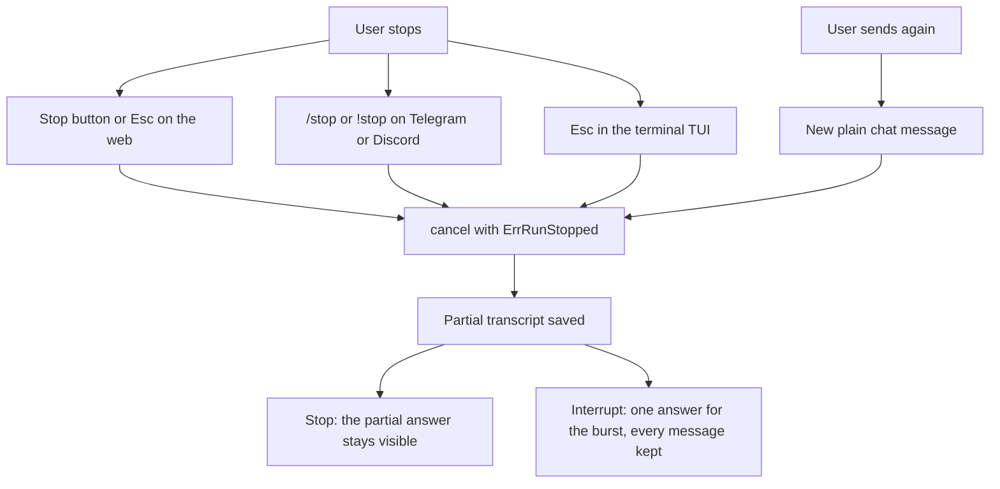
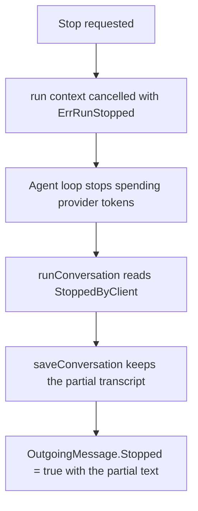
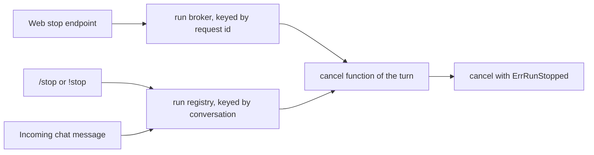
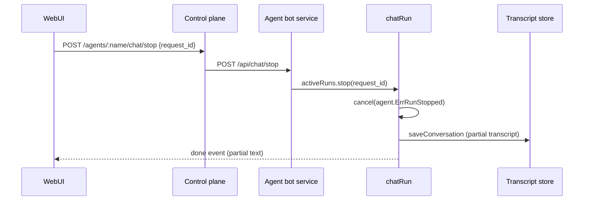
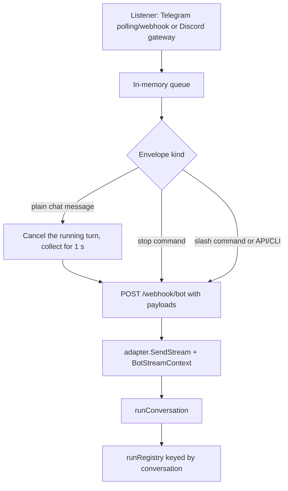
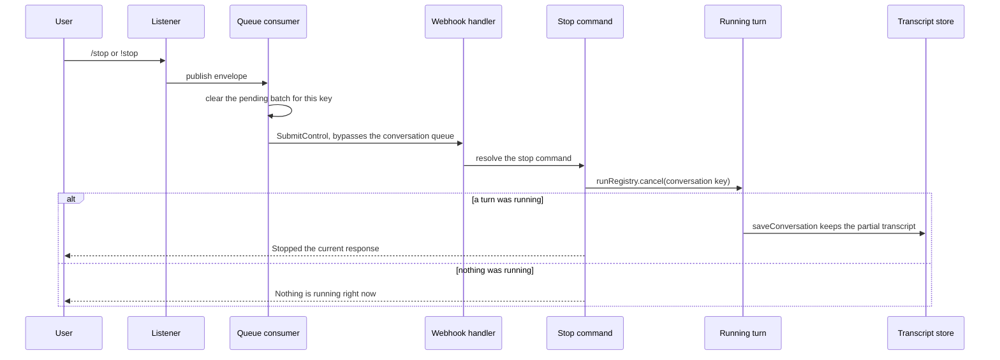
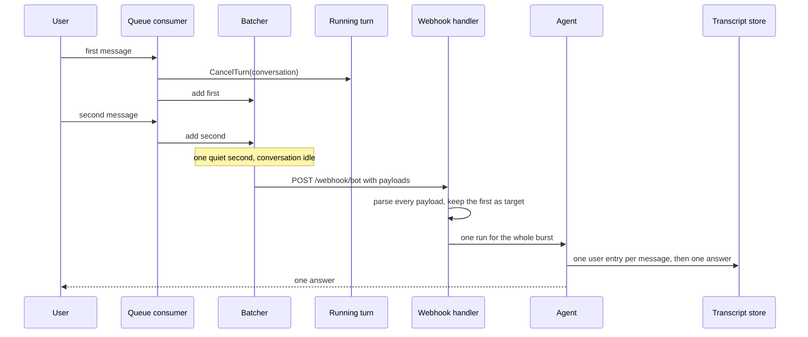
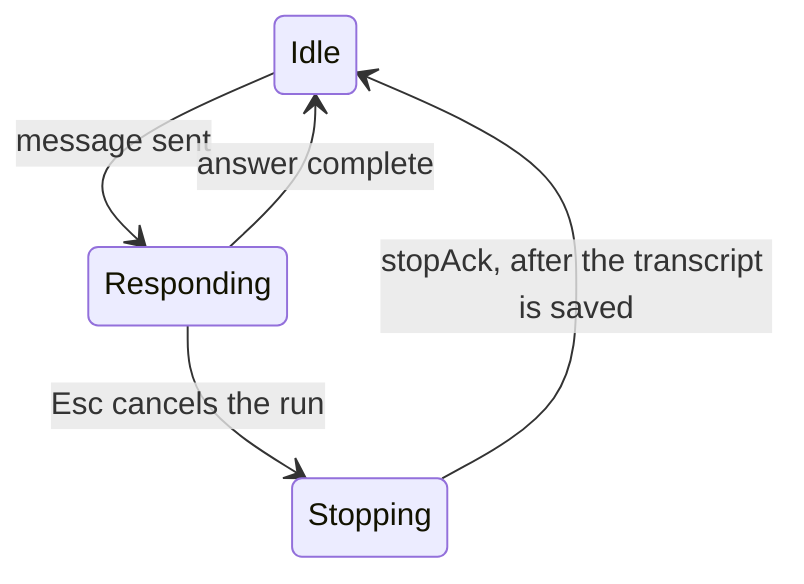

# Stopping and interrupting an agent response

How a running agent response is stopped on each surface, how a new message
replaces the response in progress without losing the messages around it, and why
the part already produced is kept.

## 1. Surfaces at a glance

| Surface | Stop the running response | Interrupt it with a new message | Partial answer |
| :--- | :--- | :--- | :--- |
| Web dashboard | Stop button, `Esc` | Depends on two composer settings (see §3.3) | Kept in the transcript |
| Telegram | `/stop` or `!stop` | Send a new plain message; a burst is answered once | Kept in the transcript |
| Discord | `!stop` (and `/stop` when the client delivers it as text) | Send a new plain message; a burst is answered once | Kept in the transcript |
| Terminal (TUI) | `Esc` | `Esc`, then send; `Enter` while responding is ignored | Kept in the transcript |
| One-shot CLI (`-m`) | `Ctrl+C` terminates the process | not applicable | **Not** saved on an abrupt kill |

The web and channel paths share the same engine: a cancelable run context, a
single stop signal, and the normal transcript-save path. The UI only decides
*when* to call the cancel function.



## 2. The shared engine

### 2.1 One stop signal

`internal/agent/stop.go` defines the only user-stop signal:

```go
var ErrRunStopped = errors.New("run stopped by client")

func StoppedByClient(ctx context.Context) bool {
    return errors.Is(context.Cause(ctx), ErrRunStopped)
}
```

A user stop is a control signal, not a failure. A plain `context.Canceled`
(server shutdown, request teardown, timeout) is a different condition and keeps
the normal error/timeout handling.



### 2.2 The turn owns a cancelable context

- **Web/API runs** (`internal/services/bot/handler/runs.go`): every run is a
  `chatRun` with `context.WithCancelCause(context.Background())`. The context is
  deliberately independent of the HTTP request, so a reload, closed tab, or
  logout does not end the answer.
- **Channel runs** (`internal/services/bot/service/runs.go`): `runConversation`
  derives `context.WithCancelCause(ctx)` from the approval context and registers
  its cancel function in `runRegistry`, keyed by `conversationLockKey(msg)`.

Both registries exist for the same reason: the stop request arrives in another
goroutine (another HTTP request, another webhook delivery), and the cancel
function is the handle that reaches the turn.



### 2.3 The partial transcript is always saved

`runConversation` (`internal/services/bot/service/conversation.go`) already
persists a turn while it runs:

1. `cfg.OnCheckpoint` saves the in-progress transcript at
   `conversationCheckpointInterval`, so tool results survive a crash or restart.
2. After the agent loop returns, `stopped := agent.StoppedByClient(ctx)` records
   whether this was a user stop.
3. Unless the turn is a silent heartbeat, `saveConversation` writes the returned
   transcript, including the partial assistant message, and publishes the turn
   event for the dashboard.
4. The returned `channel.OutgoingMessage` has `Stopped: true` and carries the
   partial text, so every surface can show what was produced before the stop.

No surface has to persist anything itself; stopping only has to call the cancel
function.

## 3. Web dashboard

The web UI talks to the control plane, which proxies to the selected agent.



### 3.1 Run broker and request ids

- `POST /api/chat/stream` calls `activeRuns.start(requestID)`. The run gets its
  own context and buffered event stream; the HTTP connection only attaches to it.
- `GET /api/chat/runs` lists attachable runs.
- `GET /api/chat/run/{id}/stream?after=N` replays missed events, which is how a
  refreshed tab catches up without restarting the answer.
- `POST /api/chat/stop` validates `request_id` and calls
  `activeRuns.stop(requestID)`.

### 3.2 What the Stop button does

`webui/src/lib/stores/chatRuns.svelte.ts` → `ChatRun.stop()`:

1. Aborts this tab's fetch first, so the UI reacts immediately even if the
   control plane is slow.
2. Marks the run finished and `finishReason = 'stopped'`.
3. Sends `chatApi.stop(agent, requestId)` so the agent itself stops spending
   provider tokens.

The dashboard's Stop button and the `Esc` shortcut both call this path. Queued
messages, if any, keep their state (see §3.3).

### 3.3 Composer behavior while a response is streaming

Two mutually exclusive preferences in Settings → Chat:

| `queueMessages` | `interruptOnSend` | What Enter/Send does while streaming |
| :---: | :---: | :--- |
| off | **on (default)** | Stops the running turn and sends the message immediately |
| on | off | Queues the message above the composer |
| off | off | The composer accepts text but sending is disabled until the turn ends |

Queue mode also provides:

- **Auto-send:** when a response that *started in this page session* finishes,
  the head of the queue is sent automatically.
- **No refresh drain:** a queue restored from storage (a reload, a menu switch,
  another chat) stays inactive until the reader sends something, so refreshing
  never sends a message behind their back.
- **Enter on an empty composer** promotes the queue head; the first row shows the
  `Enter` hint.
- **Send now** on a row interrupts the running turn and sends that row.
- The queue is stored per conversation as `myaaw_draft_queue:<agent>:<id>`, so it
  survives reloads and chat switches when "Keep drafts per chat" is on.

`interruptOnSend` is the web equivalent of a channel's interrupt-on-new-message:
the frontend stops the current run and starts the new one.

### 3.4 After a stop or reload

The partial answer stays visible in the timeline. On reload the dashboard loads
the stored transcript, so the same partial answer is shown again. A run restored
after a reload reports `resumed = true`, and its completion does not drain a
restored queue (see §3.3).

## 4. Telegram and Discord

Both chat channels use the same pipeline and the same run registry. Only the
command surface differs.

The pipeline is channel-agnostic. A future chat channel only has to implement
`channel.Adapter` and add its name to `interactiveChannels` in
`internal/channel/channel.go`; it then inherits stop commands, batched
interrupts, and partial-answer saving without touching the queue consumer or the
bot service.



### 4.1 Ordering and the dispatcher

`cmd/myaaw/dispatch.go` groups work by conversation so messages keep their order
while different conversations run in parallel. That is exactly what must be
bypassed for a stop, because otherwise the stop command would wait behind the
run it is meant to cancel.

`cmd/myaaw/consumer.go` routes each envelope three ways:

| Job | Dispatcher method | Behavior |
| :--- | :--- | :--- |
| `/stop`, `!stop` | `SubmitControl` | Runs immediately, even when every worker is busy; also clears the conversation's pending batch |
| Plain chat message | `batcher.add`, then `Submit` | Cancels the running turn and collects the message for one quiet second, so the whole burst becomes one turn |
| Slash commands, API/CLI traffic | `Submit` | Normal per-conversation ordering |

### 4.2 Stop commands

`internal/services/bot/service/command.go` adds `StopCommand`:

- `/stop` and `!stop` both work, case-insensitively (`/STOP`, `!Stop`).
- An optional `@username` suffix is stripped, so a command inserted from
  Telegram's group menu works for **any** bot name. Tagging the bot is never
  required.
- The command is resolved before `runConversation`, so it is never persisted as
  a chat turn.
- It calls `runRegistry.cancel(conversationLockKey(msg))` and replies:
  - `✅ Stopped the current response.` when a turn was running;
  - `Nothing is running right now.` when it was already idle.



`!` is only a command when the name is known. A normal message that starts with
`!` (for example `!important`) still reaches the model.

### 4.3 Interrupt with a new message

A new plain message replaces the answer in progress, and nothing the user typed is
thrown away. The burst is collected for one quiet second and then answered once,
with every message stored as its own entry in the transcript.



1. On arrival the consumer calls `service.CancelTurn(conversationKey)`. That
   cancels the turn currently answering the same chat, topic, or channel.
2. The message is appended to the conversation's batch
   (`cmd/myaaw/batch.go`) and the quiet window restarts, so a burst grows instead
   of starting several turns. Arrival order is preserved.
3. The interrupted turn sees `ErrRunStopped`, saves its partial transcript, and
   releases the conversation lock.
4. After one second without a new message, the batch is delivered as a single
   `/webhook/bot` envelope: `payloads` carries every message, oldest first.
5. The handler parses each payload with the channel adapter and keeps the first
   as the delivery target. `buildConversationMessages` appends one user entry per
   message — own id, own uploads, own caption — and the run answers the batch
   once.

`batcher.due` also holds a batch while the dispatcher is busy for that
conversation, so a flush can never queue a second answer behind a turn that is
still streaming.

What is kept, and what is not:

- **Kept:** every message as its own bubble in the transcript (the web history
  keeps them separate), every photo and document attached to the message that
  sent it, and the partial answer of the turn that was interrupted.
- **Not answered separately:** the agent sees one turn, so there is one response
  instead of one per message.
- **Dropped:** only messages that `/stop` or `!stop` clears from the pending batch
  before the window elapses.

`runConversation` also cancels a registered turn before taking the lock. That is
the backstop for direct callers; the queue consumer is what guarantees that a
question is never lost for chat platforms.

Only user turns take part:

- Cron and heartbeat turns have `TriggerType` set and are neither registered nor
  interruptible; they run to completion.
- The API and CLI paths are excluded by `channel.Interactive` and keep their own
  stop mechanisms.

### 4.4 Scope rules

Stopping and interrupting are scoped to the conversation, never the whole agent:

- Telegram DM: one user's session.
- Telegram group: chat-level session, or the specific forum topic.
- Discord DM: the user's session.
- Discord guild: the specific channel, thread, or forum post.

Any member who can talk to the bot in that scope can stop its turn, matching the
existing `/new` behavior. Restricting this to owners would be a separate policy.

### 4.5 Telegram specifics

- `/stop` and `!stop` arrive as ordinary message text.
- Telegram may append the bot username (`/stop@YourBot`) when the command is
  chosen from the group menu; the parser strips any `@name` suffix.
- A new plain message interrupts the turn already answering that chat or topic.
- Messages sent within one second of each other arrive as one turn, which is what
  makes a photo or caption spam burst readable instead of lost.
- The partial answer is sent in the same streaming message, then the new turn
  starts its own reply.

### 4.6 Discord specifics

- `!stop` is the reliable spelling: Discord's slash-command UI can capture a
  typed `/stop` instead of sending it as message text.
- No slash command is registered; commands are parsed from message content like
  Telegram.
- A new plain message in the channel or thread interrupts the running turn for
  that scope. A burst within one second is answered once, with every message and
  its attachments kept.

## 5. Terminal (CLI)

The interactive TUI (`cmd/myaaw/chat.go`) starts each run with a cancelable
context and keeps the cancel function on the model.

- `Esc` while the bot is responding cancels the run (`cancelFunc()`), appends an
  "interrupted" marker, and moves the TUI to `stateStopping`.
- `stateStopping` waits for `stopAck`, which the service sends only after
  `runConversation` has finished persisting the turn. The input unlocks after the
  ack, so a new message cannot read a transcript from before the save.
- `Ctrl+C` quits the TUI; `Enter` while responding is ignored on purpose (type
  after `Esc`).
- A normal completion that races the interrupt is reconciled by
  `completeStoppedResponse`, so the answer is not shown twice.



One-shot mode (`myaaw chat -m "..."`) has no interactive interrupt: `Ctrl+C`
terminates the process, and the partial turn is not persisted. Use the TUI when a
response must be stoppable.

## 6. Persistence details

| Layer | What is saved | When |
| :--- | :--- | :--- |
| Checkpoint | In-progress transcript with tool results | Every `conversationCheckpointInterval` during the turn |
| Final save | Full transcript with the partial assistant message | When the turn returns, including a user stop |
| Batched messages | One user entry per message, with its own uploads | With the final save of the turn that answers the burst |
| Web queue | Queued messages, per conversation | On every queue change, when "Keep drafts per chat" is on |
| Web run buffer | Replayable event stream | In memory; finished runs stay for `finishedRunTTL` |

The stored transcript is the source of truth. A stopped turn that produced
nothing visible still keeps the user message, so the conversation does not lose
the turn; a stopped turn that produced text keeps that text.

## 7. Edge cases and limits

- **Batch window.** A plain message waits up to one second for the burst to
  settle before the turn starts. That latency is what buys a single answer for a
  burst; stop commands skip the window entirely.
- **Stop before registration.** A channel turn registers its cancel function
  right after acquiring the conversation lock. A stop that arrives in the few
  milliseconds before that sees "nothing is running"; the turn then runs
  normally. This window is not reachable in normal use because a response must
  be streaming for a stop to be meaningful.
- **Triggered turns.** Cron and heartbeat turns are not interruptible by design.
- **Cross-surface stop.** A channel `/stop` only cancels channel turns of that
  scope. The web uses request ids in its own run broker; stopping one surface
  from another is not supported.
- **Discord slash commands.** `/stop` may be swallowed by Discord's command UI;
  `!stop` is the dependable form.
- **One-shot CLI.** Abrupt process termination does not save the partial turn.

## 8. Code map

| Concern | Location |
| :--- | :--- |
| Stop signal | `internal/agent/stop.go` |
| Web run broker, stop endpoint, reattach | `internal/services/bot/handler/runs.go`, `api_handler.go` |
| Control-plane proxy | `internal/services/controlplane/handler/agents.go`, `internal/services/controlplane/service/proxy.go` |
| Web UI stop and queue state | `webui/src/lib/stores/chatRuns.svelte.ts`, `webui/src/routes/app/chat/[[conversation]]/+page.svelte` |
| Web preferences | `webui/src/lib/stores/preferences.svelte.ts` |
| Channel run registry | `internal/services/bot/service/runs.go` |
| Interrupt before the lock, registration after it | `internal/services/bot/service/conversation.go` |
| Stop command and `!` rules | `internal/services/bot/service/command.go` |
| Command parser | `internal/utils/parse_command.go` |
| Interactive-channel predicate | `internal/channel/channel.go` |
| Channel dispatch routing | `cmd/myaaw/consumer.go`, `cmd/myaaw/dispatch.go` |
| Spam-burst batching | `cmd/myaaw/batch.go` |
| Batched payloads on the wire | `internal/channel/message.go` (`QueueEnvelope.Payloads`, `IncomingMessage.Batch`) |
| Batch parsing, one answer per burst | `internal/services/bot/handler/handler.go`, `internal/services/bot/service/conversation.go` |
| TUI interrupt | `cmd/myaaw/chat.go` |
| Stop replies | `internal/common/static.go` |

Tests: `internal/services/bot/service/runs_test.go`, `command_test.go`,
`interrupt_test.go`, `batch_test.go`; `internal/services/bot/handler/batch_test.go`;
`internal/utils/parse_command_test.go`; `cmd/myaaw/batch_test.go`,
`dispatch_interrupt_test.go`, `consumer_test.go`; web composer and queue behavior
in `webui/`.
