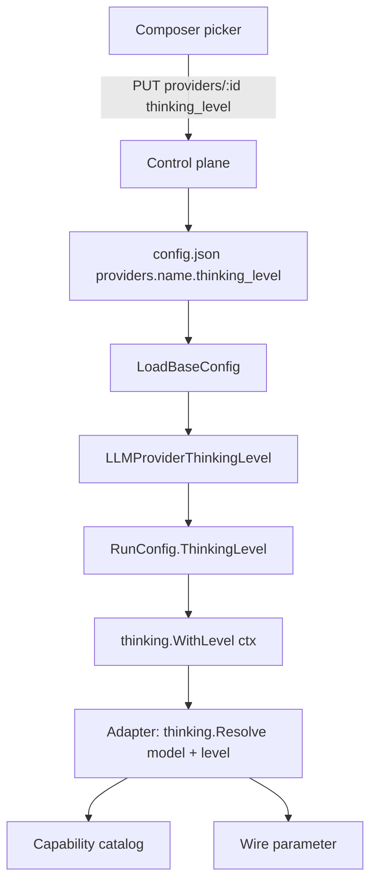

# Thinking Levels

The composer's thinking-level picker controls how much the model reasons before it
answers. The choice is stored per provider, sent with the next message, and mapped
to each provider's own reasoning parameter.

This document covers the end-to-end flow, the capability catalog it reads, and the
exact wire shape for every supported provider.

## 1. Where it lives

- **Dashboard:** the chat composer footer, between the model picker and the
  approval picker. On phones the three controls are icon-only. The **Providers**
  page exposes the same field in the create and edit forms, shown only when the
  selected model supports reasoning.
- **Config:** `providers.<name>.thinking_level` in the agent's `config.json`.
- **Runtime:** `agent.RunConfig.ThinkingLevel` → provider context → adapter.

Only the agent's **active provider** runs, so the level is persisted per provider
rather than per model. The dashboard keeps a per-`provider:model` map for the
current page load so switching models does not lose the pending choice.

## 2. The three states

| Picker state | `thinking_level` | Resolved spec | Effect |
|---|---|---|---|
| Bawaan model (default) | `""` (omitted) | `{Enabled: true, Level: ""}` | Send reasoning with no effort; the model picks (`medium` for OpenAI GPT-5.5/5.6/6, `high` for DeepSeek thinking mode) |
| Off | `off` | `{Enabled: false}` | Explicitly disable reasoning — only when the model supports it |
| A level | `low`, `medium`, `high`, `xhigh`, `max`, … | `{Enabled: true, Level: <token>}` | Send that exact effort token |

"Default" is not "off": default still reasons, it just leaves the effort to the
model. `Off`/`none` asks for no reasoning at all.

`none` is a provider effort token that some models accept as "no reasoning"
(DeepSeek lists it, `gpt-6-astra` rejects it with HTTP 400). The UI renders both
`none` and its own `off` sentinel as "Off"; the resolver normalizes both to
`Enabled: false` and each adapter spells the disable form for its API.

## 3. Flow



The runtime reloads provider config on a `config.json` change (`WatchConfig` →
`LoadBaseConfig`), and `checkAndReloadProvider` recreates the provider because the
level is part of `ProviderConfig`. A level change therefore applies to the next
message without restarting the agent.

## 4. Source of truth: the capability catalog

Thinking behavior is data-driven. The runtime reads
`~/.myaaw/config/model_capabilities.json` (with a modification-time cache) and
falls back to the embedded template when the file is missing.

Per model it uses three fields:

```json
{
  "capabilities": { "thinking": true },
  "thinking": {
    "can_disable": true,
    "effort_values": ["none", "low", "high", "max"]
  }
}
```

- `capabilities.thinking` — `true` enables the whole feature for that model.
- `thinking.effort_values` — the documented tokens the model accepts. The picker
  shows exactly these; the resolver validates against them.
- `thinking.can_disable` — whether `off`/`none` is a legal request.

**Adding a new thinking model needs no Go change:** add the catalog entry and the
picker and runtime pick it up. A brand-new API family would need one serializer
branch, but a new model within an existing family does not.

Lookup tolerates Gemini's `models/` namespace, so both `gemini-x` and
`models/gemini-x` resolve to the same entry.

`Parse`, `Load`, and `Lookup` live in `internal/capabilities`, shared by the
dashboard (`GET /models/capabilities`) and the agent runtime so there is exactly
one parser.

## 5. Resolution rules

`internal/thinking.Resolve(model, requested, legacyCapable) (Spec, bool)` is the
single decision point. `ok=false` means "send no reasoning parameters at all".

1. No catalog entry and `legacyCapable == false` → omit everything.
2. Model exists but `capabilities.thinking != true` → omit everything.
3. `requested == ""` → `{Enabled: true}` (model default effort).
4. `requested` is `off`/`none`:
   - `none` is in `effort_values`, or `can_disable` is true → `{Enabled: false}`.
   - otherwise → warn and use the model default (`{Enabled: true}`).
5. `requested` is in `effort_values` → `{Enabled: true, Level: <token>}` verbatim,
   including `xhigh` and `max`.
6. Anything else → warn and use the model default.

`Resolve` never returns an error. A non-thinking model, an unknown level, or a
model that cannot disable reasoning degrades to "no params" or "model default",
so a bad value cannot produce a 400.

## 6. Provider mapping

| Provider | Wire form | Off | Level |
|---|---|---|---|
| Gemini 3/4 | `generationConfig.thinkingConfig` | not supported (keep default) | `thinkingLevel` + `includeThoughts` |
| Gemini 2.5 Flash / Flash-Lite | `thinkingConfig.thinkingBudget` | `thinkingBudget: 0` | level mapped to a budget |
| Gemini 2.5 Pro | `thinkingConfig.thinkingBudget` | not supported (budget floor 128) | level mapped to a budget |
| OpenAI (API key) | `reasoning_effort` | `"none"` | token verbatim |
| DeepSeek (OpenAI-compatible) | `thinking.type` + `reasoning_effort` | `thinking.type: "disabled"` | `thinking.type: "enabled"` + token verbatim |
| ChatGPT Subscription | `reasoning { summary, effort }` | `effort: "none"` | `effort: <token>` with `summary: "auto"` |

### 6.1 Gemini: `thinkingLevel` vs `thinkingBudget`

Gemini has two mutually exclusive effort mechanisms. They are not interchangeable:
the 2.5 series rejects `thinkingLevel`, and sending both is a 400 on Gemini 4.

| Family | Parameter | Values | Default | Can disable? |
|---|---|---|---|---|
| Gemini 3 / 4 | `thinkingLevel` | `minimal`, `low`, `medium`, `high` (model-dependent) | model default (`medium`/`high`) | No. `minimal` is the lowest and only *likely* skips thinking |
| Gemini 2.5 Pro | `thinkingBudget` | 128–32768 | dynamic (`-1`) | No |
| Gemini 2.5 Flash | `thinkingBudget` | 0–24576 | dynamic (`-1`) | Yes, `0` |
| Gemini 2.5 Flash-Lite | `thinkingBudget` | 512–24576 | model does not think | Yes, `0` |

What the two mean:

- `thinkingLevel` is a **named tier**. The model decides how many tokens to spend,
  adaptively per request. There is no tier that guarantees zero reasoning on
  Gemini 3/4.
- `thinkingBudget` is an **exact token ceiling** for thought tokens. `0` disables
  reasoning, `-1` turns on dynamic thinking, and a number caps it. The Gemini 2.5
  series uses this instead of levels.
- `includeThoughts` is orthogonal to both: it asks the API to return thought
  summaries, not to change how much the model thinks.

Google does **not** publish a level-to-budget mapping for 2.5. The app maps the
picker's levels to fixed budgets inside each model's documented range. This is an
application choice, not an API guarantee:

| Picker | `thinkingBudget` | Notes |
|---|---|---|
| Off | `0` | Flash / Flash-Lite only |
| Minimal | `512` | Flash-Lite minimum |
| Low | `1024` | inside every 2.5 range |
| Medium | `8192` | inside every 2.5 range |
| High | `24576` (Pro: `32768`) | model maximum |
| Dynamic (stored value) | `-1` | documented dynamic mode |
| Default | omitted | model default |

Wire shapes:

```json
// Gemini 3/4, High
{
  "generationConfig": {
    "thinkingConfig": { "includeThoughts": true, "thinkingLevel": "high" }
  }
}

// Gemini 2.5, High
{
  "generationConfig": {
    "thinkingConfig": { "includeThoughts": true, "thinkingBudget": 24576 }
  }
}

// Gemini 2.5 Flash/Flash-Lite, Off
{
  "generationConfig": {
    "thinkingConfig": { "thinkingBudget": 0 }
  }
}
```

The adapter picks the mechanism from the model ID (`gemini-2.5*`). A level can
never leak into `thinkingLevel` for 2.5, and a budget is never sent for Gemini
3/4. Choosing Off on a model that cannot disable it keeps the model default.

### 6.2 OpenAI (API key, Chat Completions)

```json
{ "model": "gpt-6-astra", "reasoning_effort": "xhigh", "messages": [] }
```

`xhigh` and `max` are documented values for GPT-6/GPT-5.6 models, and the official
reasoning guide states they are valid for `reasoning.effort` (Responses) **and**
`reasoning_effort` (Chat Completions). They are passed through unchanged — never
rewritten to `high`.

### 6.3 DeepSeek (OpenAI-compatible)

```json
{ "model": "deepseek-flash", "thinking": { "type": "enabled" }, "reasoning_effort": "max" }
```

The adapter derives the variant from the endpoint host (`base_url` containing
`deepseek`); other OpenAI-compatible endpoints keep the standard shape.

### 6.4 ChatGPT Subscription (Responses API)

```json
{ "model": "gpt-6-astra", "reasoning": { "summary": "auto", "effort": "xhigh" } }
```

`chatGPTReasoningFor(ctx, model)` builds this object. When the model cannot disable
reasoning (`can_disable: false`, e.g. `gpt-6-astra`), "Off" resolves to the model
default instead of sending `effort: "none"`.

## 7. Models that do not think

A model without `capabilities.thinking: true` receives **no** reasoning field at
all: the request structs use `omitempty`, so nothing is serialized. That is the
same behavior non-reasoning models had before this feature, and it cannot fail.

Unknown levels behave the same way: the resolver logs one warning and sends the
model default.

## 8. Legacy fallback

A few aliases and retired snapshots are not in the catalog (for example
`gemini-flash-latest`, `o4-mini`, `gpt-5.2-codex`). For those, the adapters keep a
small compatibility predicate (`legacyThinkingModel`, `legacyChatGPTThinking`) that
only decides whether to include reasoning **at the model's default effort**. It
never selects a level. Models present in the catalog never consult it, and the
predicates can be deleted once those IDs are described in the catalog.

## 9. Configuration

`config.json`:

```json
{
  "default_provider": "openai",
  "providers": {
    "openai": {
      "type": "openai",
      "default_model": "gpt-6-astra",
      "thinking_level": "high"
    }
  }
}
```

Control plane:

```bash
curl -X PUT http://localhost:9000/agents/default/providers/openai \
  -H "Authorization: Bearer $TOKEN" -H 'Content-Type: application/json' \
  -d '{"thinking_level":"xhigh"}'
```

Send `""` (or omit the level from the picker) to fall back to the model default.
The provider view returns `thinking_level` so the dashboard restores the choice on
reload.

## 10. Limitations

- Persistence is per provider, not per model; the dashboard's per-model map lasts
  only for the page load.
- A level applies to the next message; a turn already streaming keeps the level it
  started with.
- DeepSeek is driven through its Chat Completions fields. Its Responses API
  (`reasoning.effort`) is not used by the OpenAI-compatible adapter.
- Groq and Ollama have no reasoning parameter here; models absent from the catalog
  are omitted.
- Catalog edits are picked up on the next request by both the dashboard and the
  agent (the runtime caches by file modification time).

## 11. File map

| File | Responsibility |
|---|---|
| `internal/capabilities/capabilities.go` | Catalog parse, load, lookup (shared with the dashboard) |
| `internal/thinking/thinking.go` | `Spec`, `Resolve`, context helpers |
| `internal/config/config.go` | `ProviderConfig.ThinkingLevel`, `LLMProviderThinkingLevel` |
| `internal/agent/config.go` | `RunConfig.ThinkingLevel` |
| `internal/agent/engine.go` | Carries the level into the provider call |
| `internal/provider/openai*.go` | `reasoning_effort`, DeepSeek `thinking.type` |
| `internal/provider/gemini.go` | `generationConfig.thinkingConfig` |
| `internal/provider/chatgpt*.go` | Responses `reasoning.effort` |
| `internal/services/controlplane` | `thinking_level` on the provider API |
| `webui/src/routes/app/chat/[[conversation]]/+page.svelte` | Picker and persistence |
