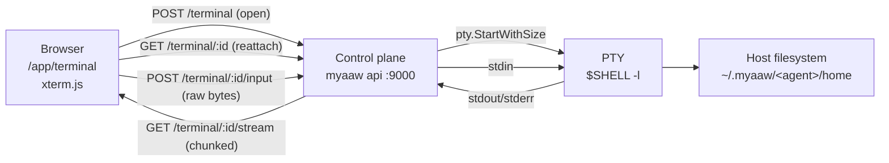

# Web Terminal

The dashboard can open a real shell on the machine that runs `myaaw api`, straight from the browser, under **Workspace → Terminal**. Think of it as SSH from your laptop to that server, except the connection is created by the control plane you are already logged into: no keys, no port forwarding, no extra daemon.

It is **off by default** and hands out full control of the host. Read [Security](#security) before enabling it.

Leaving the page, switching agents, or reloading does not kill the shell: it keeps running for a few minutes and the tab attaches to it again, so a quick jump to another dashboard page or a refresh lands you back where you were.

## Enabling and disabling

The terminal is gated by `MYAAW_TERMINAL=1`, read **once** when the control plane starts. Because `myaaw api start` and `myaaw api restart` run the API from a launchd/systemd unit that carries no environment of its own, the supported way to set it is the `--terminal` flag: it is recorded in the unit, so the daemon starts with the gate on.

| Command | Effect |
| :--- | :--- |
| `myaaw api restart --terminal` | Restart the daemon with shells enabled, and record the flag. |
| `myaaw api start --terminal` | Start a stopped daemon with shells enabled. |
| `MYAAW_TERMINAL=1 myaaw api run` | Foreground run only; nothing is remembered. |
| `myaaw api restart` | Restart without the flag, which turns the terminal off again. |

`--terminal` defaults to `false` on every invocation, so a plain `myaaw api restart` is also the way to revoke access. Exporting `MYAAW_TERMINAL` in your shell does nothing for an already-running daemon.

While the gate is off, every terminal route answers `404` and the dashboard page explains how to enable it.

## How it works

The browser never reaches the shell directly. The control plane owns the child process, pumps its output into a chunked HTTP response, and writes whatever bytes arrive at the input route back into the PTY.

Both directions are plain HTTP rather than a WebSocket upgrade: dashboards are commonly served through the SvelteKit proxy or a reverse proxy that does not forward upgrades, and a chunked response survives that hop. The stream sends each read as it happens (32 KiB chunks, flushed per chunk) and sets `X-Accel-Buffering: no` so nginx does not buffer the prompt.

### Routes

All of them live under the authenticated control plane API; see [Control Plane API §21](control-plane.md#21-terminal) for the wire format.

| Method | Path | Purpose |
| :--- | :--- | :--- |
| `GET` | `/agents/:name/terminal` | Probe: `{enabled}` |
| `POST` | `/agents/:name/terminal` | Open a shell, body `{cols, rows}` |
| `GET` | `/agents/:name/terminal/:id` | Describe a live session (the reattach probe) |
| `GET` | `/agents/:name/terminal/:id/stream` | Raw PTY output as `application/octet-stream` |
| `POST` | `/agents/:name/terminal/:id/input` | Raw request body is written to the PTY |
| `POST` | `/agents/:name/terminal/:id/resize` | `{cols, rows}` |
| `POST` | `/agents/:name/terminal/:id/heartbeat` | Refresh the idle clock |
| `DELETE` | `/agents/:name/terminal/:id` | Kill the shell (idempotent) |

## Session lifecycle

- A session is created by `POST /agents/:name/terminal` and gets a UUID that only its agent can use.
- At most **two concurrent shells per agent**. A third request answers `429`, unless a shell is detached and can yield its slot.
- **The shell outlives the page.** Navigating away, switching agents, or reloading ends the stream but leaves the PTY running for a **five minute grace window**; the tab keeps the session id in `sessionStorage` and calls `GET /agents/:name/terminal/:id` to attach to the same process again. The working directory, the running program, and anything else in that shell survive.
- The page also restores the last 500 lines of scrollback, because the browser buffer dies with the page even though the shell does not.
- **Output is not lost while away.** The server keeps the last 256 KiB the shell printed with no stream attached and replays it on the next attach, so anything a background job wrote during a reload shows up.
- **One reader at a time.** Attaching supersedes whatever stream the previous page left behind; that stale response ends instead of competing for the PTY's output.
- A **detached** shell (no stream attached) yields its slot to a new connection, oldest first, so a second tab or a fresh session is not blocked for five minutes.
- While the tab is open the page sends a **heartbeat every 30 s**. Anything untouched for **five minutes** — a crashed tab, a dropped network, a forced quit — is reaped by a background sweep.
- `DELETE /agents/:name/terminal/:id` still kills a shell immediately.
- Nothing is persisted on disk: no output, no history, no session list. Restarting the control plane ends every shell.

## Environment inside the session

| Setting | Value |
| :--- | :--- |
| Process | `$SHELL -l`, falling back to `/bin/sh` |
| Working directory | `~/.myaaw/<agent>/home`, or the agent root when that directory does not exist |
| `TERM` | `xterm-256color` |
| `MYAAW_AGENT` | the agent name from the path |

It is a login shell, so `~/.zshrc`, `~/.bashrc`, `starship`, `powerlevel10k`, `oh-my-posh`, `tmux`, and anything else in your dotfiles work exactly as they do over SSH.

The agent name only selects the starting directory. It is **not** a sandbox: `cd /` works, and so does everything the OS user can do.

## The dashboard page

`/app/terminal` mounts [xterm.js](https://xtermjs.org/) lazily, only after the probe says the gate is on.

- **Input is batched per frame.** Keystrokes are collected for 16 ms and sent as one raw `POST`, so fast typing does not become one request per character. Failures are not toasted per keystroke; the stream reports a dead session. Typing works as soon as the session exists — the page does not wait for the stream, because an idle shell has nothing to print.
- **The stream opens eagerly.** The server flushes the response headers before reading the PTY, so a quiet prompt does not leave the connection looking like it is still connecting.
- **Option is not Meta**, matching stock Terminal.app, iTerm2 and Ghostty: `⌥b` inserts `∫` and `⌥⌫` does not delete a word. Emacs-style movement (`⌥b`/`⌥f`/`⌥⌫`) needs `macOptionIsMeta: true` in the xterm options, and the same mode enabled in the terminal app you compare against; the trade-off is that Option can then no longer type accents and symbols such as `é`, `~` or `∫`.
- **Resize is debounced.** A `ResizeObserver` refits the grid after 150 ms of calm, then tells the server the new `cols`/`rows`, which resizes the kernel PTY so `vim`, `htop`, and `less` redraw correctly.
- **The theme follows the dashboard.** The ANSI palette is read from the CSS tokens, with separate light and dark palettes, so the terminal matches the rest of the UI instead of being a black rectangle.
- **The terminal font is bundled.** Prompt themes draw with Nerd Fonts Private Use Area codepoints that no system monospace font covers. Mixing fonts also breaks the grid, because a fallback icon glyph is one em wide while the cell is 0.6 em wide and its right half gets clipped. The page therefore ships JetBrains Mono Nerd Font Mono (`static/fonts/jetbrains-mono-nerd.woff2`, subset to Latin, box drawing and the icon ranges, OFL 1.1) as the single terminal font, where text and icons share the same advance width.
- **Reconnect attaches, it does not restart.** A dropped stream is not retried in a loop; the top bar keeps a Reconnect action that attaches to the same shell while it is inside its grace window and only opens a new one once the server answers `404`. Opening a shell retries a `429` a few times over about two seconds as a safety net.
- **Failures are explained.** If no session can be opened, the page shows the server's reason in a card instead of an empty pane.

## Security

The terminal is remote code execution by design. It is the same power as an SSH login as the user running `myaaw api`, so treat the control plane token as a host credential.

- **Same OS user, no sandbox.** The shell runs as the user that started `myaaw api`. Agent tool approvals, allowlists, and path restrictions apply to the *agent's tools*, not to this PTY.
- **A dashboard token is now root-equivalent** for that user: whoever holds it can read `~/.ssh`, `~/.myaaw/controlplane.json`, every agent's memory, and can start anything. Keep the gate off on any host you would not hand a shell to.
- **Keep it on loopback.** The default bind is `localhost:9000`. If you must expose the control plane, put it behind TLS and a reverse proxy that terminates HTTPS, and restrict `ALLOWED_ORIGINS` — the browser will happily attach the bearer token to a chunked stream.
- **No output is stored.** The server does not log keystrokes or terminal output. The scrollback lives in the browser tab (and in that tab's `sessionStorage`, on the same machine), never in `~/.myaaw`. There is no audit trail beyond process start/stop; use OS-level accounting if you need one.
- **Bounded blast radius.** Two shells per agent, a five minute grace window after the last heartbeat, and every shell dies with the control plane. Nothing is daemonised or written to disk.
- **Turn it off** with `myaaw api restart` (no flag) whenever you are done. The routes stay registered but answer `404`.

Platform note: this uses a Unix PTY, so it works on macOS and Linux. Windows is not supported.

## Limitations

- macOS and Linux only (no ConPTY).
- No session sharing or recording. A resumed session only reattaches from the same browser tab, and only for five minutes.
- No file upload or drag-and-drop; use the Files page for transfers.
- Restarting the control plane kills every open shell.
- The stream is one long HTTP response, so intermediaries with short idle timeouts (some load balancers default to 60 s) will cut a quiet session. Raised timeouts or a keep-alive are the fix, not a retry.

## Troubleshooting

| Symptom | Cause and fix |
| :--- | :--- |
| Page says the terminal is disabled, routes answer `404` | The daemon has no `MYAAW_TERMINAL=1`. Run `myaaw api restart --terminal`. |
| `429` when opening a second tab | Two shells per agent are being streamed right now. Detached shells give up their slot automatically, so close the other tab or wait for it to expire. |
| Prompt icons render as boxes | The symbol webfont did not load. Check that `/fonts/nerd-symbols-mono.woff2` is served by the frontend build, then hard-reload. |
| Terminal connects but never shows a prompt | The `$SHELL` on the host failed to start. Check the control plane log, and that `$SHELL` is a valid absolute path. |
| Output freezes after a minute of silence | A proxy is buffering or timing out the chunked stream. Disable response buffering upstream. |
| Everything dies at once | The control plane was rebuilt or restarted; shells do not survive it, so the page starts a new one. |

## Related

- [Control Plane API guide](control-plane.md#21-terminal) — the HTTP contract.
- [API command](../cli/api.md) — `--terminal`, `--port`, and daemon lifecycle.
- [Tool Approvals](../agents/approvals.md) — the sandbox that applies to agent tools, and not to this shell.
