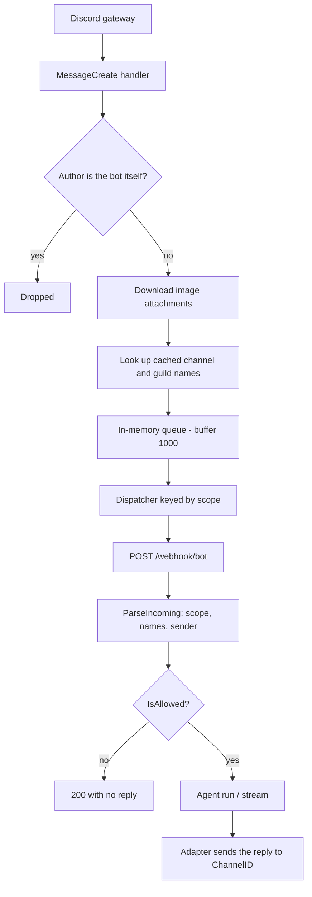

# Discord Channel

How Myaaw's Discord channel works today: message flow, the rules it applies,
per-channel sessions, display metadata, what is implemented, and what is still a
note.

---

## 1. Summary

- Channel name: `discord` (`internal/channel/discord`).
- Connection mode: **gateway listener** (no public URL, no webhook).
- Every readable message that carries content becomes **one agent run**.
- The conversation session is selected by **`scope`** (one channel = one
  session, including threads and forum posts).
- Replies go back to the originating channel through `DiscordMeta.ChannelID`.
- Server and channel names plus sender identity are stored for the dashboard.

---

## 2. Discord-side prerequisites (not application code)

### 2.1 Message Content intent

`discordgo.New` requests `IntentsAllWithoutPrivileged`, which **does not**
include `IntentMessageContent`. Without it, guild channel messages arrive with
an empty `content` while DMs still work — the bot looks half-broken. Both of the
following are required:

1. Enable **Message Content Intent** in the Discord Developer Portal under
   *Bot → Privileged Gateway Intents*.
2. Request it in code. `NewDiscordAdapter` does this:

   ```go
   session.Identify.Intents |= discordgo.IntentMessageContent
   ```

The portal toggle alone is not enough: the gateway only sends content to a
client that asks for the intent.

### 2.2 Bot permissions

Per channel the bot needs at least:

| Permission | Why |
| :--- | :--- |
| View Channels | Receive `MessageCreate` |
| Read Message History | Render context and replies |
| Send Messages | Post the answer |
| Send Messages in Threads | Reply inside threads and forum posts |
| Attach Files | Send generated images/files |

There is no privacy-mode equivalent: a bot receives every message in every
channel it can read. Discord roles are not used for access control; Myaaw's
allow-list is user-based (see §4.5).

---

## 3. Incoming message flow



Key locations:

| Stage | Location |
| :--- | :--- |
| Gateway listener and payload | `internal/channel/discord/adapter.go` |
| Scope helper | `internal/channel/discord/scope.go` |
| Approval interactions | `internal/channel/discord/approval.go` |
| In-memory queue | `internal/services/queue/repository/repository.go` |
| Dispatcher and workers | `cmd/myaaw/consumer.go` |
| User access | `internal/services/bot/service/service.go` (`IsAllowed`) |
| Agent run | `internal/services/bot/handler/handler.go`, `internal/services/bot/service/conversation.go` |
| Reply rendering | `internal/channel/discord/timeline.go` |

---

## 4. Rules

### 4.1 Messages that are processed vs dropped

| Message | Handling |
| :--- | :--- |
| Any readable message from another user | Processed |
| Message from the bot itself (including other bots' webhooks) | **Dropped** |
| Message with images attached | Processed; images are downloaded |
| Approval button interaction | Resolved inline, never enqueued |

Discord does not have Telegram's update filter yet, so non-default message types
(system messages such as joins or pinned notices) still reach the queue even
when they carry no text or images. They normally produce an empty run or a
"blank message" answer. See §7.

### 4.2 Supported content

| Content | Handling |
| :--- | :--- |
| Text | Sent as the user message |
| Image attachments | Downloaded and sent as base64 |
| Other attachments | Ignored |
| Embeds / link previews | Not read |
| Voice messages, stickers, polls | Not supported |

### 4.3 Commands

Discord has no slash-command registration; commands are parsed from the message
text exactly like Telegram, through `utils.ParseCommand` and
`CommandExecutor`:

| Command | Action |
| :--- | :--- |
| `/start`, `/menu`, `/help` | Greeting plus command list |
| `/about` | Project information |
| `/me` | User and config information |
| `/new` | Start a new session **for the current channel** |
| anything else | "Command not found" |

Because `/new` receives `msg.Scope`, it only rotates the session of the channel
where it was typed. DMs keep the legacy per-user rotation.

### 4.4 Scope and sessions

Channel ids are globally unique snowflakes, so the guild is not part of the
scope.

| Context | `scope` |
| :--- | :--- |
| Direct message (`m.GuildID == ""`) | `""` (legacy per-user session) |
| Guild text channel (`#general`) | `dc:<channelID>` |
| Thread | `dc:<threadChannelID>` (threads are channels) |
| Forum post | `dc:<postChannelID>` |
| Announcement / stage text chat | `dc:<channelID>` |
| Old payload without `chat.type` | `""` (rolling-upgrade safety) |

Session invariants:

- `conversations.id` stays a UUID; `scope` is only a selector, not an identity.
- A scope has **at most one active session** (unique index); older generations
  remain as history with `active = 0`.
- A channel session is **shared** by everyone in that channel.
- The `user_id` on a conversation row is the row's creator, not an access
  boundary; access checks use the scope for scoped rows.
- Multiple servers with the same channel name never collide, because the scope
  uses the channel id.

### 4.5 Ordering and concurrency

- In-memory queue buffer: **1000** messages.
- Workers: `bot.queue_workers`, default **4**, maximum **16**.
- Queue key: `scope:dc:<channelID>` for guild channels, threads, and forum
  posts; `user:<id>` for DMs and legacy payloads.

Messages in one channel are processed in order; different channels run in
parallel. A DM and a channel from the same user never serialize each other.

Access is decided by `IsAllowed(userID)`:

| `bot.type` | Behaviour |
| :--- | :--- |
| `public` (default) | Every user is allowed |
| `private` | Only user ids listed in `owner_ids` |

### 4.6 Replies and routing

- Outbound calls use `DiscordMeta.ChannelID`, which is the same id used for the
  scope, so a reply always lands in the channel that produced the message.
- There is no `message_thread_id` equivalent: a thread id *is* a channel id.
- Attachments and images are sent to the same channel.

### 4.7 Display names and sender identity

| Data | Source | Stored in |
| :--- | :--- | :--- |
| Server name | `State.Guild(m.GuildID).Name` | `chat_scopes.chat_name` |
| Channel name | `State.Channel(m.ChannelID).Name` | `chat_scopes.topic_name` |
| Sender id | `discord_author.id` | `messages[].sender_id` |
| Sender name | `global_name`, then username | `messages[].sender_name` |
| Sender username | `discord_author.username` | `messages[].sender_username` |

- Names are keyed by `scope`, so they survive `/new` rotations.
- Lookups are **best-effort**. A thread may not be cached in the gateway state,
  so the channel name can be empty; the session and the reply still work.
- An empty name never overwrites a stored one, so a failed lookup cannot erase a
  name that was already learned.
- Renames are picked up on the next message in that channel.
- DMs store no server/channel name at all.
- Sender fields stay dashboard-only in the transcript. The agent learns the
  speaker, the room, and the time from the `<userinfo>` block prepended to each
  user message. See [Agent Context](../agents/context.md).
- The system prompt no longer carries `User ID`, `Channel Platform`, or the
  clock, so provider prefix caching can reuse the conversation history.
- The sender name also becomes the dashboard display name for a user whose
  record is created by an incoming Discord message.

### 4.8 Upgrading an existing database

No schema change was needed: `conversations.scope` and `chat_scopes` already
exist from the Telegram work. Discord-specific behaviour:

- Existing Discord conversations keep `scope = ''` and stay on the legacy
  per-user path.
- The first message in a channel creates a new scoped session; old history is
  left untouched.
- Channel/server names cannot be backfilled for old conversations, because the
  names were never captured.
- Old payloads in the queue (no `chat.type`) fall back to the per-user key, so a
  rolling upgrade cannot break ordering.

---

## 5. Implemented

- [x] Gateway listener with reconnect and backoff.
- [x] `IntentMessageContent` requested in code.
- [x] Image attachments downloaded as base64.
- [x] Per-channel sessions keyed by `dc:<channelID>`, covering channels,
      threads, and forum posts.
- [x] DMs keep the legacy per-user session.
- [x] Scope-keyed queue ordering.
- [x] `/new` rotates only the current channel.
- [x] Server and channel names captured from the gateway state and stored in
      `chat_scopes`.
- [x] Sender id, display name, and username stored per channel message.
- [x] Control plane exposes `scope`, `chat_name`, and `topic_name`; the
      dashboard renders `Server › #channel`.
- [x] Streaming timeline, inline approval buttons, and attachment sending.

Related tests live in `internal/channel/discord/*_test.go`
(`scope_test.go`, `adapter_test.go`) and `cmd/myaaw/dispatch_test.go`.

---

## 6. Dashboard labels

The conversation list renders the scope stored on each session:

| Data available | Badge |
| :--- | :--- |
| Server and channel name | `Server › #channel` |
| Channel name only | `Discord › #channel` |
| Neither name | `Discord` |

- The badge uses the Discord glyph; Telegram scopes keep the paper-plane icon.
- The badge sits on its own line, with the date and message count underneath.
- Sender labels (`Name · @username · #id`) appear above channel user bubbles
  automatically once `sender_*` is stored.
- DMs, CLI, and API sessions show no badge and no sender label.
- `is_forum` is always `0` for Discord, so there is no `General` suffix: a
  channel-level scope simply has no channel name.

---

## 7. Not implemented / still notes

- **Mention-only reply mode** does not exist. The bot answers every readable
  message in every channel it can see, which is expensive in busy servers.
- **No content filter.** Unlike Telegram, Discord has no "carries content"
  guard: system messages and empty messages still become runs, and can produce a
  blank-prompt answer.
- **No emoji, reaction, or button-based commands.** Only text commands.
- **Voice channel audio** is not handled; voice channels are not text channels.
- **Non-image attachments** (PDF, zip, audio) are ignored rather than forwarded
  to the model.
- **Slash commands** are not registered with Discord; they would need an
  application command setup and an interaction handler.
- **No per-channel rate limit, concurrency cap, or debounce.**
- **No replay after downtime.** The gateway session can only be resumed while
  the process is alive; messages sent while the agent was down are lost. This is
  a Discord-side limitation, not a bug.
- **Thread caching.** `State.Channel` can miss a thread, so the channel name may
  be empty until Discord sends a channel update. The badge then falls back to
  `Discord`.
- **Control-plane `Get`/`Delete`** still checks `user_id`, so a shared channel
  session can only be opened by the member who created its row; others get 403.
- **Concurrent dashboard and Discord writes** can race (last write wins); there
  is no per-conversation lock yet.

---

## 8. Verifying the database

Database per agent: `<agent home>/database/myaaw.db`
(for example `~/.myaaw/default/database/myaaw.db`).

Inspect Discord sessions per channel:

```sh
sqlite3 -header -column "file:$HOME/.myaaw/default/database/myaaw.db?mode=ro" \
"SELECT substr(id,1,8) AS id, scope, active,
        json_array_length(messages) AS messages,
        datetime(updated_at,'localtime') AS updated
 FROM conversations
 WHERE scope LIKE 'dc:%'
 ORDER BY scope;"
```

Inspect the learned server/channel names:

```sh
sqlite3 -header -column "file:$HOME/.myaaw/default/database/myaaw.db?mode=ro" \
"SELECT scope, chat_name, topic_name, datetime(updated_at,'localtime') AS updated
 FROM chat_scopes WHERE scope LIKE 'dc:%' ORDER BY scope;"
```

Inspect the transcript of one session:

```sh
sqlite3 -header -column "file:$HOME/.myaaw/default/database/myaaw.db?mode=ro" \
"SELECT j.key AS idx, json_extract(j.value,'\$.role') AS role,
        substr(replace(json_extract(j.value,'\$.content'),char(10),' '),1,60) AS content,
        json_extract(j.value,'\$.sender_name') AS sender,
        json_extract(j.value,'\$.sender_id') AS sender_id
 FROM conversations c, json_each(c.messages) j
 WHERE c.scope = 'dc:<channelID>'
 ORDER BY j.key;"
```

---

## 9. Troubleshooting

| Symptom | Check |
| :--- | :--- |
| Bot is in the channel but only answers in DMs | Message Content intent is missing. Enable it in the Developer Portal **and** make sure the running build requests `IntentMessageContent`; restart the agent. |
| Bot says the message is empty in a channel | Same as above: the gateway delivered no `content`. |
| Bot is silent everywhere | Wrong token, or the bot cannot view the channel. Check the agent log for the gateway start line and `MessageCreate` entries. |
| Replies land in the wrong channel | `DiscordMeta.ChannelID` must equal the incoming `chat.id`; verify the running build. |
| Every channel shares one session | The running build predates scoping, or payloads have no `chat.type` (old queued messages). Send a new message and check `scope` in the DB. |
| Sessions get mixed per user | Check that `scope` is `dc:<channelID>` for channel messages and `''` for DMs. |
| `/new` resets another channel | Only `/new` in the same scope should rotate rows; verify the `scope` column and the unique index exist. |
| Badge says `Discord` instead of `Server › #channel` | The names were never seen. Send a message in that channel; `chat_scopes` is written per message. A thread may stay unnamed until Discord caches it. |
| Sender label missing in the dashboard | Messages stored before the sender fields existed have none; only new channel messages carry `sender_id`. |
| No answer in a thread | The bot needs **Send Messages in Threads** and Read Message History in the parent channel. |
| A DM reminder/cron never arrives, log says `Invalid Recipient(s)` (50033) | The job's `to` is the DM **channel id**. Use the recipient's user id, or let the `cron` tool default it; the adapter now falls back to a confirmed DM channel id. See [Cron & Heartbeat](../agents/cron-heartbeat.md). |
| Images are missing | The attachment's `Content-Type` must be an image; other files are ignored. Check the download error in the log. |
