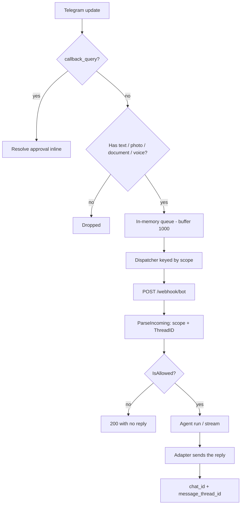

# Telegram Channel

How Myaaw's Telegram channel works today: message flow, the rules it applies,
what is already implemented, and what is still a note.

---

## 1. Summary

- Channel name: `telegram` (`internal/channel/telegram`).
- Connection mode: **polling** (default) or **webhook** (`channels.telegram.mode`).
- Every update that carries content becomes **one agent run**.
- The conversation session is selected by **`scope`** (one topic = one session).
- Replies go back to the originating chat/topic through `message_thread_id`.

---

## 2. Telegram-side prerequisites (not application code)

A bot only receives ordinary group messages when one of these is true:

| Condition | Messages received |
| :--- | :--- |
| Bot is a group **admin** | Every message in that group |
| **Privacy mode** disabled (`/setprivacy` → Disable, then re-add the bot) | Every message in every group |
| Privacy mode enabled (default) | Only commands, `@bot` mentions, replies to the bot, and **service messages** |

Without one of those, a plain `Hi` in a group/topic **never reaches** Myaaw.
That is a Telegram-side behaviour, not an application bug.

---

## 3. Connection modes

| Mode | Behaviour |
| :--- | :--- |
| `polling` (default) | Calls `deleteWebhook` on startup, then `getUpdates` (`offset` + `timeout=30`). The offset is persisted in `<agent>/database/telegram_offset`. |
| `webhook` | Calls `setWebhook` for `https://<base>/webhook/telegram`; that handler enqueues directly. |

Do not use both modes with the same bot token at the same time.

---

## 4. Incoming message flow



Key locations:

| Stage | Location |
| :--- | :--- |
| Approval / update filtering | `internal/channel/telegram/polling.go`, `internal/services/queue/handler/handler.go` |
| In-memory queue | `internal/services/queue/repository/repository.go` |
| Dispatcher and workers | `cmd/myaaw/consumer.go` |
| Payload parsing | `internal/channel/telegram/adapter.go` |
| User access | `internal/services/bot/service/service.go` (`IsAllowed`) |
| Agent run | `internal/services/bot/handler/handler.go`, `internal/services/bot/service/conversation.go` |
| Reply rendering | `internal/channel/telegram/timeline.go` |

---

## 5. Rules

### 5.1 Updates that are processed vs dropped

| Update | Handling |
| :--- | :--- |
| `message` with `text` / `photo` / `document` / `voice` | Processed |
| `callback_query` (approval) | Resolved inline, never enqueued |
| Service messages (`forum_topic_created`, `new_chat_members`, `new_chat_title`, `pinned_message`, …) | **Dropped** |
| `my_chat_member`, `edited_message`, `message_reaction` | **Dropped** |

Rule: only updates that carry content may reach the LLM. This is what prevents
the bot from answering an empty prompt (the old *"Masih kosong…"* symptom).

### 5.2 Supported content

| Content | Handling |
| :--- | :--- |
| Text | Sent as the user message |
| Voice | Transcribed first (provider transcriber) |
| Photo | The **largest** photo is downloaded and sent as base64 |
| Document | Downloaded and forwarded to the model as base64 (it shares the photo/image path, whatever the MIME type) |
| Caption | Becomes the message text |

Stickers, video, audio, location, contact, and polls are **not** supported yet
(see §7).

### 5.3 Commands

| Command | Action |
| :--- | :--- |
| `/start`, `/menu`, `/help` | Greeting plus command list |
| `/about` | Project information |
| `/me` | User and config information |
| `/new` | Start a new session (per topic in groups; per user elsewhere) |
| anything else | "Command not found" |

The `@username` suffix is stripped, so `/start@MyaawBot` still works.

### 5.4 Scope and sessions

`scope` decides which session is used:

| Context | `thread_id` | `scope` |
| :--- | :--- | :--- |
| Direct message | - | `""` (per user) |
| Group without topics | 0 | `tg:<chatID>` |
| Forum General | 0 or 1 | `tg:<chatID>` |
| Topic (anything else) | ≥ 2 | `tg:<chatID>:<threadID>` |

Why threads `0` and `1` share a scope: the General topic sometimes arrives with
`message_thread_id = 1` and sometimes without it (chat-level service messages).
Merging both prevents a session from splitting mid-conversation and keeps a
group's history when Topics are enabled or disabled later. A group without
topics maps to the same chat-level scope, which is why the badge shows only the
group name (see §5.10).

Session invariants:

- `conversations.id` stays a UUID; `scope` is only a selector, not an identity.
- A scope has **at most one active session** (enforced by a unique index);
  older generations remain as history with `active = 0`.
- Topic sessions are **shared** by every member of that topic.
- The `user_id` on a conversation row is the row's creator (for the dashboard),
  not an access boundary; access checks use the scope for scoped rows.
- The raw `message_thread_id` is still echoed to the Bot API; only the session
  key is normalised.

`/new` details:

- In a group/topic it deactivates the scope's current row and inserts a fresh
  one (`CreateConversationInScope`). Every member may run it today.
- Because any member may run it, one topic can accumulate generations with
  different `user_id` values, so the dashboard history for that topic may appear
  split across users. This can later be restricted to owners via `OwnerIDs`.
- Outside groups (DM/CLI/API) `/new` keeps the legacy per-user behaviour and only
  rotates rows with `scope = ''`.

### 5.5 Ordering and concurrency

- In-memory queue buffer: **1000** messages.
- Workers: `bot.queue_workers`, default **4**, maximum **16**.
- Queue key: `scope:tg:<chat>[:<thread>]` for groups, `user:<id>` for DMs.
  Messages in one topic are processed in order; different topics run in parallel.
- One run may take up to `bot.run_timeout_seconds` (default 900s), holding a
  worker slot for that long.

### 5.6 Replies and topic routing

- Every outbound payload carries `message_thread_id` (except thread 0).
- The first message of a turn replies to the user's message.
- The typing indicator (`sendChatAction`) also carries the thread.
- Error replies (`SendError`) and approval prompts land in the same topic.
- Telegram's message limit is 4096 characters; text is split at ~3800.
- Streaming: a `✨ Typing...` placeholder is sent first, then edited in place.

### 5.7 User access

`IsAllowed` (`internal/services/bot/service/service.go`):

- `bot.type = "public"` → every user is allowed.
- `bot.type = "private"` → only `bot.owner_ids`.

Rejected users get no reply; the handler still returns 200.

### 5.8 Tool approvals

- Tools that need permission send a message with an inline keyboard (Allow once
  / session / always / deny) into the same chat and topic.
- Only the user running that turn, in the same chat, can press a button; presses
  from another user or chat are rejected.

### 5.9 Limits, retries, and errors

| Aspect | Behaviour |
| :--- | :--- |
| Retry `429` / `5xx` | Up to 2 retries; `retry_after` honoured (capped at 30s) |
| Transport error on `sendMessage` | **Not** retried (avoids duplicates) |
| Transport error on `editMessageText` | Retried (idempotent) |
| Request timeouts | 15s (message), 60s (file), 5s (typing) |
| Run timeout | `bot.run_timeout_seconds` + 60s on the consumer side |

Outgoing files are routed by type so Telegram renders them inline: JPEG/PNG →
`sendPhoto`, GIF → `sendAnimation`, MP4 → `sendVideo`, MP3/M4A → `sendAudio`,
and everything else (zip, PDF, WebP/SVG, other codecs) → `sendDocument`. Photos
and videos are grouped with `sendMediaGroup` so multiple files arrive as one
album; the Bot API caps an album at 10 items, so twenty photos become two
albums automatically. Other types are sent as their own messages. A media
request Telegram refuses with `400` (too large, unsupported codec, odd
dimensions) is retried as a document, and an album that Telegram refuses falls
back to individual sends, so one odd file never fails the whole reply. Uploads
are capped at 20 MB by the delivery layer, transport failures are retried once
(the upload never reached Telegram), and the bot token is redacted from errors
shown in the chat.

### 5.10 Display names and sender identity

Display metadata is captured only for scoped chats (groups and forum topics).
CLI, API, and DM sessions are untouched.

| Data | Source | Stored in |
| :--- | :--- | :--- |
| Group name | `chat.title`, `new_chat_title` | `chat_scopes.chat_name` |
| Topic name | `forum_topic_created` / `forum_topic_edited`, or `reply_to_message.forum_topic_*` | `chat_scopes.topic_name` |
| Sender id | `from.id` | `messages[].sender_id` |
| Sender name | `from.first_name` | `messages[].sender_name` |
| Sender username | `from.username` | `messages[].sender_username` |
| Forum flag | `chat.is_forum` | `chat_scopes.is_forum` |

- Scope names are keyed by `scope`, so they survive `/new` rotations.
- Updates that carry no name leave the stored one untouched; only non-empty
  values replace it. `is_forum` is always refreshed from the latest update, so
  enabling or disabling Topics is reflected immediately.
- Sender fields stay dashboard-only in the transcript. The agent learns the
  speaker, the room, and the time from the `<userinfo>` block prepended to each
  user message. See [Agent Context](../agents/context.md).
- The system prompt no longer carries `User ID`, `Channel Platform`, or the
  clock, so provider prefix caching can reuse the conversation history.
- The dashboard renders `Group › Topic` in the sidebar badge and
  `Name · @username · #id` above group/topic user bubbles. The badge sits on
  its own line, with the date and message count underneath.
- A chat-level scope in a forum chat renders as `Group › General`; a group
  without topics keeps only its name because `is_forum = 0`.
- A topic that existed before this feature learns its name when the topic is
  created, renamed, or when someone replies to the topic's first message
  (that reply carries `reply_to_message.forum_topic_created`).

### 5.11 Upgrading an existing database

All schema changes are additive and idempotent; `chatdb.EnsureSchema` applies
them for both the agent and the control plane:

```sql
ALTER TABLE conversations ADD COLUMN scope TEXT NOT NULL DEFAULT '';
CREATE INDEX IF NOT EXISTS idx_conversations_scope
    ON conversations(scope, active);
CREATE UNIQUE INDEX IF NOT EXISTS idx_conversations_active_scope
    ON conversations(scope) WHERE active = 1 AND scope <> '';
CREATE TABLE IF NOT EXISTS chat_scopes (
    scope TEXT PRIMARY KEY,
    chat_name TEXT NOT NULL DEFAULT '',
    topic_name TEXT NOT NULL DEFAULT '',
    is_forum INTEGER NOT NULL DEFAULT 0,
    updated_at DATETIME NOT NULL
);
```

`chat_scopes.is_forum` is added with an `ALTER TABLE` when an older build
already created the table without it.

Existing rows get `scope = ''` and stay on the legacy per-user path; no backfill
is required. Restart the agent once so the migration and the name capture run.

---

## 6. Implemented

- [x] Polling and webhook modes.
- [x] Persisted polling offset so restarts do not replay the backlog.
- [x] Inline approval callbacks handled before enqueue.
- [x] Content filter that drops service, membership, and edited updates.
- [x] `message_thread_id` parsing.
- [x] Scope normalisation (`0`/`1` → chat-level).
- [x] `message_thread_id` on `sendMessage`, `editMessageText`,
      `sendChatAction`, `sendPhoto`, `sendDocument`, and approval prompts.
- [x] `scope` column migration plus a unique index for one active session per
      scope.
- [x] Per-topic sessions shared across topic members.
- [x] `/new` per topic; DM/CLI/API sessions stay per user.
- [x] Commands with the `@username` suffix.
- [x] Scope-keyed queue ordering.
- [x] Voice transcription, photo/document download, attachments sent as photos
      (JPEG/PNG), animations (GIF), videos (MP4), audio (MP3/M4A), or documents
      (everything else), with photo/video albums of up to 10 items.
- [x] Rate-limit retries and message chunking.
- [x] `scope` exposed by the control plane and rendered as a badge in the
      dashboard conversation list (Telegram sessions only).
- [x] Chat and topic display names stored in `chat_scopes` and rendered as
      `Group › Topic` in the dashboard badge.
- [x] `chat.is_forum` stored per scope: a forum's chat-level row renders as
      `Group › General`, while a group without topics keeps only its name.
- [x] Sender id, first name, and username stored per group/topic message and
      rendered above the corresponding dashboard bubbles.

Related tests live in `internal/channel/telegram/*_test.go`,
`internal/services/bot/repository/conversation_repository_test.go`,
`internal/services/bot/service/conversation_test.go`, and
`cmd/myaaw/dispatch_test.go`.

---

## 7. Not implemented / still notes

### Group behaviour

- **Mention-only reply mode** does not exist. The bot replies to **every**
  message that carries content, which can be expensive in busy groups.
  Planned: reply only to `/command`, `@bot` mentions, or replies to the bot.
- **Welcome messages** for new members do not exist; `new_chat_members` is
  intentionally dropped.
- **Restricting `/new` to owners** is not applied; every group member may use
  it today.
- **Bot-to-bot communication** is not handled.

### Content types

- Stickers, video, non-voice audio, location, contact, poll, and media groups
  (albums) are unsupported. An album of N photos arrives as N updates and may
  trigger N runs.
- Non-image documents are still forwarded through the image path (base64), so
  the model receives them as an image payload rather than a file reference.

### Capacity

- No per-scope concurrency limit, per-chat rate limit, or debounce.
- When the 1000-slot buffer is full, the publisher blocks (polling stops
  fetching updates; webhook requests are held).
- Default 4 workers; one long run can hold a slot for ~15 minutes.

### Dashboard / control plane

- The control plane exposes `scope`, `chat_name`, `topic_name`, and `is_forum`
  on conversation summaries and details. The dashboard badge renders
  `Group › Topic`, `Group › General` for forum chats, and just the group name
  for chats without topics; generic labels are used until names are known.
- Group/topic user bubbles show `Name · @username · #id`; CLI/API/DM sessions
  render exactly as before (no badge, no sender label).
- `Get`/`Delete` conversation in the control plane still checks `user_id`, so a
  shared topic session can only be opened by the user who created its row; other
  members get 403.
- Continuing a Telegram conversation from the dashboard appends to the same
  transcript, but the reply is only shown in the dashboard. A Telegram message
  and a dashboard message processed at the same time can race (last write wins);
  there is no per-conversation lock yet.

### Other

- `allowed_updates` is not set, so `chat_member`, `message_reaction`, and
  `message_reaction_count` are never received. Enabling `chat_member` requires
  both group admin rights **and** an explicit `allowed_updates`.
- `edited_message` is ignored; editing a message does not trigger a new reply.
- Heartbeats and cron jobs land in **General** unless the target carries a
  thread id: set `heartbeat.thread_id` in `config.json`, or `delivery.thread_id`
  on a job. See [Cron & Heartbeat](../agents/cron-heartbeat.md).
- Privacy mode / group admin status must be configured manually in
  BotFather/Telegram; Myaaw has no button for it.

---

## 8. Verifying the database

Database per agent: `<agent home>/database/myaaw.db`
(for example `~/.myaaw/agents/default/database/myaaw.db`).

Inspect sessions per topic:

```sh
sqlite3 -header -column "file:$HOME/.myaaw/default/database/myaaw.db?mode=ro" \
"SELECT substr(id,1,8) AS id, scope, active,
        json_array_length(messages) AS messages,
        datetime(updated_at,'localtime') AS updated
 FROM conversations
 WHERE scope LIKE 'tg:%'
 ORDER BY scope;"
```

Inspect the transcript of one session:

```sh
sqlite3 -header -column "file:$HOME/.myaaw/default/database/myaaw.db?mode=ro" \
"SELECT j.key AS idx, json_extract(j.value,'\$.role') AS role,
        substr(replace(json_extract(j.value,'\$.content'),char(10),' '),1,60) AS content,
        json_extract(j.value,'\$.sender_name') AS sender,
        json_extract(j.value,'\$.sender_id') AS sender_id
 FROM conversations c, json_each(c.messages) j
 WHERE substr(c.id,1,8) = 'aa5c8de5'
 ORDER BY j.key;"
```

Inspect the learned chat/topic names:

```sh
sqlite3 -header -column "file:$HOME/.myaaw/default/database/myaaw.db?mode=ro" \
"SELECT scope, chat_name, topic_name, is_forum,
        datetime(updated_at,'localtime') AS updated
 FROM chat_scopes ORDER BY scope;"
```

---

## 9. Troubleshooting

| Symptom | Check |
| :--- | :--- |
| Bot silent in a group/topic | `getMe` → `can_read_all_group_messages`; is the bot an admin? Do the logs show the update at all? |
| Bot replies to `Hi` in DMs but not in groups | Privacy mode is still enabled; disable it (and re-add the bot) or promote the bot to admin. |
| Replies appear in **General** instead of the topic | For a live reply, the outbound call is missing `message_thread_id`. For a scheduled message, set `heartbeat.thread_id` or the job's `delivery.thread_id`. |
| Bot answers *"Masih kosong…"* | The running build predates the content filter; service messages are reaching the agent. |
| Commands say "Command not found" in groups | Old build without the `@username` suffix fix, or a genuinely unknown command. |
| Topic sessions get mixed | Check the `scope` values in the DB; every topic must have `tg:<chatID>:<threadID>`. |
| `/new` resets another topic | Only `/new` in the same scope should flip rows; verify the `scope` column and index exist. |
| Badge still says `Topic 4` instead of the topic name | The name was never seen. Create or rename the topic, or reply to the topic's first message; all three carry the name. Check `chat_scopes` in the DB. |
| Forum General shows only the group name | `chat_scopes.is_forum` is still 0 for that scope. Send one message in the chat (the service refreshes the flag) or check the DB. |
| Sender label missing in the dashboard | Messages stored before the sender fields existed have none; only new group/topic messages carry `sender_id`. |
